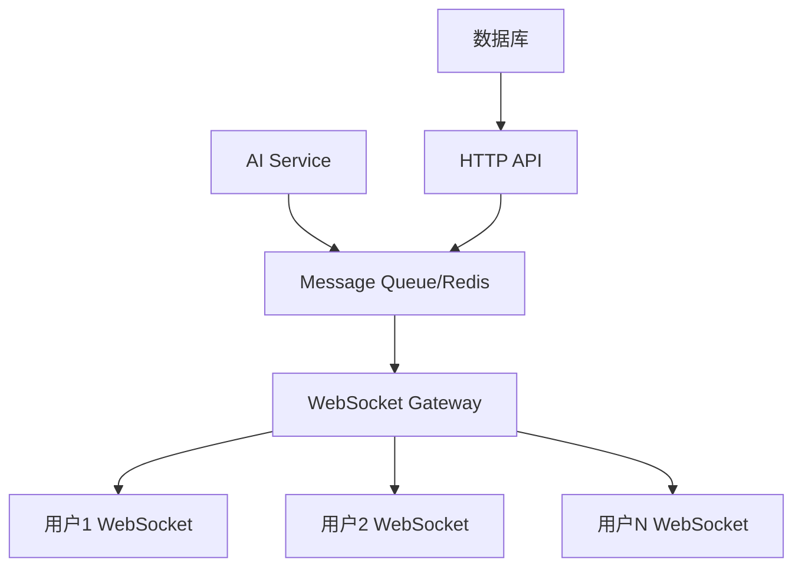

# 聊天室逻辑设计思路与方案

## 📋 概述

本文档记录了 Connet.AI 聊天室功能的核心设计思路，重点讨论了**混合聊天室**（真人 + AI）中的流式响应处理方案。

### 核心挑战

- **传统 1v1**：人与 AI 对话，流式输出到单用户
- **群组场景**：多个真人 + 多个 AI 在同一聊天室，需要实时同步 AI 响应
- **性能权衡**：在用户体验和系统性能之间找到平衡点

---

## 🎯 技术方案对比

### 方案 1：全流式 WebSocket 广播

#### 技术架构



#### 实现要点

- **WebSocket 连接管理**：维护房间内所有用户连接
- **消息广播机制**：实时将 AI 响应块广播给所有参与者
- **状态同步**：确保所有用户看到一致的 AI 响应进度

#### 优势

- ✅ 用户体验一致：所有场景都是实时流式效果
- ✅ 真实感强：所有用户同步看到 AI "打字"过程
- ✅ 扩展性好：支持任意数量的参与者
- ✅ 技术先进：充分利用现代 WebSocket 技术

#### 劣势

- ❌ 实现复杂：需要处理连接管理、消息同步、错误恢复
- ❌ 性能开销：多用户广播消耗更多带宽和服务器资源
- ❌ 技术债务：需要维护复杂的实时通信基础设施

### 方案 2：条件流式响应（推荐）

#### 决策逻辑

```typescript
if (参与者 === 2 && AI数量 === 1) {
  使用流式响应 // 1v1 场景
} else {
  使用批量响应 // 群组场景
}
```

#### 场景分析

| 场景       | 参与者       | 响应方式 | 用户体验            |
| ---------- | ------------ | -------- | ------------------- |
| 1v1 对话   | 1 人 + 1AI   | 流式     | 实时打字效果        |
| 小群组     | 2-5 人 + 1AI | 批量     | 思考状态 → 完整响应 |
| 多 AI 协作 | N 人 + 多 AI | 批量     | 避免响应冲突        |

#### 优势

- ✅ 实现简单：基于现有技术栈快速实现
- ✅ 性能优秀：避免不必要的实时广播开销
- ✅ 灵活可控：可根据业务需求调整判断规则
- ✅ 渐进演进：支持后续升级到全流式方案

#### 劣势

- ❌ 体验不一致：不同场景下用户体验有差异
- ❌ 功能受限：群组场景失去实时感
- ❌ 规则复杂：需要维护场景判断逻辑

---

## 🛠️ 技术实现详解

### WebSocket 广播方案实现

#### 1. 后端 AI 响应处理

```typescript
class AIResponseHandler {
  async processGroupAIResponse(
    roomId: string,
    prompt: string,
    participants: string[]
  ) {
    const messageId = generateId()

    // 创建 AI 响应流
    const aiStream = await this.aiService.generateResponse(prompt)

    // 广播开始信号
    await this.broadcaster.notifyResponseStart(roomId, messageId)

    // 流式处理和广播
    let fullResponse = ''
    for await (const chunk of aiStream) {
      fullResponse += chunk

      await this.broadcaster.broadcastChunk(roomId, {
        messageId,
        chunk,
        fullResponse, // 可选：发送完整内容用于纠错
        isComplete: false,
      })
    }

    // 广播完成信号
    await this.broadcaster.broadcastComplete(roomId, {
      messageId,
      fullResponse,
      isComplete: true,
    })

    // 持久化到数据库
    await this.saveMessage(roomId, messageId, fullResponse)
  }
}
```

#### 2. WebSocket 连接管理

```typescript
class ChatRoomService {
  private rooms = new Map<string, Set<WebSocket>>()

  async handleAIResponse(roomId: string, aiResponse: AsyncGenerator<string>) {
    const roomSockets = this.rooms.get(roomId) || new Set()

    for await (const chunk of aiResponse) {
      // 同时广播给房间内所有用户
      const message = {
        type: 'ai_response_chunk',
        roomId,
        chunk,
        timestamp: Date.now(),
      }

      // 并行发送给所有连接的用户
      await Promise.all(
        Array.from(roomSockets).map((socket) =>
          this.sendToSocket(socket, message)
        )
      )
    }
  }

  private async sendToSocket(socket: WebSocket, message: any) {
    if (socket.readyState === WebSocket.OPEN) {
      socket.send(JSON.stringify(message))
    }
  }
}
```

#### 3. 前端状态管理

```typescript
class GroupChatClient {
  private ws: WebSocket
  private messageBuffer = new Map<string, string>()

  handleAIResponseChunk(data: {
    roomId: string
    chunk: string
    messageId: string
    isComplete: boolean
  }) {
    // 累积 AI 响应块
    const currentMessage = this.messageBuffer.get(data.messageId) || ''
    const updatedMessage = currentMessage + data.chunk

    this.messageBuffer.set(data.messageId, updatedMessage)

    // 实时更新 UI
    this.updateMessageInUI(data.messageId, updatedMessage, !data.isComplete)

    if (data.isComplete) {
      this.messageBuffer.delete(data.messageId)
    }
  }
}
```

### 条件流式方案实现

#### 1. 智能决策逻辑

```typescript
class ConditionalStreamingService {
  async processMessage(roomId: string, message: string) {
    const streamingMode = await this.shouldUseStreaming(roomId)

    if (streamingMode) {
      return this.processStreaming(roomId, message)
    } else {
      return this.processBatch(roomId, message)
    }
  }

  private async shouldUseStreaming(roomId: string): Promise<boolean> {
    const room = await this.getRoomDetails(roomId)

    // 多维度判断规则
    const rules = [
      // 基础规则：1v1 且单AI
      room.participants.length === 2 && room.aiAgents.length === 1,

      // 性能规则：网络条件好
      await this.checkNetworkCondition(roomId),

      // 用户偏好：启用实时模式
      room.settings.realTimeMode === true,

      // 内容规则：预期响应较短
      (await this.estimateResponseLength(message)) < 1000,
    ]

    return rules.every((rule) => rule)
  }
}
```

#### 2. 增强批量响应体验

```typescript
class EnhancedBatchResponse {
  async processBatchResponse(roomId: string, prompt: string) {
    // 1. 立即反馈
    await this.sendTypingIndicator(roomId, true)

    // 2. 进度提示
    const progressTimer = setInterval(async () => {
      await this.sendProgressHint(roomId, 'AI 正在深度思考...')
    }, 2000)

    try {
      // 3. 生成响应
      const response = await this.aiService.generateComplete(prompt)

      // 4. 分段发送长文本（模拟流式效果）
      if (response.length > 500) {
        await this.sendInChunks(roomId, response)
      } else {
        await this.sendComplete(roomId, response)
      }
    } finally {
      clearInterval(progressTimer)
      await this.sendTypingIndicator(roomId, false)
    }
  }

  private async sendInChunks(roomId: string, text: string) {
    const chunks = this.splitIntoReadableChunks(text)

    for (const chunk of chunks) {
      await this.broadcastMessage(roomId, chunk)
      await this.sleep(150) // 模拟打字延迟
    }
  }
}
```

---

## ⚡ 性能优化策略

### 1. 连接管理优化

```typescript
class OptimizedConnectionManager {
  private connections = new Map<string, Set<WebSocket>>()

  // 只向活跃连接发送
  async broadcastToActiveConnections(roomId: string, message: any) {
    const roomConnections = this.connections.get(roomId)
    const activeConnections = Array.from(roomConnections || []).filter(
      (ws) => ws.readyState === WebSocket.OPEN
    )

    // 批量发送，避免阻塞
    const batchSize = 10
    for (let i = 0; i < activeConnections.length; i += batchSize) {
      const batch = activeConnections.slice(i, i + batchSize)
      await Promise.all(batch.map((ws) => this.safeSend(ws, message)))
    }
  }
}
```

### 2. 消息缓冲与压缩

```typescript
class MessageOptimizer {
  private chunkBuffer: string[] = []
  private bufferTimeout: NodeJS.Timeout | null = null

  async optimizedBroadcast(roomId: string, chunk: string) {
    this.chunkBuffer.push(chunk)

    // 批量发送策略：减少网络请求
    if (this.chunkBuffer.length >= 5 || !this.bufferTimeout) {
      await this.flushBuffer(roomId)
    }

    // 最大延迟保证：100ms 内必须发送
    if (!this.bufferTimeout) {
      this.bufferTimeout = setTimeout(() => {
        this.flushBuffer(roomId)
      }, 100)
    }
  }

  private async flushBuffer(roomId: string) {
    if (this.chunkBuffer.length > 0) {
      const combinedChunk = this.chunkBuffer.join('')

      // 压缩长文本
      const compressed =
        combinedChunk.length > 200
          ? await this.compress(combinedChunk)
          : combinedChunk

      await this.broadcastToRoom(roomId, compressed)

      this.chunkBuffer = []
      this.clearTimeout()
    }
  }
}
```

### 3. Redis 发布/订阅扩展

```typescript
class ScalableAIBroadcaster {
  private redis: Redis

  async broadcastAIResponse(roomId: string, aiStream: AsyncGenerator<string>) {
    const messageId = generateId()

    for await (const chunk of aiStream) {
      // 发布到 Redis 频道，支持多服务器实例
      await this.redis.publish(
        `room:${roomId}`,
        JSON.stringify({
          type: 'ai_chunk',
          messageId,
          chunk,
          timestamp: Date.now(),
        })
      )
    }

    // 标记完成
    await this.redis.publish(
      `room:${roomId}`,
      JSON.stringify({
        type: 'ai_complete',
        messageId,
      })
    )
  }
}
```

---

## 🎨 用户体验设计

### 流式响应 UI 状态

```typescript
interface AIResponseState {
  messageId: string
  content: string
  isStreaming: boolean
  status: 'thinking' | 'typing' | 'complete' | 'error'
  progress?: number
}

// React 组件示例
function AIMessage({ message }: { message: AIResponseState }) {
  return (
    <div className="ai-message">
      {message.isStreaming && (
        <div className="typing-indicator">
          <TypingAnimation />
          <span>AI 正在回复...</span>
        </div>
      )}

      <div className="message-content">
        {message.content}
        {message.isStreaming && <BlinkingCursor />}
      </div>

      {message.status === 'thinking' && (
        <ProgressBar progress={message.progress} />
      )}
    </div>
  )
}
```

### 批量响应 UI 增强

```typescript
function BatchResponseIndicator({ status }: { status: string }) {
  const statusMessages = {
    thinking: '🤔 AI 正在深度思考...',
    analyzing: '🔍 正在分析您的问题...',
    generating: '✨ 正在生成回复...',
    finalizing: '📝 正在完善答案...',
  }

  return (
    <div className="batch-indicator">
      <LoadingSpinner />
      <span>{statusMessages[status]}</span>
      <ElapsedTimer />
    </div>
  )
}
```

---

## 📊 方案选择矩阵

| 评估维度       | 权重 | 全流式方案     | 条件流式方案   |
| -------------- | ---- | -------------- | -------------- |
| **开发复杂度** | 20%  | 3/5 ⭐⭐⭐     | 5/5 ⭐⭐⭐⭐⭐ |
| **用户体验**   | 25%  | 5/5 ⭐⭐⭐⭐⭐ | 3/5 ⭐⭐⭐     |
| **性能表现**   | 20%  | 3/5 ⭐⭐⭐     | 5/5 ⭐⭐⭐⭐⭐ |
| **维护成本**   | 15%  | 2/5 ⭐⭐       | 4/5 ⭐⭐⭐⭐   |
| **扩展性**     | 10%  | 5/5 ⭐⭐⭐⭐⭐ | 3/5 ⭐⭐⭐     |
| **上线速度**   | 10%  | 2/5 ⭐⭐       | 5/5 ⭐⭐⭐⭐⭐ |

### 综合评分

- **全流式方案**：3.4/5 ⭐⭐⭐⭐
- **条件流式方案**：4.1/5 ⭐⭐⭐⭐⭐

---

## 🚀 推荐实施路径

### 阶段 1：MVP 快速验证（2-3 周）

**目标**：实现条件流式方案，验证产品核心假设

**实施步骤**：

1. 实现基础聊天室功能
2. 添加简单的流式/批量判断逻辑
3. 完善 UI 状态展示
4. 收集用户反馈和性能数据

**成功指标**：

- 1v1 场景流式响应延迟 < 200ms
- 群组场景响应时间 < 3s
- 用户满意度 > 80%

### 阶段 2：体验优化（2-4 周）

**目标**：提升批量响应的用户体验

**优化重点**：

1. 增强加载状态和进度提示
2. 实现分段发送模拟流式效果
3. 添加智能判断规则（网络状况、响应长度等）
4. 优化错误处理和重试机制

**成功指标**：

- 批量响应的用户体验评分提升 20%
- 平均等待时间感知降低 30%

### 阶段 3：技术升级评估（1-2 周）

**目标**：基于实际数据决定是否升级到全流式方案

**评估标准**：

- 用户是否强烈要求一致体验
- 技术团队资源是否充足
- 系统性能是否支持实时广播
- 商业价值是否证明投入合理

### 阶段 4：全流式升级（可选，4-6 周）

**目标**：如果评估通过，实施全流式 WebSocket 方案

**技术要点**：

- 设计可靠的 WebSocket 基础设施
- 实现消息同步和错误恢复机制
- 优化性能和资源消耗
- 平滑迁移现有用户数据

---

## 🔧 关键技术决策

### 1. 消息存储策略

```typescript
interface MessageStorageStrategy {
  // 流式消息的存储时机
  streamingStorage: 'chunk' | 'complete' | 'hybrid'

  // 消息版本控制
  versionControl: boolean

  // 实时同步机制
  realtimeSync: 'websocket' | 'polling' | 'sse'
}
```

### 2. 错误处理机制

```typescript
class ErrorRecoveryManager {
  // 连接断开恢复
  async handleConnectionLoss(roomId: string, lastMessageId: string) {
    // 1. 重新连接
    await this.reconnectWebSocket()

    // 2. 同步丢失的消息
    const missedMessages = await this.fetchMissedMessages(roomId, lastMessageId)

    // 3. 重建 UI 状态
    await this.restoreUIState(missedMessages)
  }

  // AI 响应中断恢复
  async handleAIResponseInterruption(messageId: string) {
    // 1. 检测中断状态
    const partialMessage = await this.getPartialMessage(messageId)

    // 2. 重新生成或继续
    if (partialMessage.canContinue) {
      await this.continueAIResponse(messageId, partialMessage.context)
    } else {
      await this.regenerateAIResponse(messageId)
    }
  }
}
```

### 3. 性能监控指标

```typescript
interface PerformanceMetrics {
  // WebSocket 连接相关
  connectionCount: number
  averageLatency: number
  reconnectionRate: number

  // AI 响应相关
  streamingLatency: number
  batchResponseTime: number
  tokensPerSecond: number

  // 用户体验相关
  perceivedWaitTime: number
  userSatisfactionScore: number
  featureUsageRate: Record<string, number>
}
```

---

## 📝 总结与建议

### 最终推荐方案：条件流式响应

**理由**：

1. **风险可控**：技术实现相对简单，降低项目风险
2. **性能优秀**：避免不必要的实时通信开销
3. **快速迭代**：能够快速上线并收集用户反馈
4. **灵活演进**：为后续升级保留技术空间

### 关键成功因素

1. **用户教育**：向用户清晰说明不同场景下的体验差异
2. **状态展示**：在批量响应场景下提供丰富的进度反馈
3. **性能监控**：建立完善的监控体系，持续优化体验
4. **反馈收集**：建立用户反馈机制，数据驱动产品迭代

### 技术债务管理

- 保持代码架构清晰，为后续重构做好准备
- 建立完善的测试覆盖，确保功能稳定性
- 文档化设计决策，便于团队理解和维护

---

_最后更新时间：2024 年 12 月_
_文档版本：v1.0_
_负责人：开发团队_
