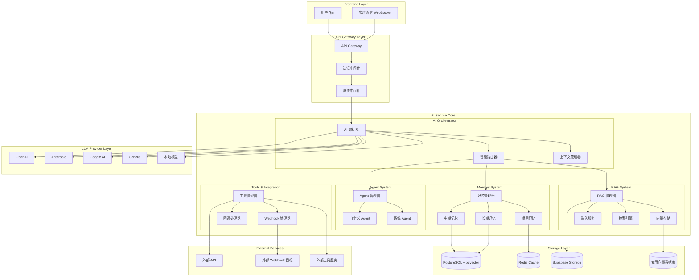
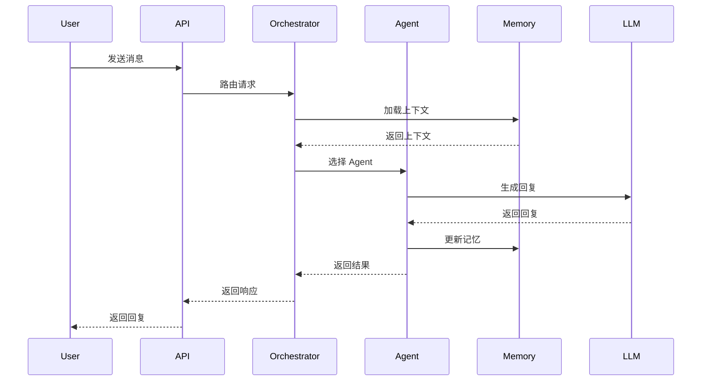
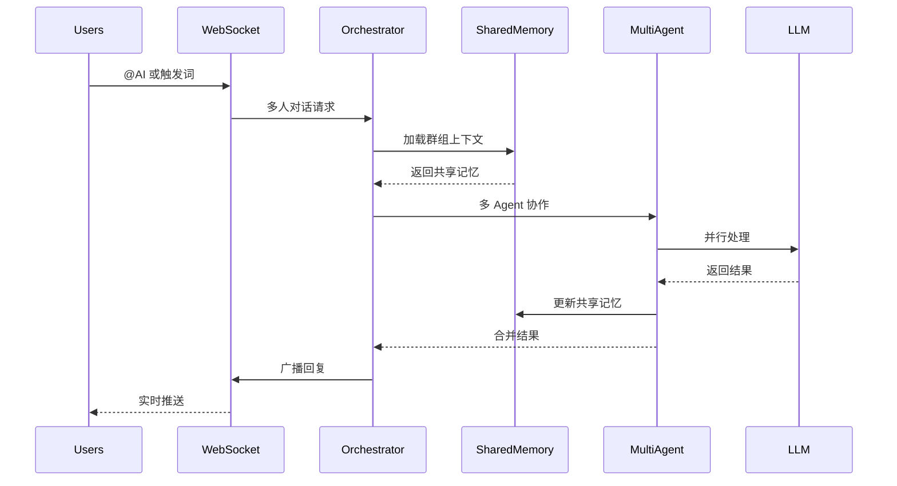
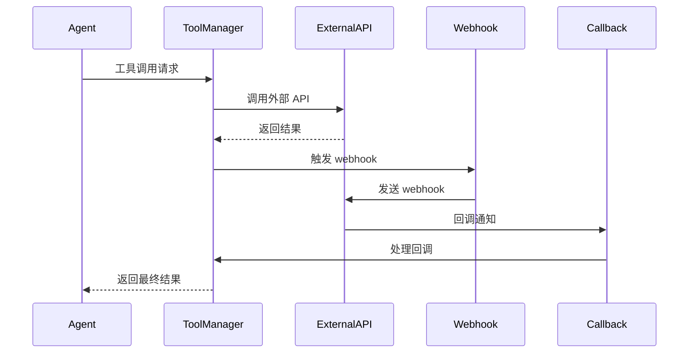

# AI Service Architecture - Connet.AI

## 🎯 架构概览

Connet.AI 的 AI 服务采用多层次、分布式架构，支持 1v1 对话、多人聊天室、外部工具调用、记忆管理、RAG 检索增强生成和自定义 Agent 系统。

### 核心设计原则

1. **模块化设计** - 各组件松耦合，易于扩展和维护
2. **多模态支持** - 文本、图像、文件、代码等多种内容类型
3. **智能路由** - 基于上下文智能选择最适合的 AI 模型和 Agent
4. **记忆分层** - 长期/中期/短期记忆分层管理
5. **工具生态** - 丰富的外部工具和 API 集成
6. **实时协作** - 多人环境下的实时 AI 协作

---

## 🏗️ 整体架构图



---

## 🧠 核心组件详解

### 1. AI Orchestrator（AI 编排器）

AI 编排器是整个 AI 服务的核心控制中心，负责协调各个组件的工作。

#### 1.1 智能路由器 (Smart Router)

```python
class SmartRouter:
    """智能路由器 - 根据上下文选择最佳处理策略"""
    
    async def route_request(self, request: AIRequest) -> RouteDecision:
        """
        路由决策逻辑：
        1. 分析请求类型和上下文
        2. 评估可用的 Agent 和模型
        3. 选择最优的处理路径
        4. 返回路由决策
        """
        context = await self.analyze_context(request)
        available_agents = await self.get_available_agents(context)
        best_model = await self.select_model(context, request.complexity)
        
        return RouteDecision(
            agent=available_agents[0],
            model=best_model,
            tools=await self.select_tools(context),
            memory_strategy=await self.determine_memory_strategy(context)
        )
```

#### 1.2 上下文管理器 (Context Manager)

```python
class ContextManager:
    """上下文管理器 - 管理对话上下文和状态"""
    
    async def build_context(self, conversation_id: str) -> ConversationContext:
        """
        构建对话上下文：
        1. 加载对话历史
        2. 获取参与者信息
        3. 加载相关记忆
        4. 构建工具上下文
        """
        
    async def update_context(self, context: ConversationContext, new_message: Message):
        """更新上下文状态"""
        
    async def compress_context(self, context: ConversationContext) -> ConversationContext:
        """上下文压缩 - 处理长对话"""
```

### 2. Memory System（记忆系统）

采用三层记忆架构，模拟人类记忆模式：

#### 2.1 短期记忆 (Short-term Memory)
- **存储位置**: Redis (内存)
- **生命周期**: 15分钟 - 2小时
- **内容**: 当前对话上下文、临时状态
- **容量**: 每个对话 ~4K tokens

```python
class ShortTermMemory:
    """短期记忆 - 当前对话会话"""
    
    async def store_message(self, conversation_id: str, message: Message):
        """存储消息到短期记忆"""
        
    async def get_recent_context(self, conversation_id: str, limit: int = 10):
        """获取最近的对话上下文"""
        
    async def compress_to_medium_term(self, conversation_id: str):
        """压缩到中期记忆"""
```

#### 2.2 中期记忆 (Medium-term Memory)
- **存储位置**: PostgreSQL + Redis 缓存
- **生命周期**: 1天 - 1个月
- **内容**: 对话摘要、重要信息提取、用户偏好
- **容量**: 每个对话 ~1K tokens 摘要

```python
class MediumTermMemory:
    """中期记忆 - 对话摘要和重要信息"""
    
    async def create_conversation_summary(self, conversation_id: str):
        """创建对话摘要"""
        
    async def extract_important_info(self, messages: List[Message]) -> ImportantInfo:
        """提取重要信息"""
        
    async def update_user_preferences(self, user_id: str, preferences: dict):
        """更新用户偏好"""
```

#### 2.3 长期记忆 (Long-term Memory)  
- **存储位置**: PostgreSQL + 向量数据库
- **生命周期**: 永久存储
- **内容**: 用户画像、知识图谱、历史模式
- **容量**: 无限制，按向量相似度检索

```python
class LongTermMemory:
    """长期记忆 - 用户画像和知识积累"""
    
    async def build_user_profile(self, user_id: str) -> UserProfile:
        """构建用户画像"""
        
    async def store_knowledge(self, knowledge: Knowledge):
        """存储知识到长期记忆"""
        
    async def semantic_search(self, query: str, user_id: str) -> List[Memory]:
        """语义搜索相关记忆"""
```

### 3. Agent System（智能代理系统）

#### 3.1 Agent 类型分类

```python
class AgentType(Enum):
    # 系统内置 Agent
    GENERAL_CHAT = "general_chat"           # 通用对话
    CODE_ASSISTANT = "code_assistant"       # 代码助手
    WRITING_ASSISTANT = "writing_assistant" # 写作助手
    DATA_ANALYST = "data_analyst"          # 数据分析师
    PROJECT_MANAGER = "project_manager"     # 项目管理
    
    # 专业领域 Agent  
    LEGAL_ADVISOR = "legal_advisor"        # 法律顾问
    MEDICAL_ADVISOR = "medical_advisor"    # 医疗顾问
    FINANCIAL_ADVISOR = "financial_advisor" # 财务顾问
    
    # 用户自定义 Agent
    CUSTOM = "custom"                      # 用户自定义
```

#### 3.2 自定义 Agent 架构

```python
class CustomAgent:
    """自定义 Agent 基础类"""
    
    def __init__(self, config: AgentConfig):
        self.name = config.name
        self.description = config.description
        self.system_prompt = config.system_prompt
        self.tools = config.tools
        self.model_preference = config.model_preference
        self.memory_config = config.memory_config
        
    async def process_message(self, message: Message, context: Context) -> AgentResponse:
        """处理用户消息"""
        
    async def invoke_tools(self, tool_calls: List[ToolCall]) -> List[ToolResult]:
        """调用工具"""
        
    async def update_memory(self, interaction: Interaction):
        """更新记忆"""
```

#### 3.3 Agent 协作机制

```python
class AgentCollaboration:
    """Agent 协作管理器"""
    
    async def orchestrate_multi_agent(self, task: ComplexTask) -> CollaborationResult:
        """多 Agent 协作编排"""
        
    async def delegate_subtask(self, subtask: SubTask, agent: Agent) -> TaskResult:
        """子任务委派"""
        
    async def merge_results(self, results: List[TaskResult]) -> FinalResult:
        """结果合并"""
```

### 4. RAG System（检索增强生成）

#### 4.1 RAG 架构组件

```python
class RAGManager:
    """RAG 管理器"""
    
    async def ingest_document(self, document: Document) -> IngestionResult:
        """文档摄取和向量化"""
        
    async def semantic_search(self, query: str, filters: dict) -> List[Document]:
        """语义搜索"""
        
    async def generate_with_context(self, query: str, context: List[Document]) -> Response:
        """基于检索结果生成回答"""
```

#### 4.2 向量存储策略

```python
class VectorStore:
    """向量存储抽象层"""
    
    # 支持多种向量数据库
    SUPPORTED_STORES = {
        'pgvector': PGVectorStore,
        'chromadb': ChromaDBStore, 
        'pinecone': PineconeStore,
        'weaviate': WeaviateStore
    }
    
    async def store_embeddings(self, embeddings: List[Embedding]):
        """存储向量嵌入"""
        
    async def similarity_search(self, query_vector: List[float], top_k: int) -> List[Document]:
        """相似度搜索"""
```

### 5. Tool Integration（工具集成系统）

#### 5.1 工具管理器

```python
class ToolManager:
    """工具管理器 - 管理所有可用工具"""
    
    async def register_tool(self, tool: Tool):
        """注册新工具"""
        
    async def execute_tool(self, tool_call: ToolCall) -> ToolResult:
        """执行工具调用"""
        
    async def batch_execute(self, tool_calls: List[ToolCall]) -> List[ToolResult]:
        """批量执行工具"""
```

#### 5.2 内置工具类型

```python
class BuiltinTools:
    """内置工具集合"""
    
    # 搜索工具
    web_search = WebSearchTool()
    code_search = CodeSearchTool()
    document_search = DocumentSearchTool()
    
    # 文件处理工具
    file_reader = FileReaderTool()
    image_processor = ImageProcessorTool()
    pdf_processor = PDFProcessorTool()
    
    # API 调用工具
    rest_api_caller = RestAPITool()
    graphql_caller = GraphQLTool()
    
    # 代码执行工具
    python_executor = PythonExecutorTool()
    javascript_executor = JSExecutorTool()
    
    # 数据处理工具
    csv_processor = CSVProcessorTool()
    json_processor = JSONProcessorTool()
```

#### 5.3 Webhook 系统

```python
class WebhookManager:
    """Webhook 管理器"""
    
    async def register_webhook(self, webhook: WebhookConfig):
        """注册 webhook"""
        
    async def trigger_webhook(self, event: Event, webhook_url: str):
        """触发 webhook"""
        
    async def handle_callback(self, callback_data: dict) -> CallbackResult:
        """处理回调"""
```

---

## 💾 数据存储架构

### 存储层设计

```python
class StorageArchitecture:
    """存储架构设计"""
    
    # 主数据库 - PostgreSQL
    primary_db = {
        'conversations': '对话记录',
        'messages': '消息内容', 
        'agents': 'Agent 配置',
        'users': '用户数据',
        'tools': '工具配置'
    }
    
    # 向量数据库 - pgvector/专用向量DB
    vector_db = {
        'embeddings': '文档向量',
        'memory_vectors': '记忆向量',
        'user_profile_vectors': '用户画像向量'
    }
    
    # 缓存层 - Redis
    cache_layer = {
        'short_term_memory': '短期记忆',
        'session_state': '会话状态',
        'tool_results': '工具调用结果',
        'model_responses': '模型响应缓存'
    }
    
    # 文件存储 - Supabase Storage
    file_storage = {
        'documents': '用户上传文档',
        'generated_files': 'AI 生成文件',
        'tool_outputs': '工具输出文件',
        'conversation_exports': '对话导出文件'
    }
```

---

## 🔄 工作流程设计

### 1. 单人对话流程 (1v1 AI Chat)



### 2. 多人聊天室流程 (Group Chat)



### 3. 工具调用流程 (Tool Integration)



---

## ⚙️ 配置系统

### 1. AI 服务配置

```yaml
# ai_service_config.yaml
ai_service:
  # 路由配置
  routing:
    default_model: "gpt-3.5-turbo"
    fallback_models: ["claude-3-sonnet", "gemini-pro"]
    max_retries: 3
    timeout_seconds: 30
  
  # 记忆配置
  memory:
    short_term:
      ttl_minutes: 30
      max_tokens: 4000
    medium_term: 
      ttl_days: 30
      summary_model: "gpt-3.5-turbo"
    long_term:
      embedding_model: "text-embedding-3-small"
      vector_dimensions: 1536
  
  # Agent 配置
  agents:
    max_concurrent: 10
    default_system_prompt: "You are a helpful AI assistant..."
    custom_agents_enabled: true
  
  # 工具配置
  tools:
    enabled_tools: ["web_search", "file_reader", "code_executor"]
    webhook_timeout: 30
    max_tool_calls: 5
```

### 2. 模型配置

```yaml
# models_config.yaml
llm_providers:
  openai:
    models:
      - name: "gpt-4"
        max_tokens: 8192
        cost_per_1k: 0.03
        capabilities: ["chat", "code", "analysis"]
      - name: "gpt-3.5-turbo" 
        max_tokens: 4096
        cost_per_1k: 0.002
        capabilities: ["chat", "simple_tasks"]
  
  anthropic:
    models:
      - name: "claude-3-opus"
        max_tokens: 200000
        cost_per_1k: 0.015
        capabilities: ["chat", "analysis", "writing"]
```

---

## 🔒 安全与权限

### 1. AI 安全控制

```python
class AISafetyController:
    """AI 安全控制器"""
    
    async def content_filter(self, content: str) -> FilterResult:
        """内容过滤"""
        
    async def rate_limit_check(self, user_id: str) -> bool:
        """速率限制检查"""
        
    async def cost_control(self, user_id: str, estimated_cost: float) -> bool:
        """成本控制"""
        
    async def privilege_check(self, user_id: str, action: str) -> bool:
        """权限检查"""
```

### 2. 数据隐私保护

```python
class PrivacyProtection:
    """隐私保护机制"""
    
    async def anonymize_data(self, data: dict) -> dict:
        """数据匿名化"""
        
    async def encrypt_memory(self, memory: Memory) -> EncryptedMemory:
        """记忆加密"""
        
    async def audit_access(self, user_id: str, resource: str):
        """访问审计"""
```

---

## 📊 监控与可观测性

### 1. 性能监控

```python
class AIServiceMonitoring:
    """AI 服务监控"""
    
    # 关键指标
    metrics = {
        'response_time': '响应时间',
        'token_usage': 'Token 使用量',
        'model_accuracy': '模型准确度',
        'user_satisfaction': '用户满意度',
        'cost_efficiency': '成本效率'
    }
    
    async def track_interaction(self, interaction: Interaction):
        """跟踪交互指标"""
        
    async def generate_report(self) -> MonitoringReport:
        """生成监控报告"""
```

### 2. 错误处理与恢复

```python
class ErrorRecovery:
    """错误恢复机制"""
    
    async def handle_model_failure(self, error: ModelError) -> RecoveryAction:
        """模型故障处理"""
        
    async def circuit_breaker(self, service: str) -> bool:
        """熔断器机制"""
        
    async def graceful_degradation(self, context: Context) -> FallbackResponse:
        """优雅降级"""
```

---

## 🚀 部署与扩展

### 1. 微服务部署

```yaml
# docker-compose.ai-services.yml
version: '3.8'
services:
  ai-orchestrator:
    build: ./ai-orchestrator
    ports:
      - "8080:8080"
    environment:
      - REDIS_URL=redis://redis:6379
      - POSTGRES_URL=postgresql://postgres:5432/ai_db
  
  memory-service:
    build: ./memory-service  
    ports:
      - "8081:8081"
      
  rag-service:
    build: ./rag-service
    ports:
      - "8082:8082"
      
  tool-service:
    build: ./tool-service
    ports:
      - "8083:8083"
```

### 2. 水平扩展策略

```python
class ScalingStrategy:
    """扩展策略"""
    
    auto_scaling_rules = {
        'cpu_threshold': 70,      # CPU 使用率阈值
        'memory_threshold': 80,   # 内存使用率阈值
        'queue_length': 100,      # 队列长度阈值
        'response_time': 5000     # 响应时间阈值(ms)
    }
    
    async def scale_out(self, service: str, instances: int):
        """横向扩展"""
        
    async def load_balance(self, requests: List[Request]) -> LoadBalanceResult:
        """负载均衡"""
```

---

## 📋 实现路线图

### Phase 1: 基础架构 (2-3周)
- [ ] AI Orchestrator 核心框架
- [ ] 基础记忆系统 (短期记忆)
- [ ] 简单 Agent 系统
- [ ] 基础工具集成

### Phase 2: 核心功能 (3-4周)  
- [ ] 完整记忆系统 (三层架构)
- [ ] RAG 系统实现
- [ ] 自定义 Agent 支持
- [ ] Webhook 系统

### Phase 3: 高级功能 (2-3周)
- [ ] 多 Agent 协作
- [ ] 高级上下文管理
- [ ] 性能优化
- [ ] 监控系统

### Phase 4: 生产就绪 (1-2周)
- [ ] 安全加固
- [ ] 部署自动化
- [ ] 文档完善
- [ ] 测试覆盖

---

这个 AI 服务架构设计涵盖了您提到的所有核心需求，包括 1v1 对话、多人聊天、工具调用、记忆管理、RAG 和自定义 Agent。架构采用模块化设计，支持水平扩展，具有良好的可维护性和可扩展性。