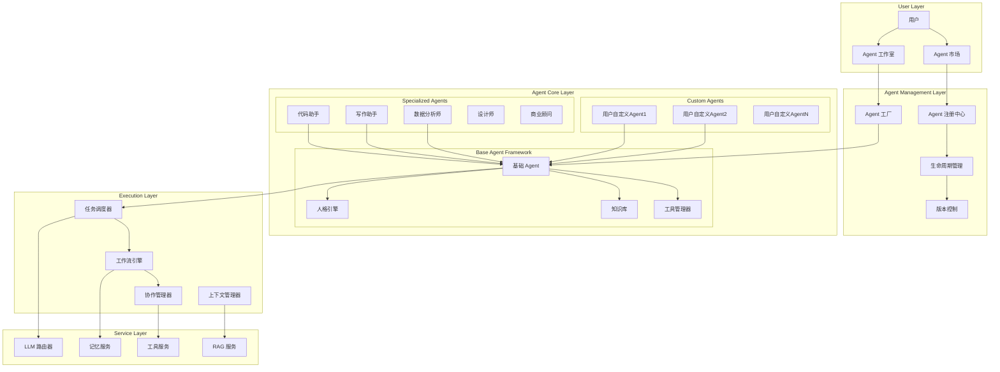

# Custom Agent System - 自定义智能代理系统

## 🤖 Agent 系统概览

Connet.AI 的自定义 Agent 系统允许用户创建、配置和部署个性化的 AI 智能代理。每个 Agent 具有独特的人格、专业知识、工具集和行为模式，能够在不同场景下为用户提供专业化服务。

---

## 🏗️ Agent 系统架构



---

## 🎭 Agent 基础框架

### 1. 基础 Agent 类

```python
class BaseAgent:
    """基础 Agent 类"""
    
    def __init__(self, config: AgentConfig):
        self.id = config.id or str(uuid4())
        self.name = config.name
        self.display_name = config.display_name
        self.version = config.version or "1.0.0"
        self.created_by = config.created_by
        
        # 核心配置
        self.personality = PersonalityProfile.from_dict(config.personality)
        self.system_prompt = config.system_prompt
        self.knowledge_base = KnowledgeBase(config.knowledge_base_config)
        self.tool_manager = ToolManager(config.enabled_tools)
        
        # 模型配置
        self.model_preference = config.model_preference
        self.generation_config = config.generation_config
        
        # 行为配置
        self.behavior_rules = config.behavior_rules
        self.conversation_style = config.conversation_style
        
        # 状态管理
        self.state = AgentState()
        self.metrics = AgentMetrics()
        
        # 服务依赖
        self.memory_service = MemoryService()
        self.rag_service = RAGService()
        self.llm_router = LLMRouter()
    
    async def process_message(self, message: Message, context: ConversationContext) -> AgentResponse:
        """处理消息的主要入口"""
        
        try:
            # 1. 上下文分析
            analyzed_context = await self._analyze_context(message, context)
            
            # 2. 意图识别
            intent = await self._identify_intent(message, analyzed_context)
            
            # 3. 任务规划
            task_plan = await self._plan_task(intent, analyzed_context)
            
            # 4. 执行任务
            execution_result = await self._execute_task(task_plan, analyzed_context)
            
            # 5. 生成回应
            response = await self._generate_response(execution_result, analyzed_context)
            
            # 6. 更新记忆
            await self._update_memory(message, response, analyzed_context)
            
            # 7. 记录指标
            await self._track_interaction(message, response)
            
            return response
            
        except Exception as e:
            return await self._handle_error(e, message, context)
    
    async def _analyze_context(self, message: Message, context: ConversationContext) -> AnalyzedContext:
        """分析上下文"""
        
        # 获取相关记忆
        relevant_memories = await self.memory_service.get_relevant_memories(
            conversation_id=context.conversation_id,
            query=message.content,
            agent_id=self.id
        )
        
        # 分析用户意图和情感
        user_analysis = await self._analyze_user_state(message, context)
        
        # 构建分析结果
        return AnalyzedContext(
            original_context=context,
            relevant_memories=relevant_memories,
            user_analysis=user_analysis,
            conversation_stage=await self._determine_conversation_stage(context),
            urgency_level=await self._assess_urgency(message),
            complexity_level=await self._assess_complexity(message)
        )
    
    async def _identify_intent(self, message: Message, context: AnalyzedContext) -> Intent:
        """识别用户意图"""
        
        intent_prompt = f"""
        根据以下信息识别用户意图：
        
        用户消息：{message.content}
        对话历史：{context.conversation_stage}
        用户状态：{context.user_analysis}
        
        我是一个{self.personality.role}，专长是{self.personality.expertise}。
        
        请识别用户的主要意图类型：
        1. 信息询问 (information_request)
        2. 任务执行 (task_execution)
        3. 创作协助 (creative_assistance)
        4. 问题解决 (problem_solving)
        5. 闲聊互动 (casual_interaction)
        6. 学习指导 (learning_guidance)
        
        同时提取关键实体和参数。
        """
        
        intent_response = await self.llm_router.complete(
            prompt=intent_prompt,
            model_preference=self.model_preference.get('intent_model', 'gpt-3.5-turbo'),
            temperature=0.3
        )
        
        return Intent.from_llm_response(intent_response.content)
    
    async def _plan_task(self, intent: Intent, context: AnalyzedContext) -> TaskPlan:
        """任务规划"""
        
        # 根据意图类型选择规划策略
        if intent.type == 'task_execution':
            planner = TaskExecutionPlanner()
        elif intent.type == 'creative_assistance':
            planner = CreativeAssistancePlanner()
        elif intent.type == 'problem_solving':
            planner = ProblemSolvingPlanner()
        else:
            planner = DefaultPlanner()
        
        task_plan = await planner.plan(
            intent=intent,
            context=context,
            agent_capabilities=self._get_capabilities(),
            available_tools=self.tool_manager.get_available_tools()
        )
        
        return task_plan
    
    async def _execute_task(self, task_plan: TaskPlan, context: AnalyzedContext) -> ExecutionResult:
        """执行任务"""
        
        executor = TaskExecutor(
            agent=self,
            tool_manager=self.tool_manager,
            rag_service=self.rag_service
        )
        
        execution_result = await executor.execute(task_plan, context)
        
        return execution_result
```

### 2. 人格引擎

```python
class PersonalityEngine:
    """人格引擎 - 管理 Agent 的人格特征"""
    
    def __init__(self, personality_profile: PersonalityProfile):
        self.profile = personality_profile
        self.response_generator = PersonalityResponseGenerator()
        self.trait_manager = PersonalityTraitManager()
    
    async def adapt_response(self, base_response: str, context: ConversationContext) -> str:
        """根据人格特征调整回应"""
        
        adaptation_prompt = f"""
        请根据以下人格特征调整回应内容：
        
        人格档案：
        - 角色：{self.profile.role}
        - 专业领域：{', '.join(self.profile.expertise)}
        - 沟通风格：{self.profile.communication_style}
        - 语言特点：{', '.join(self.profile.language_traits)}
        - 情感倾向：{self.profile.emotional_tendency}
        
        原始回应：
        {base_response}
        
        对话情境：
        - 对话阶段：{context.stage}
        - 用户情绪：{context.user_mood}
        - 正式程度：{context.formality_level}
        
        请调整回应以匹配人格特征，保持内容准确性的同时体现个性。
        """
        
        adapted_response = await self.response_generator.generate(adaptation_prompt)
        
        return adapted_response.content
    
    def get_system_prompt(self) -> str:
        """生成系统提示"""
        
        system_prompt = f"""你是{self.profile.display_name}，一个{self.profile.role}。

人格特征：
- 专业领域：{', '.join(self.profile.expertise)}
- 沟通风格：{self.profile.communication_style}
- 语言特点：{', '.join(self.profile.language_traits)}
- 情感倾向：{self.profile.emotional_tendency}

行为准则：
{chr(10).join(f'- {rule}' for rule in self.profile.behavior_rules)}

你的目标是：
{chr(10).join(f'- {goal}' for goal in self.profile.goals)}

请始终保持这些特征，以一致的方式与用户交互。"""

        return system_prompt

class PersonalityProfile:
    """人格档案"""
    
    def __init__(self, data: Dict):
        self.role = data.get('role', 'AI助手')
        self.display_name = data.get('display_name', 'Assistant')
        self.expertise = data.get('expertise', [])
        self.communication_style = data.get('communication_style', 'professional')
        self.language_traits = data.get('language_traits', ['清晰', '准确'])
        self.emotional_tendency = data.get('emotional_tendency', 'neutral')
        self.behavior_rules = data.get('behavior_rules', [])
        self.goals = data.get('goals', [])
        
        # 高级特征
        self.creativity_level = data.get('creativity_level', 0.5)  # 0-1
        self.formality_level = data.get('formality_level', 0.7)   # 0-1
        self.empathy_level = data.get('empathy_level', 0.6)       # 0-1
        self.curiosity_level = data.get('curiosity_level', 0.5)   # 0-1
```

### 3. Agent 工厂

```python
class AgentFactory:
    """Agent 工厂 - 创建和配置 Agent"""
    
    def __init__(self):
        self.agent_templates = self._load_agent_templates()
        self.component_library = ComponentLibrary()
        self.validation_service = AgentValidationService()
    
    async def create_agent(self, agent_spec: AgentSpecification) -> CustomAgent:
        """创建自定义 Agent"""
        
        # 1. 验证规格
        validation_result = await self.validation_service.validate(agent_spec)
        if not validation_result.is_valid:
            raise AgentValidationError(validation_result.errors)
        
        # 2. 选择基础模板
        base_template = self._select_base_template(agent_spec.agent_type)
        
        # 3. 构建配置
        agent_config = await self._build_agent_config(agent_spec, base_template)
        
        # 4. 创建 Agent 实例
        if agent_spec.agent_type == 'custom':
            agent = CustomAgent(agent_config)
        else:
            agent_class = self._get_agent_class(agent_spec.agent_type)
            agent = agent_class(agent_config)
        
        # 5. 初始化组件
        await self._initialize_agent_components(agent, agent_spec)
        
        # 6. 注册到系统
        await self._register_agent(agent)
        
        return agent
    
    async def _build_agent_config(self, spec: AgentSpecification, template: AgentTemplate) -> AgentConfig:
        """构建 Agent 配置"""
        
        # 合并模板和用户配置
        config = AgentConfig()
        
        # 基础信息
        config.name = spec.name
        config.display_name = spec.display_name
        config.description = spec.description
        config.created_by = spec.user_id
        
        # 人格配置
        config.personality = self._merge_personality_config(
            template.default_personality,
            spec.personality_overrides
        )
        
        # 系统提示
        config.system_prompt = await self._generate_system_prompt(
            spec, template, config.personality
        )
        
        # 知识库配置
        config.knowledge_base_config = await self._configure_knowledge_base(spec)
        
        # 工具配置
        config.enabled_tools = await self._select_tools(spec)
        
        # 模型偏好
        config.model_preference = spec.model_preferences or template.default_model_preference
        
        # 行为规则
        config.behavior_rules = spec.behavior_rules or template.default_behavior_rules
        
        return config
    
    async def _generate_system_prompt(self, spec: AgentSpecification, 
                                    template: AgentTemplate, 
                                    personality: PersonalityProfile) -> str:
        """生成系统提示"""
        
        prompt_builder = SystemPromptBuilder()
        
        system_prompt = await prompt_builder.build(
            agent_type=spec.agent_type,
            personality=personality,
            domain_knowledge=spec.domain_knowledge,
            user_instructions=spec.custom_instructions,
            template_prompt=template.system_prompt_template
        )
        
        return system_prompt
```

---

## 🛠️ 专业化 Agent 类型

### 1. 代码助手 Agent

```python
class CodeAssistantAgent(BaseAgent):
    """代码助手 Agent"""
    
    def __init__(self, config: AgentConfig):
        super().__init__(config)
        
        # 专业工具
        self.code_tools = {
            'code_executor': CodeExecutor(),
            'code_analyzer': CodeAnalyzer(),
            'code_formatter': CodeFormatter(),
            'test_generator': TestGenerator(),
            'documentation_generator': DocumentationGenerator()
        }
        
        # 编程语言支持
        self.supported_languages = config.get('supported_languages', [
            'python', 'javascript', 'typescript', 'java', 'cpp', 'go', 'rust'
        ])
        
        # 专业知识库
        self.code_knowledge_base = CodeKnowledgeBase()
    
    async def analyze_code(self, code: str, language: str) -> CodeAnalysis:
        """代码分析"""
        
        analyzer = self.code_tools['code_analyzer']
        
        analysis = await analyzer.analyze(
            code=code,
            language=language,
            checks=['syntax', 'style', 'security', 'performance']
        )
        
        return analysis
    
    async def generate_code(self, requirement: str, language: str, context: str = None) -> CodeGeneration:
        """代码生成"""
        
        generation_prompt = f"""
        作为一个专业的{language}开发者，请根据以下需求生成代码：
        
        需求描述：{requirement}
        编程语言：{language}
        上下文信息：{context or '无'}
        
        请生成：
        1. 完整的代码实现
        2. 详细的注释说明
        3. 使用示例
        4. 可能的改进建议
        
        确保代码遵循最佳实践和语言规范。
        """
        
        response = await self.llm_router.complete(
            prompt=generation_prompt,
            model_preference=self.model_preference.get('code_model', 'gpt-4'),
            temperature=0.2
        )
        
        return CodeGeneration(
            code=self._extract_code_from_response(response.content),
            explanation=self._extract_explanation_from_response(response.content),
            language=language,
            quality_score=await self._assess_code_quality(response.content)
        )
    
    async def debug_code(self, code: str, error_message: str, language: str) -> DebugSuggestion:
        """代码调试"""
        
        debug_prompt = f"""
        请帮助调试以下{language}代码中的错误：
        
        代码：
        ```{language}
        {code}
        ```
        
        错误信息：
        {error_message}
        
        请提供：
        1. 错误原因分析
        2. 修复方案
        3. 修正后的代码
        4. 预防类似错误的建议
        """
        
        response = await self.llm_router.complete(
            prompt=debug_prompt,
            model_preference=self.model_preference.get('debug_model', 'gpt-4'),
            temperature=0.1
        )
        
        return DebugSuggestion.from_response(response.content)

class WritingAssistantAgent(BaseAgent):
    """写作助手 Agent"""
    
    def __init__(self, config: AgentConfig):
        super().__init__(config)
        
        # 写作工具
        self.writing_tools = {
            'grammar_checker': GrammarChecker(),
            'style_analyzer': StyleAnalyzer(),
            'plagiarism_checker': PlagiarismChecker(),
            'readability_analyzer': ReadabilityAnalyzer()
        }
        
        # 支持的写作类型
        self.writing_types = config.get('writing_types', [
            'academic', 'business', 'creative', 'technical', 'marketing'
        ])
        
        # 语言和风格
        self.supported_languages = config.get('languages', ['en', 'zh'])
        self.writing_styles = config.get('styles', ['formal', 'casual', 'academic'])
    
    async def improve_writing(self, text: str, writing_type: str, target_audience: str) -> WritingImprovement:
        """改进写作"""
        
        # 分析现有文本
        analysis = await self._analyze_writing(text)
        
        # 生成改进建议
        improvement_prompt = f"""
        请改进以下{writing_type}类型的文本：
        
        原文：
        {text}
        
        目标受众：{target_audience}
        改进要求：
        1. 提高清晰度和可读性
        2. 增强论点说服力
        3. 优化语言表达
        4. 保持原意和风格
        
        请提供：
        1. 改进后的文本
        2. 具体的修改说明
        3. 进一步优化建议
        """
        
        response = await self.llm_router.complete(
            prompt=improvement_prompt,
            model_preference=self.model_preference.get('writing_model', 'gpt-4'),
            temperature=0.3
        )
        
        return WritingImprovement.from_response(response.content, analysis)
    
    async def generate_content(self, topic: str, content_type: str, requirements: Dict) -> ContentGeneration:
        """内容生成"""
        
        generation_prompt = f"""
        请创作关于"{topic}"的{content_type}内容：
        
        具体要求：
        - 字数：{requirements.get('word_count', '适中')}
        - 风格：{requirements.get('style', 'professional')}
        - 语调：{requirements.get('tone', 'neutral')}
        - 受众：{requirements.get('audience', 'general')}
        
        特殊要求：
        {requirements.get('special_requirements', '无')}
        
        请确保内容原创、准确、吸引人。
        """
        
        response = await self.llm_router.complete(
            prompt=generation_prompt,
            model_preference=self.model_preference.get('content_model', 'gpt-4'),
            temperature=0.7
        )
        
        return ContentGeneration(
            content=response.content,
            topic=topic,
            content_type=content_type,
            quality_metrics=await self._assess_content_quality(response.content)
        )

class DataAnalystAgent(BaseAgent):
    """数据分析师 Agent"""
    
    def __init__(self, config: AgentConfig):
        super().__init__(config)
        
        # 数据分析工具
        self.data_tools = {
            'csv_analyzer': CSVAnalyzer(),
            'chart_generator': ChartGenerator(),
            'statistical_analyzer': StatisticalAnalyzer(),
            'trend_analyzer': TrendAnalyzer(),
            'data_cleaner': DataCleaner()
        }
        
        # 支持的数据格式
        self.supported_formats = ['csv', 'json', 'excel', 'sql']
        
        # 分析类型
        self.analysis_types = [
            'descriptive', 'predictive', 'prescriptive', 'diagnostic'
        ]
    
    async def analyze_dataset(self, dataset_path: str, analysis_request: str) -> DataAnalysis:
        """数据集分析"""
        
        # 加载数据
        data_loader = DataLoader()
        dataset = await data_loader.load(dataset_path)
        
        # 初步数据探索
        basic_stats = await self.data_tools['statistical_analyzer'].get_basic_statistics(dataset)
        
        # 生成分析计划
        analysis_plan = await self._create_analysis_plan(dataset, analysis_request)
        
        # 执行分析
        analysis_results = await self._execute_analysis_plan(dataset, analysis_plan)
        
        # 生成洞察
        insights = await self._generate_insights(analysis_results, analysis_request)
        
        return DataAnalysis(
            dataset_info=dataset.get_info(),
            basic_statistics=basic_stats,
            analysis_results=analysis_results,
            insights=insights,
            visualizations=await self._create_visualizations(analysis_results)
        )
    
    async def _create_analysis_plan(self, dataset: Dataset, request: str) -> AnalysisPlan:
        """创建分析计划"""
        
        planning_prompt = f"""
        作为数据分析专家，请为以下数据集制定分析计划：
        
        数据集信息：
        - 行数：{dataset.shape[0]}
        - 列数：{dataset.shape[1]}
        - 列名：{list(dataset.columns)}
        - 数据类型：{dataset.dtypes.to_dict()}
        
        分析需求：{request}
        
        请制定包含以下步骤的分析计划：
        1. 数据清洗步骤
        2. 探索性数据分析
        3. 统计分析方法
        4. 可视化方案
        5. 关键洞察提取
        """
        
        response = await self.llm_router.complete(
            prompt=planning_prompt,
            model_preference=self.model_preference.get('analysis_model', 'gpt-4'),
            temperature=0.2
        )
        
        return AnalysisPlan.from_response(response.content)
```

---

## 🤝 Agent 协作系统

### 1. 多 Agent 协作管理器

```python
class MultiAgentCollaborationManager:
    """多 Agent 协作管理器"""
    
    def __init__(self):
        self.orchestrator = CollaborationOrchestrator()
        self.task_distributor = TaskDistributor()
        self.result_aggregator = ResultAggregator()
        self.conflict_resolver = ConflictResolver()
    
    async def orchestrate_collaboration(self, 
                                      task: ComplexTask, 
                                      available_agents: List[BaseAgent],
                                      collaboration_strategy: str = 'auto') -> CollaborationResult:
        """编排多 Agent 协作"""
        
        # 1. 分析任务复杂度
        task_analysis = await self._analyze_task_complexity(task)
        
        # 2. 选择合适的 Agent
        selected_agents = await self._select_agents_for_task(task_analysis, available_agents)
        
        # 3. 分配子任务
        subtasks = await self.task_distributor.distribute_task(task, selected_agents)
        
        # 4. 并行执行子任务
        execution_results = await self._execute_subtasks_in_parallel(subtasks)
        
        # 5. 处理冲突和依赖
        resolved_results = await self.conflict_resolver.resolve_conflicts(execution_results)
        
        # 6. 聚合结果
        final_result = await self.result_aggregator.aggregate(resolved_results, task)
        
        return CollaborationResult(
            task=task,
            participating_agents=[agent.id for agent in selected_agents],
            execution_results=resolved_results,
            final_result=final_result,
            collaboration_metrics=await self._calculate_collaboration_metrics(execution_results)
        )
    
    async def _select_agents_for_task(self, task_analysis: TaskAnalysis, 
                                    available_agents: List[BaseAgent]) -> List[BaseAgent]:
        """为任务选择合适的 Agent"""
        
        selected_agents = []
        required_capabilities = task_analysis.required_capabilities
        
        # 为每个所需能力找到最合适的 Agent
        for capability in required_capabilities:
            best_agent = await self._find_best_agent_for_capability(capability, available_agents)
            if best_agent and best_agent not in selected_agents:
                selected_agents.append(best_agent)
        
        # 确保有协调者 Agent
        coordinator = await self._select_coordinator_agent(selected_agents, task_analysis)
        if coordinator not in selected_agents:
            selected_agents.append(coordinator)
        
        return selected_agents
    
    async def _execute_subtasks_in_parallel(self, subtasks: List[SubTask]) -> List[SubTaskResult]:
        """并行执行子任务"""
        
        execution_tasks = []
        
        for subtask in subtasks:
            task_coroutine = self._execute_single_subtask(subtask)
            execution_tasks.append(task_coroutine)
        
        # 并行执行所有子任务
        results = await asyncio.gather(*execution_tasks, return_exceptions=True)
        
        # 处理执行异常
        processed_results = []
        for i, result in enumerate(results):
            if isinstance(result, Exception):
                error_result = SubTaskResult(
                    subtask_id=subtasks[i].id,
                    status='failed',
                    error=str(result),
                    result=None
                )
                processed_results.append(error_result)
            else:
                processed_results.append(result)
        
        return processed_results

class CollaborationOrchestrator:
    """协作编排器"""
    
    async def create_collaboration_workflow(self, task: ComplexTask, agents: List[BaseAgent]) -> CollaborationWorkflow:
        """创建协作工作流"""
        
        workflow = CollaborationWorkflow(
            task_id=task.id,
            participating_agents=agents
        )
        
        # 分析任务依赖关系
        dependencies = await self._analyze_task_dependencies(task)
        
        # 创建工作流步骤
        workflow_steps = []
        
        for step_order, subtasks in dependencies.execution_order.items():
            step = WorkflowStep(
                order=step_order,
                subtasks=subtasks,
                dependencies=dependencies.get_dependencies_for_step(step_order),
                execution_mode='parallel' if len(subtasks) > 1 else 'sequential'
            )
            workflow_steps.append(step)
        
        workflow.steps = workflow_steps
        
        return workflow
    
    async def monitor_collaboration(self, workflow: CollaborationWorkflow) -> CollaborationMonitoring:
        """监控协作进度"""
        
        monitoring = CollaborationMonitoring(workflow.task_id)
        
        while not workflow.is_complete():
            # 检查每个步骤的状态
            for step in workflow.steps:
                step_status = await self._check_step_status(step)
                monitoring.update_step_status(step.order, step_status)
                
                # 检测阻塞情况
                if step_status.is_blocked():
                    blocking_issues = await self._identify_blocking_issues(step)
                    monitoring.add_blocking_issues(step.order, blocking_issues)
            
            # 更新整体进度
            monitoring.update_overall_progress()
            
            await asyncio.sleep(1)  # 监控间隔
        
        return monitoring
```

### 2. Agent 通信协议

```python
class AgentCommunicationProtocol:
    """Agent 通信协议"""
    
    def __init__(self):
        self.message_broker = MessageBroker()
        self.protocol_handlers = {
            'task_assignment': TaskAssignmentHandler(),
            'result_sharing': ResultSharingHandler(),
            'coordination': CoordinationHandler(),
            'conflict_resolution': ConflictResolutionHandler()
        }
    
    async def send_message(self, sender_agent_id: str, receiver_agent_id: str, 
                          message: AgentMessage) -> MessageDeliveryResult:
        """发送 Agent 间消息"""
        
        # 验证消息格式
        validation_result = await self._validate_message(message)
        if not validation_result.is_valid:
            return MessageDeliveryResult(
                success=False,
                error=validation_result.error_message
            )
        
        # 选择处理器
        handler = self.protocol_handlers.get(message.message_type)
        if not handler:
            return MessageDeliveryResult(
                success=False,
                error=f"Unsupported message type: {message.message_type}"
            )
        
        # 处理消息
        processed_message = await handler.process_outgoing_message(message)
        
        # 通过消息代理发送
        delivery_result = await self.message_broker.deliver_message(
            sender_id=sender_agent_id,
            receiver_id=receiver_agent_id,
            message=processed_message
        )
        
        return delivery_result
    
    async def receive_message(self, agent_id: str) -> Optional[AgentMessage]:
        """接收消息"""
        
        raw_message = await self.message_broker.get_message(agent_id)
        if not raw_message:
            return None
        
        # 选择处理器
        handler = self.protocol_handlers.get(raw_message.message_type)
        if not handler:
            await self._log_protocol_error(f"No handler for message type: {raw_message.message_type}")
            return None
        
        # 处理接收的消息
        processed_message = await handler.process_incoming_message(raw_message)
        
        return processed_message

class AgentMessage:
    """Agent 消息格式"""
    
    def __init__(self, message_type: str, payload: Dict, metadata: Dict = None):
        self.id = str(uuid4())
        self.message_type = message_type
        self.payload = payload
        self.metadata = metadata or {}
        self.timestamp = datetime.utcnow()
        self.priority = metadata.get('priority', 'normal')  # high, normal, low
    
    def to_dict(self) -> Dict:
        return {
            'id': self.id,
            'message_type': self.message_type,
            'payload': self.payload,
            'metadata': self.metadata,
            'timestamp': self.timestamp.isoformat(),
            'priority': self.priority
        }
    
    @classmethod
    def from_dict(cls, data: Dict) -> 'AgentMessage':
        message = cls(
            message_type=data['message_type'],
            payload=data['payload'],
            metadata=data['metadata']
        )
        message.id = data['id']
        message.timestamp = datetime.fromisoformat(data['timestamp'])
        message.priority = data['priority']
        return message
```

---

## 🎨 Agent 工作室

### 1. Agent 创建界面

```python
class AgentStudio:
    """Agent 工作室 - 可视化 Agent 创建和编辑"""
    
    def __init__(self):
        self.template_manager = AgentTemplateManager()
        self.component_palette = ComponentPalette()
        self.preview_service = AgentPreviewService()
        self.deployment_service = AgentDeploymentService()
    
    async def create_agent_from_template(self, user_id: str, template_id: str, 
                                       customizations: Dict) -> AgentCreationResult:
        """从模板创建 Agent"""
        
        # 获取模板
        template = await self.template_manager.get_template(template_id)
        
        # 应用用户定制
        customized_config = await self._apply_customizations(template, customizations)
        
        # 创建 Agent 规范
        agent_spec = AgentSpecification(
            name=customizations.get('name', template.default_name),
            display_name=customizations.get('display_name', template.default_display_name),
            agent_type=template.agent_type,
            personality_overrides=customizations.get('personality', {}),
            custom_instructions=customizations.get('instructions', ''),
            enabled_tools=customizations.get('tools', template.default_tools),
            model_preferences=customizations.get('model_preferences', {}),
            user_id=user_id
        )
        
        # 验证配置
        validation_result = await self._validate_agent_specification(agent_spec)
        if not validation_result.is_valid:
            return AgentCreationResult(
                success=False,
                errors=validation_result.errors
            )
        
        # 创建 Agent
        agent_factory = AgentFactory()
        created_agent = await agent_factory.create_agent(agent_spec)
        
        return AgentCreationResult(
            success=True,
            agent=created_agent,
            deployment_url=await self._generate_deployment_url(created_agent)
        )
    
    async def preview_agent_behavior(self, agent_config: AgentConfig, 
                                   test_messages: List[str]) -> AgentPreviewResult:
        """预览 Agent 行为"""
        
        # 创建临时 Agent 实例
        preview_agent = await self.preview_service.create_preview_agent(agent_config)
        
        preview_results = []
        
        for test_message in test_messages:
            # 模拟对话上下文
            mock_context = self._create_mock_context()
            
            # 生成预览回应
            message = Message(content=test_message, sender_id='test_user')
            preview_response = await preview_agent.process_message(message, mock_context)
            
            preview_results.append(PreviewInteraction(
                input_message=test_message,
                agent_response=preview_response.content,
                response_time=preview_response.processing_time,
                confidence_score=preview_response.confidence_score
            ))
        
        return AgentPreviewResult(
            agent_config=agent_config,
            test_interactions=preview_results,
            personality_analysis=await self._analyze_personality_consistency(preview_results),
            recommendations=await self._generate_improvement_recommendations(preview_results)
        )

class ComponentPalette:
    """组件调色板 - Agent 构建组件库"""
    
    def __init__(self):
        self.personality_components = self._load_personality_components()
        self.tool_components = self._load_tool_components()
        self.knowledge_components = self._load_knowledge_components()
        self.behavior_components = self._load_behavior_components()
    
    def get_personality_templates(self) -> List[PersonalityTemplate]:
        """获取人格模板"""
        return [
            PersonalityTemplate(
                id='professional_advisor',
                name='专业顾问',
                traits={
                    'communication_style': 'professional',
                    'formality_level': 0.8,
                    'empathy_level': 0.7,
                    'expertise_confidence': 0.9
                },
                description='专业、可靠的顾问角色，擅长提供深入的专业建议'
            ),
            PersonalityTemplate(
                id='creative_collaborator',
                name='创意合作者',
                traits={
                    'communication_style': 'casual',
                    'creativity_level': 0.9,
                    'curiosity_level': 0.8,
                    'formality_level': 0.3
                },
                description='富有创意和想象力，善于激发灵感和创新思维'
            ),
            PersonalityTemplate(
                id='analytical_expert',
                name='分析专家',
                traits={
                    'communication_style': 'precise',
                    'analytical_depth': 0.9,
                    'detail_orientation': 0.8,
                    'logical_reasoning': 0.9
                },
                description='注重逻辑分析和数据驱动的决策支持'
            )
        ]
    
    def get_tool_components(self) -> List[ToolComponent]:
        """获取工具组件"""
        return [
            ToolComponent(
                id='web_search',
                name='网络搜索',
                description='实时搜索网络信息',
                capabilities=['search', 'fact_checking', 'research'],
                configuration_options={
                    'search_engines': ['google', 'bing', 'duckduckgo'],
                    'result_limit': {'min': 5, 'max': 20, 'default': 10},
                    'language_filter': True
                }
            ),
            ToolComponent(
                id='code_executor',
                name='代码执行器',
                description='安全执行代码片段',
                capabilities=['code_execution', 'debugging', 'testing'],
                configuration_options={
                    'supported_languages': ['python', 'javascript', 'sql'],
                    'timeout_seconds': {'min': 10, 'max': 300, 'default': 60},
                    'memory_limit_mb': {'min': 128, 'max': 1024, 'default': 512}
                }
            ),
            ToolComponent(
                id='file_processor',
                name='文件处理器',
                description='处理各种格式的文件',
                capabilities=['file_reading', 'format_conversion', 'data_extraction'],
                configuration_options={
                    'supported_formats': ['pdf', 'docx', 'csv', 'json', 'xlsx'],
                    'max_file_size_mb': {'min': 1, 'max': 100, 'default': 10}
                }
            )
        ]
```

---

## 📊 Agent 监控与分析

### 1. Agent 性能监控

```python
class AgentPerformanceMonitor:
    """Agent 性能监控系统"""
    
    def __init__(self):
        self.metrics_collector = MetricsCollector()
        self.performance_analyzer = PerformanceAnalyzer()
        self.alert_manager = AlertManager()
        self.dashboard_generator = DashboardGenerator()
    
    async def monitor_agent(self, agent_id: str) -> AgentMonitoringSession:
        """开始监控 Agent"""
        
        session = AgentMonitoringSession(agent_id)
        
        # 注册指标收集器
        await self.metrics_collector.register_agent(agent_id, [
            'response_time',
            'accuracy_score',
            'user_satisfaction',
            'tool_usage',
            'error_rate',
            'memory_usage',
            'token_consumption'
        ])
        
        # 启动实时监控
        monitoring_task = asyncio.create_task(
            self._continuous_monitoring(agent_id, session)
        )
        
        session.monitoring_task = monitoring_task
        
        return session
    
    async def _continuous_monitoring(self, agent_id: str, session: AgentMonitoringSession):
        """持续监控 Agent 性能"""
        
        while session.is_active:
            try:
                # 收集指标
                current_metrics = await self.metrics_collector.collect_metrics(agent_id)
                session.add_metrics(current_metrics)
                
                # 分析性能
                performance_analysis = await self.performance_analyzer.analyze(
                    agent_id, current_metrics
                )
                
                # 检查告警条件
                alerts = await self._check_alert_conditions(agent_id, current_metrics)
                for alert in alerts:
                    await self.alert_manager.send_alert(alert)
                
                # 更新仪表板
                await self.dashboard_generator.update_dashboard(agent_id, current_metrics)
                
                await asyncio.sleep(10)  # 10秒监控间隔
                
            except Exception as e:
                await self._log_monitoring_error(agent_id, e)
                await asyncio.sleep(30)  # 错误后延长间隔
    
    async def generate_performance_report(self, agent_id: str, 
                                        time_range: DateRange) -> AgentPerformanceReport:
        """生成性能报告"""
        
        # 获取历史指标
        historical_metrics = await self.metrics_collector.get_historical_metrics(
            agent_id, time_range
        )
        
        # 生成统计分析
        statistics = await self.performance_analyzer.generate_statistics(
            historical_metrics
        )
        
        # 识别性能趋势
        trends = await self.performance_analyzer.identify_trends(
            historical_metrics
        )
        
        # 生成优化建议
        recommendations = await self._generate_optimization_recommendations(
            agent_id, statistics, trends
        )
        
        return AgentPerformanceReport(
            agent_id=agent_id,
            time_range=time_range,
            statistics=statistics,
            trends=trends,
            recommendations=recommendations,
            generated_at=datetime.utcnow()
        )

class AgentAnalytics:
    """Agent 分析系统"""
    
    async def analyze_agent_effectiveness(self, agent_id: str, 
                                        analysis_period: DateRange) -> EffectivenessAnalysis:
        """分析 Agent 有效性"""
        
        # 收集交互数据
        interactions = await self._get_agent_interactions(agent_id, analysis_period)
        
        # 计算关键指标
        metrics = {
            'total_interactions': len(interactions),
            'avg_response_time': self._calculate_avg_response_time(interactions),
            'user_satisfaction_score': await self._calculate_satisfaction_score(interactions),
            'task_completion_rate': await self._calculate_completion_rate(interactions),
            'error_rate': self._calculate_error_rate(interactions),
            'user_retention_rate': await self._calculate_retention_rate(interactions)
        }
        
        # 分析用户反馈
        feedback_analysis = await self._analyze_user_feedback(interactions)
        
        # 识别改进机会
        improvement_opportunities = await self._identify_improvement_opportunities(
            metrics, feedback_analysis
        )
        
        return EffectivenessAnalysis(
            agent_id=agent_id,
            analysis_period=analysis_period,
            metrics=metrics,
            feedback_analysis=feedback_analysis,
            improvement_opportunities=improvement_opportunities,
            effectiveness_score=self._calculate_overall_effectiveness(metrics)
        )
    
    async def compare_agents(self, agent_ids: List[str], 
                           comparison_metrics: List[str]) -> AgentComparisonReport:
        """比较多个 Agent 的性能"""
        
        comparison_data = {}
        
        for agent_id in agent_ids:
            agent_metrics = await self._get_agent_metrics(agent_id, comparison_metrics)
            comparison_data[agent_id] = agent_metrics
        
        # 生成比较分析
        comparative_analysis = await self._perform_comparative_analysis(
            comparison_data, comparison_metrics
        )
        
        return AgentComparisonReport(
            compared_agents=agent_ids,
            metrics=comparison_metrics,
            comparison_data=comparison_data,
            analysis=comparative_analysis,
            recommendations=await self._generate_comparison_recommendations(comparative_analysis)
        )
```

---

## 🚀 Agent 部署与版本控制

### 1. Agent 部署系统

```python
class AgentDeploymentService:
    """Agent 部署服务"""
    
    def __init__(self):
        self.deployment_manager = DeploymentManager()
        self.version_controller = VersionController()
        self.rollback_service = RollbackService()
        self.health_checker = HealthChecker()
    
    async def deploy_agent(self, agent: BaseAgent, deployment_config: DeploymentConfig) -> DeploymentResult:
        """部署 Agent"""
        
        # 1. 预部署验证
        validation_result = await self._validate_deployment(agent, deployment_config)
        if not validation_result.is_valid:
            return DeploymentResult(
                success=False,
                errors=validation_result.errors
            )
        
        # 2. 创建部署版本
        version = await self.version_controller.create_version(agent)
        
        # 3. 准备部署环境
        deployment_env = await self.deployment_manager.prepare_environment(
            agent.id, deployment_config
        )
        
        # 4. 部署 Agent
        deployment_status = await self.deployment_manager.deploy(
            agent, deployment_env, version
        )
        
        # 5. 健康检查
        health_check_result = await self.health_checker.check_agent_health(
            agent.id, deployment_env
        )
        
        if not health_check_result.is_healthy:
            # 部署失败，回滚
            await self.rollback_service.rollback_deployment(agent.id, version.previous_version)
            return DeploymentResult(
                success=False,
                errors=[f"Health check failed: {health_check_result.error_message}"]
            )
        
        # 6. 更新 Agent 注册
        await self._update_agent_registry(agent, deployment_env, version)
        
        return DeploymentResult(
            success=True,
            agent_id=agent.id,
            version=version.version_number,
            deployment_url=deployment_env.access_url,
            deployment_time=datetime.utcnow()
        )
    
    async def update_agent(self, agent_id: str, updated_agent: BaseAgent, 
                          update_strategy: str = 'blue_green') -> UpdateResult:
        """更新 Agent"""
        
        if update_strategy == 'blue_green':
            return await self._blue_green_update(agent_id, updated_agent)
        elif update_strategy == 'rolling':
            return await self._rolling_update(agent_id, updated_agent)
        else:
            return await self._direct_update(agent_id, updated_agent)
    
    async def _blue_green_update(self, agent_id: str, updated_agent: BaseAgent) -> UpdateResult:
        """蓝绿部署更新"""
        
        # 1. 部署到绿色环境
        green_deployment = await self.deploy_agent(
            updated_agent, 
            DeploymentConfig(environment='green')
        )
        
        if not green_deployment.success:
            return UpdateResult(
                success=False,
                errors=green_deployment.errors
            )
        
        # 2. 健康检查和烟雾测试
        smoke_test_result = await self._run_smoke_tests(updated_agent.id, 'green')
        
        if not smoke_test_result.passed:
            await self._cleanup_failed_deployment(updated_agent.id, 'green')
            return UpdateResult(
                success=False,
                errors=smoke_test_result.errors
            )
        
        # 3. 流量切换
        traffic_switch_result = await self._switch_traffic(agent_id, 'blue', 'green')
        
        if traffic_switch_result.success:
            # 4. 清理蓝色环境
            await self._cleanup_old_deployment(agent_id, 'blue')
            
            return UpdateResult(
                success=True,
                previous_version=traffic_switch_result.previous_version,
                new_version=green_deployment.version,
                update_time=datetime.utcnow()
            )
        else:
            # 回滚到蓝色环境
            await self.rollback_service.rollback_deployment(agent_id, 'blue')
            return UpdateResult(
                success=False,
                errors=[f"Traffic switch failed: {traffic_switch_result.error}"]
            )

class VersionController:
    """版本控制系统"""
    
    async def create_version(self, agent: BaseAgent) -> AgentVersion:
        """创建新版本"""
        
        # 获取当前版本
        current_version = await self._get_current_version(agent.id)
        
        # 生成新版本号
        new_version_number = self._generate_version_number(
            current_version.version_number if current_version else "0.0.0"
        )
        
        # 计算变更摘要
        changes = await self._calculate_changes(agent, current_version)
        
        # 创建版本记录
        version = AgentVersion(
            agent_id=agent.id,
            version_number=new_version_number,
            previous_version=current_version.version_number if current_version else None,
            changes=changes,
            agent_snapshot=await self._create_agent_snapshot(agent),
            created_at=datetime.utcnow(),
            created_by=agent.created_by
        )
        
        # 保存版本
        await self._save_version(version)
        
        return version
    
    async def rollback_to_version(self, agent_id: str, target_version: str) -> RollbackResult:
        """回滚到指定版本"""
        
        # 获取目标版本
        target_version_record = await self._get_version(agent_id, target_version)
        if not target_version_record:
            return RollbackResult(
                success=False,
                error=f"Version {target_version} not found"
            )
        
        # 恢复 Agent 配置
        agent_config = await self._restore_agent_from_snapshot(
            target_version_record.agent_snapshot
        )
        
        # 重新部署
        rollback_deployment = await self.deployment_service.deploy_agent(
            agent_config, 
            DeploymentConfig(is_rollback=True)
        )
        
        if rollback_deployment.success:
            # 更新当前版本指针
            await self._update_current_version(agent_id, target_version)
            
            return RollbackResult(
                success=True,
                rolled_back_to=target_version,
                rollback_time=datetime.utcnow()
            )
        else:
            return RollbackResult(
                success=False,
                error=f"Failed to deploy rollback version: {rollback_deployment.errors}"
            )
```

这个自定义 Agent 系统提供了完整的 Agent 生命周期管理，从创建、配置、部署到监控和维护，支持用户构建个性化的 AI 智能代理，并提供强大的协作和版本控制功能。