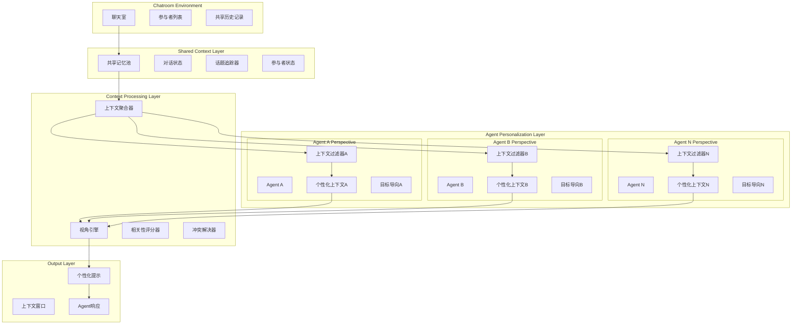

# Multi-Agent Context Management - 多Agent上下文管理系统

## 🎯 系统概览

在 Connet.AI 的多 Agent 聊天室环境中，多个 AI Agent 共享同一个会话空间，但每个 Agent 基于其角色、专长和目标具有不同的上下文视角。本系统设计了一套智能的上下文管理机制，实现共享记忆与个性化视角的平衡。

---

## 🏗️ 多Agent上下文架构



---

## 💾 共享上下文数据模型

### 1. 共享记忆池

```python
from dataclasses import dataclass
from typing import Dict, List, Optional, Any
from datetime import datetime
from enum import Enum

class MessageType(Enum):
    USER_MESSAGE = "user_message"
    AGENT_RESPONSE = "agent_response"
    SYSTEM_EVENT = "system_event"
    TOPIC_CHANGE = "topic_change"
    PARTICIPANT_JOIN = "participant_join"
    PARTICIPANT_LEAVE = "participant_leave"

@dataclass
class SharedMessage:
    """共享消息记录"""
    id: str
    content: str
    sender_id: str
    sender_type: str  # user, agent, system
    message_type: MessageType
    timestamp: datetime
    mentioned_agents: List[str]
    topics: List[str]
    metadata: Dict[str, Any]
    
    # 多视角相关性评分
    agent_relevance_scores: Dict[str, float] = None
    
    # 消息重要性评级
    importance_level: float = 0.5  # 0.0 - 1.0

@dataclass
class ConversationTopic:
    """对话话题"""
    id: str
    title: str
    description: str
    start_message_id: str
    end_message_id: Optional[str] = None
    active: bool = True
    participants: List[str] = None
    related_agents: List[str] = None
    topic_keywords: List[str] = None

@dataclass
class SharedContextPool:
    """共享上下文池"""
    conversation_id: str
    participants: List[str]  # 包括用户和Agent
    active_agents: List[str]
    current_topics: List[ConversationTopic]
    shared_messages: List[SharedMessage]
    conversation_state: Dict[str, Any]
    participant_status: Dict[str, Dict[str, Any]]
    
    # 共享决策和结论
    shared_decisions: List[Dict[str, Any]] = None
    shared_tasks: List[Dict[str, Any]] = None
    shared_knowledge: List[Dict[str, Any]] = None

class SharedContextManager:
    """共享上下文管理器"""
    
    def __init__(self):
        self.context_pools: Dict[str, SharedContextPool] = {}
        self.topic_tracker = TopicTracker()
        self.relevance_calculator = RelevanceCalculator()
    
    async def update_shared_context(self, conversation_id: str, 
                                  new_message: SharedMessage) -> SharedContextPool:
        """更新共享上下文"""
        
        pool = self.context_pools.get(conversation_id)
        if not pool:
            pool = await self._initialize_context_pool(conversation_id)
        
        # 添加新消息到共享池
        pool.shared_messages.append(new_message)
        
        # 更新话题跟踪
        topic_updates = await self.topic_tracker.process_message(new_message)
        if topic_updates:
            pool.current_topics.extend(topic_updates.new_topics)
            # 更新现有话题
            for topic in pool.current_topics:
                if topic.id in topic_updates.updated_topics:
                    topic.__dict__.update(topic_updates.updated_topics[topic.id])
        
        # 计算Agent相关性评分
        if new_message.agent_relevance_scores is None:
            new_message.agent_relevance_scores = await self._calculate_agent_relevance(
                new_message, pool.active_agents
            )
        
        # 更新参与者状态
        await self._update_participant_status(pool, new_message)
        
        self.context_pools[conversation_id] = pool
        return pool
    
    async def _calculate_agent_relevance(self, message: SharedMessage, 
                                       active_agents: List[str]) -> Dict[str, float]:
        """计算消息对各Agent的相关性"""
        
        relevance_scores = {}
        
        for agent_id in active_agents:
            # 获取Agent配置
            agent_config = await self._get_agent_config(agent_id)
            
            # 基于多个维度计算相关性
            relevance_score = await self.relevance_calculator.calculate_relevance(
                message=message,
                agent_expertise=agent_config.expertise,
                agent_role=agent_config.role,
                agent_interests=agent_config.interests
            )
            
            relevance_scores[agent_id] = relevance_score
        
        return relevance_scores
```

### 2. Agent个性化上下文

```python
@dataclass
class AgentPerspective:
    """Agent视角配置"""
    agent_id: str
    role: str
    expertise: List[str]
    interests: List[str]
    personality_traits: Dict[str, float]
    goals: List[str]
    focus_areas: List[str]
    
    # 上下文偏好设置
    context_depth: int = 10  # 关注的消息深度
    relevance_threshold: float = 0.3  # 相关性阈值
    topic_focus_weight: float = 0.7  # 话题聚焦权重
    participant_attention: Dict[str, float] = None  # 对特定参与者的关注度

@dataclass
class PersonalizedContext:
    """个性化上下文"""
    agent_id: str
    conversation_id: str
    
    # 过滤后的相关消息
    relevant_messages: List[SharedMessage]
    
    # 当前关注的话题
    focused_topics: List[ConversationTopic]
    
    # 个人任务和目标
    current_objectives: List[str]
    pending_tasks: List[Dict[str, Any]]
    
    # Agent特定的记忆
    personal_insights: List[str]
    interaction_history: Dict[str, List[str]]  # 与特定参与者的互动历史
    
    # 上下文窗口
    context_window: List[str]  # 最终用于LLM的上下文

class AgentContextFilter:
    """Agent上下文过滤器"""
    
    def __init__(self, perspective: AgentPerspective):
        self.perspective = perspective
        self.relevance_calculator = RelevanceCalculator()
        self.context_builder = PersonalizedContextBuilder()
    
    async def filter_shared_context(self, shared_pool: SharedContextPool) -> PersonalizedContext:
        """过滤共享上下文，生成个性化上下文"""
        
        # 1. 基于相关性过滤消息
        relevant_messages = await self._filter_relevant_messages(
            shared_pool.shared_messages
        )
        
        # 2. 识别关注话题
        focused_topics = await self._identify_focused_topics(
            shared_pool.current_topics
        )
        
        # 3. 提取个人任务和目标
        current_objectives = await self._extract_current_objectives(
            relevant_messages, focused_topics
        )
        
        # 4. 构建个性化上下文
        personalized_context = PersonalizedContext(
            agent_id=self.perspective.agent_id,
            conversation_id=shared_pool.conversation_id,
            relevant_messages=relevant_messages,
            focused_topics=focused_topics,
            current_objectives=current_objectives,
            pending_tasks=await self._extract_pending_tasks(relevant_messages),
            personal_insights=await self._generate_personal_insights(relevant_messages),
            interaction_history=await self._build_interaction_history(relevant_messages)
        )
        
        # 5. 构建最终上下文窗口
        personalized_context.context_window = await self.context_builder.build_context_window(
            personalized_context, self.perspective
        )
        
        return personalized_context
    
    async def _filter_relevant_messages(self, messages: List[SharedMessage]) -> List[SharedMessage]:
        """过滤相关消息"""
        
        relevant_messages = []
        
        for message in messages:
            # 检查Agent相关性评分
            relevance_score = message.agent_relevance_scores.get(
                self.perspective.agent_id, 0.0
            )
            
            if relevance_score >= self.perspective.relevance_threshold:
                relevant_messages.append(message)
                continue
            
            # 检查是否直接提及该Agent
            if self.perspective.agent_id in message.mentioned_agents:
                relevant_messages.append(message)
                continue
            
            # 检查是否涉及Agent的专业领域
            if await self._is_expertise_relevant(message):
                relevant_messages.append(message)
        
        # 按相关性和时间排序
        relevant_messages.sort(
            key=lambda msg: (
                msg.agent_relevance_scores.get(self.perspective.agent_id, 0.0),
                msg.timestamp
            ),
            reverse=True
        )
        
        return relevant_messages[:self.perspective.context_depth]
    
    async def _identify_focused_topics(self, topics: List[ConversationTopic]) -> List[ConversationTopic]:
        """识别Agent关注的话题"""
        
        focused_topics = []
        
        for topic in topics:
            if not topic.active:
                continue
            
            # 检查话题是否与Agent专业领域相关
            topic_relevance = await self._calculate_topic_relevance(topic)
            
            if topic_relevance >= self.perspective.relevance_threshold:
                focused_topics.append(topic)
        
        return focused_topics
    
    async def _is_expertise_relevant(self, message: SharedMessage) -> bool:
        """检查消息是否与Agent专业领域相关"""
        
        message_content = message.content.lower()
        
        for expertise in self.perspective.expertise:
            expertise_keywords = await self._get_expertise_keywords(expertise)
            
            for keyword in expertise_keywords:
                if keyword.lower() in message_content:
                    return True
        
        return False
```

### 3. 上下文聚合和冲突解决

```python
class MultiAgentContextOrchestrator:
    """多Agent上下文编排器"""
    
    def __init__(self):
        self.shared_context_manager = SharedContextManager()
        self.context_filters: Dict[str, AgentContextFilter] = {}
        self.conflict_resolver = ContextConflictResolver()
        self.coordination_engine = AgentCoordinationEngine()
    
    async def process_new_message(self, conversation_id: str, 
                                message: SharedMessage) -> Dict[str, PersonalizedContext]:
        """处理新消息，为所有Agent生成个性化上下文"""
        
        # 1. 更新共享上下文
        shared_pool = await self.shared_context_manager.update_shared_context(
            conversation_id, message
        )
        
        # 2. 为每个Agent生成个性化上下文
        agent_contexts = {}
        
        for agent_id in shared_pool.active_agents:
            # 获取或创建上下文过滤器
            context_filter = await self._get_context_filter(agent_id)
            
            # 生成个性化上下文
            personalized_context = await context_filter.filter_shared_context(shared_pool)
            
            agent_contexts[agent_id] = personalized_context
        
        # 3. 检测和解决上下文冲突
        conflict_resolution = await self.conflict_resolver.resolve_conflicts(
            agent_contexts, shared_pool
        )
        
        # 4. 协调Agent响应策略
        coordination_plan = await self.coordination_engine.plan_agent_coordination(
            agent_contexts, conflict_resolution
        )
        
        return agent_contexts
    
    async def _get_context_filter(self, agent_id: str) -> AgentContextFilter:
        """获取Agent的上下文过滤器"""
        
        if agent_id not in self.context_filters:
            agent_perspective = await self._load_agent_perspective(agent_id)
            self.context_filters[agent_id] = AgentContextFilter(agent_perspective)
        
        return self.context_filters[agent_id]

class ContextConflictResolver:
    """上下文冲突解决器"""
    
    async def resolve_conflicts(self, agent_contexts: Dict[str, PersonalizedContext],
                              shared_pool: SharedContextPool) -> ConflictResolution:
        """解决Agent间的上下文冲突"""
        
        conflicts = await self._identify_conflicts(agent_contexts)
        resolutions = []
        
        for conflict in conflicts:
            if conflict.type == "overlapping_objectives":
                resolution = await self._resolve_overlapping_objectives(conflict)
            elif conflict.type == "contradicting_information":
                resolution = await self._resolve_contradicting_information(conflict)
            elif conflict.type == "resource_competition":
                resolution = await self._resolve_resource_competition(conflict)
            
            resolutions.append(resolution)
        
        return ConflictResolution(
            conflicts=conflicts,
            resolutions=resolutions,
            coordination_recommendations=await self._generate_coordination_recommendations(
                agent_contexts, resolutions
            )
        )
    
    async def _identify_conflicts(self, agent_contexts: Dict[str, PersonalizedContext]) -> List[ContextConflict]:
        """识别Agent间的上下文冲突"""
        
        conflicts = []
        
        # 检查目标重叠
        objectives_by_agent = {
            agent_id: context.current_objectives 
            for agent_id, context in agent_contexts.items()
        }
        
        overlapping_objectives = await self._find_overlapping_objectives(objectives_by_agent)
        if overlapping_objectives:
            conflicts.append(ContextConflict(
                type="overlapping_objectives",
                involved_agents=list(overlapping_objectives.keys()),
                details=overlapping_objectives
            ))
        
        # 检查信息矛盾
        contradictions = await self._find_information_contradictions(agent_contexts)
        if contradictions:
            conflicts.append(ContextConflict(
                type="contradicting_information",
                involved_agents=list(contradictions.keys()),
                details=contradictions
            ))
        
        return conflicts

class AgentCoordinationEngine:
    """Agent协调引擎"""
    
    async def plan_agent_coordination(self, agent_contexts: Dict[str, PersonalizedContext],
                                    conflict_resolution: ConflictResolution) -> CoordinationPlan:
        """规划Agent协调策略"""
        
        coordination_strategies = []
        
        # 分析协作机会
        collaboration_opportunities = await self._identify_collaboration_opportunities(
            agent_contexts
        )
        
        for opportunity in collaboration_opportunities:
            strategy = await self._create_collaboration_strategy(
                opportunity, agent_contexts
            )
            coordination_strategies.append(strategy)
        
        # 处理冲突解决建议
        for resolution in conflict_resolution.resolutions:
            coordination_strategy = await self._create_conflict_resolution_strategy(
                resolution
            )
            coordination_strategies.append(coordination_strategy)
        
        return CoordinationPlan(
            strategies=coordination_strategies,
            execution_order=await self._determine_execution_order(coordination_strategies),
            success_metrics=await self._define_success_metrics(coordination_strategies)
        )
    
    async def _identify_collaboration_opportunities(self, 
                                                 agent_contexts: Dict[str, PersonalizedContext]) -> List[CollaborationOpportunity]:
        """识别协作机会"""
        
        opportunities = []
        
        # 检查互补技能
        complementary_skills = await self._find_complementary_skills(agent_contexts)
        
        for skill_match in complementary_skills:
            opportunity = CollaborationOpportunity(
                type="complementary_skills",
                participating_agents=skill_match.agents,
                potential_synergy=skill_match.synergy_score,
                suggested_tasks=skill_match.collaborative_tasks
            )
            opportunities.append(opportunity)
        
        # 检查共同目标
        shared_objectives = await self._find_shared_objectives(agent_contexts)
        
        for objective_group in shared_objectives:
            opportunity = CollaborationOpportunity(
                type="shared_objectives",
                participating_agents=objective_group.agents,
                potential_synergy=objective_group.alignment_score,
                suggested_tasks=objective_group.joint_tasks
            )
            opportunities.append(opportunity)
        
        return opportunities
```

### 4. 个性化提示生成

```python
class PersonalizedPromptGenerator:
    """个性化提示生成器"""
    
    def __init__(self):
        self.template_manager = PromptTemplateManager()
        self.context_builder = ContextBuilder()
    
    async def generate_agent_prompt(self, agent_id: str, 
                                  personalized_context: PersonalizedContext,
                                  agent_perspective: AgentPerspective) -> str:
        """为Agent生成个性化提示"""
        
        # 1. 选择合适的提示模板
        template = await self.template_manager.select_template(
            agent_role=agent_perspective.role,
            context_type="multi_agent_chat",
            interaction_mode="collaborative"
        )
        
        # 2. 构建上下文部分
        context_section = await self._build_context_section(personalized_context)
        
        # 3. 构建角色定义部分
        role_section = await self._build_role_section(agent_perspective)
        
        # 4. 构建协作指导部分
        collaboration_section = await self._build_collaboration_section(
            personalized_context, agent_perspective
        )
        
        # 5. 组装完整提示
        full_prompt = template.format(
            role_definition=role_section,
            conversation_context=context_section,
            collaboration_guidelines=collaboration_section,
            current_objectives=await self._format_objectives(
                personalized_context.current_objectives
            ),
            agent_name=agent_perspective.agent_id,
            expertise_areas=", ".join(agent_perspective.expertise)
        )
        
        return full_prompt
    
    async def _build_context_section(self, context: PersonalizedContext) -> str:
        """构建上下文部分"""
        
        context_parts = []
        
        # 相关消息历史
        if context.relevant_messages:
            messages_text = "\n".join([
                f"{msg.sender_id}: {msg.content}"
                for msg in context.relevant_messages[-5:]  # 最近5条相关消息
            ])
            context_parts.append(f"Recent relevant messages:\n{messages_text}")
        
        # 当前话题
        if context.focused_topics:
            topics_text = ", ".join([topic.title for topic in context.focused_topics])
            context_parts.append(f"Current topics of focus: {topics_text}")
        
        # 待办任务
        if context.pending_tasks:
            tasks_text = "\n".join([
                f"- {task['description']}"
                for task in context.pending_tasks
            ])
            context_parts.append(f"Pending tasks:\n{tasks_text}")
        
        return "\n\n".join(context_parts)
    
    async def _build_collaboration_section(self, context: PersonalizedContext,
                                         perspective: AgentPerspective) -> str:
        """构建协作指导部分"""
        
        collaboration_guidelines = [
            "You are participating in a multi-agent conversation.",
            "Work collaboratively with other agents while maintaining your unique perspective.",
            "Acknowledge and build upon insights from other agents when appropriate.",
            "If you notice potential conflicts or overlaps, suggest coordination strategies."
        ]
        
        # 基于当前参与者添加特定指导
        if context.interaction_history:
            frequent_collaborators = await self._identify_frequent_collaborators(
                context.interaction_history
            )
            if frequent_collaborators:
                collaboration_guidelines.append(
                    f"You frequently collaborate with: {', '.join(frequent_collaborators)}. "
                    "Consider their perspectives and expertise."
                )
        
        return "\n".join(f"- {guideline}" for guideline in collaboration_guidelines)
```

这个多Agent上下文管理系统确保了在共享聊天室环境中，每个Agent都能获得个性化的、符合其角色和目标的上下文信息，同时保持协作的一致性和效率。