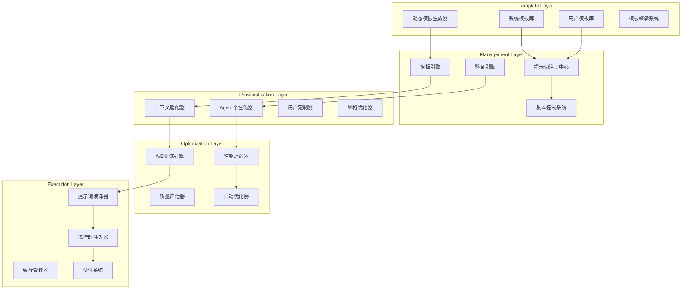

# Prompts Management System - 提示词管理系统

## 🎯 系统概览

Connet.AI 的提示词管理系统提供了一套完整的提示词生命周期管理解决方案，支持模板化、版本控制、动态生成、A/B测试和性能优化，确保 AI Agent 能够获得最优质的提示词来提供准确、相关的回复。

---

## 🏗️ 提示词管理架构



---

## 📝 提示词数据模型

### 1. 核心数据结构

```python
from dataclasses import dataclass, field
from typing import Dict, List, Optional, Any, Union
from datetime import datetime
from enum import Enum

class PromptType(Enum):
    SYSTEM = "system"                    # 系统级提示词
    AGENT_PERSONALITY = "agent_personality"  # Agent人格提示词
    TASK_SPECIFIC = "task_specific"      # 任务特定提示词
    CONTEXT_INJECTION = "context_injection"  # 上下文注入提示词
    USER_CUSTOM = "user_custom"          # 用户自定义提示词
    DYNAMIC = "dynamic"                  # 动态生成提示词

class PromptCategory(Enum):
    CONVERSATION = "conversation"
    CODE_GENERATION = "code_generation"
    CREATIVE_WRITING = "creative_writing"
    DATA_ANALYSIS = "data_analysis"
    PROBLEM_SOLVING = "problem_solving"
    LEARNING_GUIDANCE = "learning_guidance"

@dataclass
class PromptVariable:
    """提示词变量定义"""
    name: str
    type: str  # string, number, boolean, array, object
    description: str
    required: bool = True
    default_value: Any = None
    validation_rules: Dict[str, Any] = field(default_factory=dict)
    transformation_rules: List[str] = field(default_factory=list)

@dataclass
class PromptTemplate:
    """提示词模板"""
    id: str
    name: str
    description: str
    template_content: str
    prompt_type: PromptType
    category: PromptCategory
    version: str
    
    # 变量定义
    variables: List[PromptVariable] = field(default_factory=list)
    
    # 继承关系
    parent_template_id: Optional[str] = None
    child_templates: List[str] = field(default_factory=list)
    
    # 适用范围
    supported_models: List[str] = field(default_factory=list)
    supported_languages: List[str] = field(default_factory=list)
    agent_types: List[str] = field(default_factory=list)
    
    # 性能指标
    usage_count: int = 0
    success_rate: float = 0.0
    avg_response_quality: float = 0.0
    
    # 元数据
    tags: List[str] = field(default_factory=list)
    created_by: str = ""
    created_at: datetime = field(default_factory=datetime.utcnow)
    updated_at: datetime = field(default_factory=datetime.utcnow)
    is_active: bool = True

@dataclass
class CompiledPrompt:
    """编译后的提示词"""
    template_id: str
    compiled_content: str
    variables_used: Dict[str, Any]
    compilation_context: Dict[str, Any]
    compiled_at: datetime
    expiry_time: Optional[datetime] = None
    checksum: str = ""

class PromptTemplateEngine:
    """提示词模板引擎"""
    
    def __init__(self):
        self.template_registry = PromptTemplateRegistry()
        self.variable_resolver = VariableResolver()
        self.inheritance_manager = TemplateInheritanceManager()
        self.validation_engine = PromptValidationEngine()
    
    async def compile_prompt(self, template_id: str, context: Dict[str, Any], 
                           personalization: Dict[str, Any] = None) -> CompiledPrompt:
        """编译提示词模板"""
        
        # 1. 获取模板
        template = await self.template_registry.get_template(template_id)
        if not template:
            raise TemplateNotFoundError(f"Template {template_id} not found")
        
        # 2. 处理模板继承
        resolved_template = await self.inheritance_manager.resolve_inheritance(template)
        
        # 3. 解析变量
        resolved_variables = await self.variable_resolver.resolve_variables(
            resolved_template.variables, context, personalization
        )
        
        # 4. 编译模板内容
        compiled_content = await self._compile_template_content(
            resolved_template.template_content, resolved_variables
        )
        
        # 5. 验证编译结果
        validation_result = await self.validation_engine.validate_compiled_prompt(
            compiled_content, resolved_template
        )
        if not validation_result.is_valid:
            raise PromptValidationError(validation_result.errors)
        
        # 6. 创建编译结果
        compiled_prompt = CompiledPrompt(
            template_id=template_id,
            compiled_content=compiled_content,
            variables_used=resolved_variables,
            compilation_context=context,
            compiled_at=datetime.utcnow(),
            checksum=self._calculate_checksum(compiled_content)
        )
        
        return compiled_prompt
    
    async def _compile_template_content(self, template_content: str, 
                                      variables: Dict[str, Any]) -> str:
        """编译模板内容"""
        
        import jinja2
        
        # 使用 Jinja2 作为模板引擎
        template = jinja2.Template(
            template_content,
            undefined=jinja2.StrictUndefined  # 严格模式，未定义变量会报错
        )
        
        # 添加自定义过滤器
        template.environment.filters.update({
            'truncate_smart': self._smart_truncate,
            'format_list': self._format_list,
            'capitalize_first': self._capitalize_first,
            'remove_duplicates': self._remove_duplicates
        })
        
        compiled_content = template.render(**variables)
        
        return compiled_content.strip()
```

### 2. 模板继承系统

```python
class TemplateInheritanceManager:
    """模板继承管理器"""
    
    async def resolve_inheritance(self, template: PromptTemplate) -> PromptTemplate:
        """解析模板继承关系"""
        
        if not template.parent_template_id:
            return template
        
        # 获取父模板
        parent_template = await self.template_registry.get_template(
            template.parent_template_id
        )
        if not parent_template:
            return template
        
        # 递归解析父模板的继承关系
        resolved_parent = await self.resolve_inheritance(parent_template)
        
        # 合并模板内容
        merged_template = await self._merge_templates(resolved_parent, template)
        
        return merged_template
    
    async def _merge_templates(self, parent: PromptTemplate, 
                             child: PromptTemplate) -> PromptTemplate:
        """合并父子模板"""
        
        # 合并变量定义（子模板优先）
        merged_variables = {}
        
        # 添加父模板变量
        for var in parent.variables:
            merged_variables[var.name] = var
        
        # 子模板变量覆盖父模板变量
        for var in child.variables:
            merged_variables[var.name] = var
        
        # 合并模板内容
        if "{{parent_content}}" in child.template_content:
            merged_content = child.template_content.replace(
                "{{parent_content}}", parent.template_content
            )
        else:
            merged_content = f"{parent.template_content}\n\n{child.template_content}"
        
        # 创建合并后的模板
        merged_template = PromptTemplate(
            id=child.id,
            name=child.name,
            description=child.description,
            template_content=merged_content,
            prompt_type=child.prompt_type,
            category=child.category,
            version=child.version,
            variables=list(merged_variables.values()),
            supported_models=list(set(parent.supported_models + child.supported_models)),
            supported_languages=list(set(parent.supported_languages + child.supported_languages)),
            agent_types=list(set(parent.agent_types + child.agent_types)),
            tags=list(set(parent.tags + child.tags)),
            created_by=child.created_by,
            created_at=child.created_at,
            updated_at=child.updated_at,
            is_active=child.is_active
        )
        
        return merged_template

class VariableResolver:
    """变量解析器"""
    
    async def resolve_variables(self, variable_definitions: List[PromptVariable],
                              context: Dict[str, Any],
                              personalization: Dict[str, Any] = None) -> Dict[str, Any]:
        """解析提示词变量"""
        
        resolved_variables = {}
        personalization = personalization or {}
        
        for var_def in variable_definitions:
            # 1. 从个性化设置获取值
            if var_def.name in personalization:
                value = personalization[var_def.name]
            # 2. 从上下文获取值
            elif var_def.name in context:
                value = context[var_def.name]
            # 3. 使用默认值
            elif var_def.default_value is not None:
                value = var_def.default_value
            # 4. 必需变量但未提供值
            elif var_def.required:
                raise MissingVariableError(f"Required variable '{var_def.name}' not provided")
            else:
                continue
            
            # 验证变量值
            validated_value = await self._validate_variable_value(value, var_def)
            
            # 应用转换规则
            transformed_value = await self._transform_variable_value(
                validated_value, var_def.transformation_rules
            )
            
            resolved_variables[var_def.name] = transformed_value
        
        return resolved_variables
    
    async def _validate_variable_value(self, value: Any, 
                                     var_def: PromptVariable) -> Any:
        """验证变量值"""
        
        # 类型检查
        if var_def.type == "string" and not isinstance(value, str):
            raise VariableValidationError(f"Variable '{var_def.name}' must be a string")
        elif var_def.type == "number" and not isinstance(value, (int, float)):
            raise VariableValidationError(f"Variable '{var_def.name}' must be a number")
        elif var_def.type == "boolean" and not isinstance(value, bool):
            raise VariableValidationError(f"Variable '{var_def.name}' must be a boolean")
        
        # 应用验证规则
        for rule_name, rule_value in var_def.validation_rules.items():
            if rule_name == "min_length" and len(str(value)) < rule_value:
                raise VariableValidationError(f"Variable '{var_def.name}' is too short")
            elif rule_name == "max_length" and len(str(value)) > rule_value:
                raise VariableValidationError(f"Variable '{var_def.name}' is too long")
            elif rule_name == "pattern":
                import re
                if not re.match(rule_value, str(value)):
                    raise VariableValidationError(f"Variable '{var_def.name}' does not match pattern")
        
        return value
    
    async def _transform_variable_value(self, value: Any, 
                                      transformation_rules: List[str]) -> Any:
        """应用变量转换规则"""
        
        transformed_value = value
        
        for rule in transformation_rules:
            if rule == "uppercase":
                transformed_value = str(transformed_value).upper()
            elif rule == "lowercase":
                transformed_value = str(transformed_value).lower()
            elif rule == "capitalize":
                transformed_value = str(transformed_value).capitalize()
            elif rule == "strip":
                transformed_value = str(transformed_value).strip()
            elif rule.startswith("truncate:"):
                max_length = int(rule.split(":")[1])
                transformed_value = str(transformed_value)[:max_length]
        
        return transformed_value
```

### 3. 动态提示词生成

```python
class DynamicPromptGenerator:
    """动态提示词生成器"""
    
    def __init__(self):
        self.context_analyzer = ContextAnalyzer()
        self.template_selector = TemplateSelector()
        self.content_optimizer = ContentOptimizer()
        self.llm_client = LLMClient()
    
    async def generate_dynamic_prompt(self, request: DynamicPromptRequest) -> PromptTemplate:
        """生成动态提示词"""
        
        # 1. 分析上下文和需求
        context_analysis = await self.context_analyzer.analyze(
            conversation_context=request.conversation_context,
            agent_profile=request.agent_profile,
            user_preferences=request.user_preferences,
            task_requirements=request.task_requirements
        )
        
        # 2. 选择基础模板
        base_template = await self.template_selector.select_base_template(
            context_analysis
        )
        
        # 3. 生成个性化内容
        personalized_sections = await self._generate_personalized_sections(
            context_analysis, base_template
        )
        
        # 4. 组装动态模板
        dynamic_template = await self._assemble_dynamic_template(
            base_template, personalized_sections, context_analysis
        )
        
        # 5. 优化提示词内容
        optimized_template = await self.content_optimizer.optimize(
            dynamic_template, context_analysis
        )
        
        return optimized_template
    
    async def _generate_personalized_sections(self, context_analysis: ContextAnalysis,
                                            base_template: PromptTemplate) -> Dict[str, str]:
        """生成个性化内容段落"""
        
        personalized_sections = {}
        
        # 生成角色定义段落
        if context_analysis.agent_specialization:
            role_prompt = f"""
            Generate a role definition for an AI agent with the following characteristics:
            - Specialization: {context_analysis.agent_specialization}
            - Communication style: {context_analysis.communication_style}
            - Expertise level: {context_analysis.expertise_level}
            - User interaction preferences: {context_analysis.interaction_preferences}
            
            Create a concise, engaging role definition that captures the agent's personality and capabilities.
            """
            
            role_response = await self.llm_client.complete(role_prompt)
            personalized_sections["role_definition"] = role_response.content
        
        # 生成上下文说明段落
        if context_analysis.conversation_context:
            context_prompt = f"""
            Create a context description based on the following conversation context:
            {context_analysis.conversation_context}
            
            Focus on the key points that would be relevant for continuing the conversation effectively.
            Keep it concise and actionable.
            """
            
            context_response = await self.llm_client.complete(context_prompt)
            personalized_sections["context_description"] = context_response.content
        
        # 生成目标导向段落
        if context_analysis.task_objectives:
            objectives_prompt = f"""
            Create a clear objective statement based on these goals:
            {context_analysis.task_objectives}
            
            Frame it as actionable guidance for achieving these objectives while maintaining 
            helpful and engaging communication.
            """
            
            objectives_response = await self.llm_client.complete(objectives_prompt)
            personalized_sections["objectives_guidance"] = objectives_response.content
        
        return personalized_sections
    
    async def _assemble_dynamic_template(self, base_template: PromptTemplate,
                                       personalized_sections: Dict[str, str],
                                       context_analysis: ContextAnalysis) -> PromptTemplate:
        """组装动态模板"""
        
        # 构建动态模板内容
        template_parts = []
        
        # 添加角色定义
        if "role_definition" in personalized_sections:
            template_parts.append(f"## Role Definition\n{personalized_sections['role_definition']}")
        
        # 添加基础模板内容
        template_parts.append(f"## Core Instructions\n{base_template.template_content}")
        
        # 添加上下文描述
        if "context_description" in personalized_sections:
            template_parts.append(f"## Current Context\n{personalized_sections['context_description']}")
        
        # 添加目标指导
        if "objectives_guidance" in personalized_sections:
            template_parts.append(f"## Objectives\n{personalized_sections['objectives_guidance']}")
        
        # 组装完整内容
        dynamic_content = "\n\n".join(template_parts)
        
        # 创建动态模板
        dynamic_template = PromptTemplate(
            id=f"dynamic_{datetime.utcnow().timestamp()}",
            name=f"Dynamic Template - {context_analysis.scenario_type}",
            description="Dynamically generated template based on context and requirements",
            template_content=dynamic_content,
            prompt_type=PromptType.DYNAMIC,
            category=context_analysis.primary_category,
            version="1.0",
            variables=base_template.variables,  # 继承基础模板的变量
            supported_models=base_template.supported_models,
            supported_languages=base_template.supported_languages,
            tags=["dynamic", "personalized"] + base_template.tags,
            created_at=datetime.utcnow()
        )
        
        return dynamic_template

@dataclass
class DynamicPromptRequest:
    """动态提示词生成请求"""
    conversation_context: Dict[str, Any]
    agent_profile: Dict[str, Any]
    user_preferences: Dict[str, Any]
    task_requirements: Dict[str, Any]
    quality_requirements: Dict[str, float] = field(default_factory=dict)
    performance_constraints: Dict[str, Any] = field(default_factory=dict)
```

### 4. A/B测试和优化系统

```python
class PromptABTestingEngine:
    """提示词A/B测试引擎"""
    
    def __init__(self):
        self.experiment_manager = ExperimentManager()
        self.metrics_collector = MetricsCollector()
        self.statistical_analyzer = StatisticalAnalyzer()
        
    async def create_ab_test(self, test_config: ABTestConfig) -> str:
        """创建A/B测试"""
        
        experiment_id = f"prompt_test_{datetime.utcnow().timestamp()}"
        
        experiment = PromptExperiment(
            id=experiment_id,
            name=test_config.name,
            description=test_config.description,
            control_template_id=test_config.control_template_id,
            variant_template_ids=test_config.variant_template_ids,
            traffic_split=test_config.traffic_split,
            success_metrics=test_config.success_metrics,
            sample_size_target=test_config.sample_size_target,
            start_date=test_config.start_date,
            end_date=test_config.end_date,
            status="active"
        )
        
        await self.experiment_manager.store_experiment(experiment)
        return experiment_id
    
    async def get_prompt_for_test(self, experiment_id: str, 
                                user_context: Dict[str, Any]) -> str:
        """为测试获取提示词变体"""
        
        experiment = await self.experiment_manager.get_experiment(experiment_id)
        if not experiment or experiment.status != "active":
            return experiment.control_template_id
        
        # 根据用户哈希分配变体
        user_hash = hash(str(user_context.get("user_id", "")))
        variant_index = user_hash % len(experiment.all_templates)
        
        selected_template_id = experiment.all_templates[variant_index]
        
        # 记录分配
        await self.metrics_collector.record_assignment(
            experiment_id=experiment_id,
            user_id=user_context.get("user_id"),
            template_id=selected_template_id,
            assignment_time=datetime.utcnow()
        )
        
        return selected_template_id
    
    async def record_experiment_result(self, experiment_id: str, 
                                     user_id: str, template_id: str,
                                     result_metrics: Dict[str, float]):
        """记录实验结果"""
        
        await self.metrics_collector.record_result(
            experiment_id=experiment_id,
            user_id=user_id,
            template_id=template_id,
            metrics=result_metrics,
            recorded_at=datetime.utcnow()
        )
    
    async def analyze_experiment(self, experiment_id: str) -> ABTestResult:
        """分析实验结果"""
        
        experiment = await self.experiment_manager.get_experiment(experiment_id)
        results_data = await self.metrics_collector.get_experiment_results(experiment_id)
        
        # 统计分析
        analysis = await self.statistical_analyzer.analyze(
            control_data=results_data.control_results,
            variant_data=results_data.variant_results,
            metrics=experiment.success_metrics
        )
        
        return ABTestResult(
            experiment_id=experiment_id,
            control_performance=analysis.control_stats,
            variant_performance=analysis.variant_stats,
            statistical_significance=analysis.significance,
            confidence_level=analysis.confidence_level,
            recommended_action=analysis.recommendation,
            analyzed_at=datetime.utcnow()
        )

class PromptOptimizer:
    """提示词优化器"""
    
    def __init__(self):
        self.performance_analyzer = PerformanceAnalyzer()
        self.content_analyzer = ContentAnalyzer()
        self.llm_client = LLMClient()
    
    async def optimize_prompt_template(self, template_id: str, 
                                     performance_data: Dict[str, Any]) -> List[OptimizationSuggestion]:
        """优化提示词模板"""
        
        template = await self.template_registry.get_template(template_id)
        performance_analysis = await self.performance_analyzer.analyze(performance_data)
        
        suggestions = []
        
        # 分析性能问题
        if performance_analysis.avg_response_time > 3.0:  # 响应时间过长
            suggestions.append(await self._optimize_for_speed(template))
        
        if performance_analysis.success_rate < 0.8:  # 成功率过低
            suggestions.append(await self._optimize_for_accuracy(template, performance_analysis))
        
        if performance_analysis.user_satisfaction < 4.0:  # 用户满意度低
            suggestions.append(await self._optimize_for_satisfaction(template, performance_analysis))
        
        # 内容分析优化
        content_issues = await self.content_analyzer.identify_issues(template.template_content)
        for issue in content_issues:
            suggestion = await self._create_content_optimization(issue, template)
            suggestions.append(suggestion)
        
        return suggestions
    
    async def _optimize_for_speed(self, template: PromptTemplate) -> OptimizationSuggestion:
        """优化响应速度"""
        
        optimization_prompt = f"""
        Analyze the following prompt template and suggest ways to make it more concise 
        while maintaining its effectiveness:
        
        {template.template_content}
        
        Focus on:
        1. Removing redundant instructions
        2. Simplifying complex sentences
        3. Combining related instructions
        4. Maintaining clarity and effectiveness
        
        Provide a optimized version and explain the changes.
        """
        
        response = await self.llm_client.complete(optimization_prompt)
        
        return OptimizationSuggestion(
            type="speed_optimization",
            title="Optimize for faster response",
            description="Reduce prompt complexity to improve response speed",
            suggested_changes=response.content,
            expected_improvement="20-30% faster response time",
            confidence_score=0.8
        )
    
    async def _optimize_for_accuracy(self, template: PromptTemplate, 
                                   performance_analysis: PerformanceAnalysis) -> OptimizationSuggestion:
        """优化准确性"""
        
        common_failures = performance_analysis.common_failure_patterns
        
        optimization_prompt = f"""
        Improve the following prompt template to address these common failure patterns:
        {common_failures}
        
        Current template:
        {template.template_content}
        
        Suggestions should focus on:
        1. Adding clearer instructions
        2. Providing better examples
        3. Addressing ambiguities
        4. Adding error prevention guidelines
        
        Provide specific improvements and explanations.
        """
        
        response = await self.llm_client.complete(optimization_prompt)
        
        return OptimizationSuggestion(
            type="accuracy_optimization",
            title="Improve response accuracy",
            description="Address common failure patterns to improve success rate",
            suggested_changes=response.content,
            expected_improvement="15-25% higher success rate",
            confidence_score=0.9
        )

@dataclass
class OptimizationSuggestion:
    """优化建议"""
    type: str
    title: str
    description: str
    suggested_changes: str
    expected_improvement: str
    confidence_score: float
    implementation_complexity: str = "medium"
    estimated_effort_hours: int = 2
```

### 5. 提示词缓存和交付系统

```python
class PromptCacheManager:
    """提示词缓存管理器"""
    
    def __init__(self):
        self.redis_client = Redis()
        self.cache_strategy = SmartCacheStrategy()
        
    async def get_cached_prompt(self, cache_key: str) -> Optional[CompiledPrompt]:
        """获取缓存的提示词"""
        
        cached_data = await self.redis_client.get(f"prompt_cache:{cache_key}")
        if cached_data:
            data = json.loads(cached_data)
            return CompiledPrompt(**data)
        
        return None
    
    async def cache_prompt(self, cache_key: str, compiled_prompt: CompiledPrompt, 
                         ttl_seconds: int = None):
        """缓存提示词"""
        
        if ttl_seconds is None:
            ttl_seconds = await self.cache_strategy.calculate_ttl(compiled_prompt)
        
        cache_data = json.dumps(compiled_prompt.__dict__, default=str)
        await self.redis_client.setex(
            f"prompt_cache:{cache_key}",
            ttl_seconds,
            cache_data
        )
    
    async def invalidate_cache(self, pattern: str):
        """缓存失效"""
        
        keys = await self.redis_client.keys(f"prompt_cache:{pattern}")
        if keys:
            await self.redis_client.delete(*keys)

class PromptDeliverySystem:
    """提示词交付系统"""
    
    def __init__(self):
        self.template_engine = PromptTemplateEngine()
        self.cache_manager = PromptCacheManager()
        self.personalization_engine = PromptPersonalizationEngine()
        self.quality_checker = PromptQualityChecker()
    
    async def deliver_prompt(self, request: PromptDeliveryRequest) -> PromptDeliveryResult:
        """交付提示词"""
        
        # 1. 生成缓存键
        cache_key = self._generate_cache_key(request)
        
        # 2. 检查缓存
        cached_prompt = await self.cache_manager.get_cached_prompt(cache_key)
        if cached_prompt and not request.force_refresh:
            return PromptDeliveryResult(
                prompt_content=cached_prompt.compiled_content,
                source="cache",
                compilation_time=0,
                cache_key=cache_key
            )
        
        # 3. 编译提示词
        start_time = time.time()
        
        compiled_prompt = await self.template_engine.compile_prompt(
            template_id=request.template_id,
            context=request.context,
            personalization=request.personalization
        )
        
        compilation_time = time.time() - start_time
        
        # 4. 个性化处理
        if request.personalization_enabled:
            personalized_prompt = await self.personalization_engine.personalize(
                compiled_prompt, request.personalization_config
            )
            compiled_prompt = personalized_prompt
        
        # 5. 质量检查
        quality_result = await self.quality_checker.check_quality(compiled_prompt)
        if not quality_result.meets_standards:
            # 记录质量问题但不阻塞交付
            await self._log_quality_issue(compiled_prompt, quality_result)
        
        # 6. 缓存结果
        await self.cache_manager.cache_prompt(cache_key, compiled_prompt)
        
        # 7. 返回结果
        return PromptDeliveryResult(
            prompt_content=compiled_prompt.compiled_content,
            source="compiled",
            compilation_time=compilation_time,
            cache_key=cache_key,
            quality_score=quality_result.overall_score,
            template_version=compiled_prompt.template_id
        )
    
    def _generate_cache_key(self, request: PromptDeliveryRequest) -> str:
        """生成缓存键"""
        
        import hashlib
        
        key_components = [
            request.template_id,
            str(hash(frozenset(request.context.items()))),
            str(hash(frozenset(request.personalization.items()))) if request.personalization else "",
            request.agent_id,
            request.user_id
        ]
        
        key_string = ":".join(filter(None, key_components))
        return hashlib.md5(key_string.encode()).hexdigest()

@dataclass
class PromptDeliveryRequest:
    """提示词交付请求"""
    template_id: str
    context: Dict[str, Any]
    agent_id: str
    user_id: str
    personalization: Dict[str, Any] = field(default_factory=dict)
    personalization_enabled: bool = True
    personalization_config: Dict[str, Any] = field(default_factory=dict)
    force_refresh: bool = False
    quality_requirements: Dict[str, float] = field(default_factory=dict)

@dataclass
class PromptDeliveryResult:
    """提示词交付结果"""
    prompt_content: str
    source: str  # "cache" or "compiled"
    compilation_time: float
    cache_key: str
    quality_score: float = 0.0
    template_version: str = ""
    warnings: List[str] = field(default_factory=list)
```

这个提示词管理系统提供了完整的提示词生命周期管理，从模板创建、版本控制、动态生成到优化和交付，确保 AI Agent 能够获得高质量、个性化的提示词来提供最佳的用户体验。