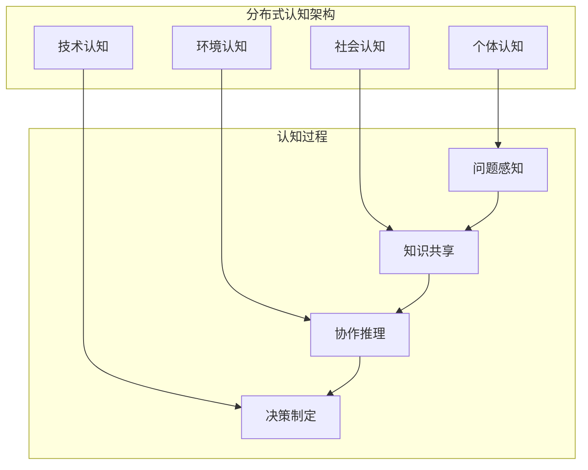

# 理论基础 (Theoretical Foundation)

## 🎯 核心理念

我们的多智能体协作协议基于以下核心理念：将多智能体系统视为一个**智能社会**，每个智能体都是社会中的**独立个体**，具有自主性、社会性和智能性。这个社会需要建立有效的**协作规则**、**沟通机制**和**共识达成**方式。

## 🏛️ 理论基础框架

### 1. 分布式智能社会理论 (Distributed Intelligent Society Theory)

#### 1.1 社会结构模型

```python
class AgentSocietyStructure:
    """
    智能体社会结构模型
    基于社会学的多层次结构理论
    """

    class SocietyLevel(Enum):
        INDIVIDUAL = "individual"        # 个体层：单个智能体
        GROUP = "group"                 # 群组层：协作小组
        ORGANIZATION = "organization"    # 组织层：功能性组织
        SOCIETY = "society"             # 社会层：整个智能体社会

    class SocialRole(Enum):
        LEADER = "leader"               # 领导者：协调和决策
        SPECIALIST = "specialist"       # 专家：专业技能提供者
        MEDIATOR = "mediator"          # 调解者：冲突解决
        OBSERVER = "observer"          # 观察者：信息收集和分析
        EXECUTOR = "executor"          # 执行者：任务执行
        INNOVATOR = "innovator"        # 创新者：创意和改进
```

#### 1.2 社会关系网络

基于**社会网络理论**，智能体之间形成复杂的关系网络：

- **协作关系** (Collaboration Ties): 基于共同任务的合作关系
- **信任关系** (Trust Relationships): 基于历史交互的信任度量
- **专业关系** (Expertise Networks): 基于知识领域的专业联系
- **影响关系** (Influence Networks): 基于决策影响力的层次关系

### 2. 分布式认知理论 (Distributed Cognition Theory)

#### 2.1 认知负载分布



#### 2.2 集体智能涌现

集体智能的涌现基于以下原则：

1. **多样性原则**: 不同类型智能体带来多样化视角
2. **去中心化原则**: 避免单点决策，分布式处理
3. **聚合原则**: 有效整合个体智能为集体智能
4. **激励相容原则**: 个体目标与集体目标保持一致

### 3. 博弈论与协作机制 (Game Theory & Cooperation Mechanisms)

#### 3.1 协作博弈模型

```python
class CooperationGameModel:
    """
    基于博弈论的协作模型
    """

    def __init__(self):
        self.game_types = {
            "coordination_game": CoordinationGame(),      # 协调博弈
            "prisoners_dilemma": PrisonersDilemma(),     # 囚徒困境
            "public_goods": PublicGoodsGame(),           # 公共物品博弈
            "auction": AuctionMechanism()                # 拍卖机制
        }

    async def analyze_cooperation_scenario(self, agents: List[Agent],
                                         task: Task) -> CooperationStrategy:
        """
        分析协作场景，选择最优协作策略
        """
        # 1. 识别博弈类型
        game_type = await self._identify_game_type(agents, task)

        # 2. 计算纳什均衡
        nash_equilibrium = await self._calculate_nash_equilibrium(game_type, agents)

        # 3. 评估协作收益
        cooperation_payoff = await self._evaluate_cooperation_payoff(agents, task)

        # 4. 设计激励机制
        incentive_mechanism = await self._design_incentive_mechanism(
            nash_equilibrium, cooperation_payoff
        )

        return CooperationStrategy(
            game_type=game_type,
            nash_equilibrium=nash_equilibrium,
            incentive_mechanism=incentive_mechanism,
            expected_outcome=cooperation_payoff
        )
```

#### 3.2 声誉与信任机制

基于**重复博弈理论**，建立智能体声誉系统：

```python
class ReputationSystem:
    """
    声誉系统 - 基于历史行为的信任度量
    """

    def __init__(self):
        self.reputation_dimensions = {
            "reliability": ReliabilityScore(),      # 可靠性
            "expertise": ExpertiseScore(),          # 专业度
            "cooperation": CooperationScore(),      # 协作度
            "honesty": HonestyScore(),             # 诚实度
            "efficiency": EfficiencyScore()         # 效率
        }

    async def update_reputation(self, agent_id: str,
                              interaction: Interaction) -> ReputationUpdate:
        """
        基于交互结果更新声誉分数
        """
        updates = {}

        for dimension, scorer in self.reputation_dimensions.items():
            score_change = await scorer.calculate_score_change(interaction)
            updates[dimension] = score_change

        # 应用时间衰减因子
        weighted_updates = await self._apply_time_decay(updates, interaction.timestamp)

        # 更新全局声誉分数
        new_reputation = await self._update_global_reputation(agent_id, weighted_updates)

        return ReputationUpdate(
            agent_id=agent_id,
            dimension_updates=weighted_updates,
            new_global_score=new_reputation
        )
```

### 4. 复杂适应系统理论 (Complex Adaptive Systems Theory)

#### 4.1 自组织机制

智能体社会具备自组织能力，能够在没有中央控制的情况下形成有序结构：

```python
class SelfOrganizationMechanism:
    """
    自组织机制 - 智能体自发形成协作结构
    """

    def __init__(self):
        self.organization_patterns = {
            "hierarchical": HierarchicalPattern(),      # 层次化组织
            "network": NetworkPattern(),                # 网络化组织
            "cluster": ClusterPattern(),                # 集群组织
            "hybrid": HybridPattern()                   # 混合组织
        }

    async def evolve_organization(self, agents: List[Agent],
                                environment: Environment) -> OrganizationStructure:
        """
        基于当前环境和任务需求演化组织结构
        """
        # 1. 分析当前组织效率
        current_efficiency = await self._analyze_current_efficiency(agents)

        # 2. 识别改进机会
        improvement_opportunities = await self._identify_improvements(
            agents, environment
        )

        # 3. 模拟不同组织模式
        simulation_results = {}
        for pattern_name, pattern in self.organization_patterns.items():
            result = await pattern.simulate_organization(agents, environment)
            simulation_results[pattern_name] = result

        # 4. 选择最优组织模式
        optimal_pattern = await self._select_optimal_pattern(simulation_results)

        # 5. 执行组织转换
        new_structure = await self._transition_to_new_structure(
            agents, optimal_pattern
        )

        return new_structure
```

#### 4.2 涌现性与适应性

系统的涌现性表现在：

1. **集体智能涌现**: 个体智能聚合产生超越个体能力的集体智能
2. **协作模式涌现**: 智能体间自发形成有效的协作模式
3. **创新能力涌现**: 通过交互产生新的解决方案和想法
4. **自愈能力涌现**: 系统能够自动检测和修复故障

### 5. 信息论与知识共享 (Information Theory & Knowledge Sharing)

#### 5.1 信息熵与知识价值

基于**信息论**量化知识价值和共享效率：

```python
class KnowledgeValueCalculator:
    """
    知识价值计算器 - 基于信息论量化知识价值
    """

    def calculate_information_entropy(self, knowledge: Knowledge) -> float:
        """
        计算知识的信息熵
        """
        # H(X) = -Σ p(x) log p(x)
        probabilities = self._extract_concept_probabilities(knowledge)
        entropy = -sum(p * math.log2(p) for p in probabilities if p > 0)
        return entropy

    def calculate_mutual_information(self, knowledge_a: Knowledge,
                                   knowledge_b: Knowledge) -> float:
        """
        计算两个知识集合的互信息
        """
        # I(X;Y) = H(X) + H(Y) - H(X,Y)
        entropy_a = self.calculate_information_entropy(knowledge_a)
        entropy_b = self.calculate_information_entropy(knowledge_b)
        joint_entropy = self._calculate_joint_entropy(knowledge_a, knowledge_b)

        return entropy_a + entropy_b - joint_entropy

    def calculate_knowledge_novelty(self, new_knowledge: Knowledge,
                                  existing_knowledge: List[Knowledge]) -> float:
        """
        计算知识的新颖性
        """
        max_mutual_info = 0
        for existing in existing_knowledge:
            mutual_info = self.calculate_mutual_information(new_knowledge, existing)
            max_mutual_info = max(max_mutual_info, mutual_info)

        knowledge_entropy = self.calculate_information_entropy(new_knowledge)
        novelty = (knowledge_entropy - max_mutual_info) / knowledge_entropy

        return max(0, novelty)  # 确保非负
```

#### 5.2 知识传播模型

基于**传播理论**建模知识在智能体网络中的传播：

```python
class KnowledgeDiffusionModel:
    """
    知识扩散模型 - 模拟知识在智能体网络中的传播
    """

    def __init__(self):
        self.diffusion_models = {
            "threshold": ThresholdModel(),          # 阈值模型
            "cascade": IndependentCascadeModel(),   # 独立级联模型
            "linear": LinearThresholdModel(),       # 线性阈值模型
            "viral": ViralDiffusionModel()         # 病毒式传播模型
        }

    async def simulate_knowledge_spread(self,
                                      initial_agents: List[str],
                                      knowledge: Knowledge,
                                      network: AgentNetwork,
                                      time_steps: int) -> DiffusionResult:
        """
        模拟知识传播过程
        """
        diffusion_trace = []
        current_adopters = set(initial_agents)

        for step in range(time_steps):
            # 计算传播概率
            transmission_probs = await self._calculate_transmission_probabilities(
                current_adopters, knowledge, network
            )

            # 执行一轮传播
            new_adopters = await self._execute_diffusion_step(
                transmission_probs, current_adopters
            )

            # 记录传播状态
            diffusion_trace.append(DiffusionStep(
                step=step,
                adopters=current_adopters.copy(),
                new_adopters=new_adopters,
                total_adoption_rate=len(current_adopters) / len(network.agents)
            ))

            current_adopters.update(new_adopters)

            # 检查传播是否完成
            if len(new_adopters) == 0:
                break

        return DiffusionResult(
            knowledge=knowledge,
            initial_adopters=initial_agents,
            final_adopters=list(current_adopters),
            diffusion_trace=diffusion_trace,
            total_time=step + 1
        )
```

### 6. 机器学习与适应性 (Machine Learning & Adaptability)

#### 6.1 多智能体强化学习

使用**多智能体强化学习**优化协作策略：

```python
class MultiAgentReinforcementLearning:
    """
    多智能体强化学习 - 优化协作策略
    """

    def __init__(self):
        self.learning_algorithms = {
            "independent_q_learning": IndependentQLearning(),
            "multi_agent_ddpg": MultiAgentDDPG(),
            "maddpg": MADDPG(),
            "qmix": QMIX(),
            "coma": COMA()
        }

    async def train_collaboration_policy(self,
                                       agents: List[Agent],
                                       environment: Environment,
                                       episodes: int) -> CollaborationPolicy:
        """
        训练协作策略
        """
        # 1. 初始化学习环境
        learning_env = MultiAgentEnvironment(agents, environment)

        # 2. 定义奖励函数
        reward_function = CollaborationRewardFunction()

        # 3. 训练过程
        training_history = []

        for episode in range(episodes):
            # 重置环境
            state = learning_env.reset()
            episode_reward = 0
            step = 0

            while not learning_env.done:
                # 获取动作
                actions = {}
                for agent in agents:
                    action = await agent.select_action(state, epsilon=self._get_epsilon(episode))
                    actions[agent.id] = action

                # 执行动作
                next_state, rewards, done, info = learning_env.step(actions)

                # 更新智能体策略
                for agent in agents:
                    await agent.update_policy(
                        state, actions[agent.id], rewards[agent.id], next_state, done
                    )

                state = next_state
                episode_reward += sum(rewards.values())
                step += 1

            training_history.append({
                'episode': episode,
                'total_reward': episode_reward,
                'steps': step,
                'cooperation_score': info.get('cooperation_score', 0)
            })

        # 4. 提取训练后的策略
        trained_policies = {}
        for agent in agents:
            trained_policies[agent.id] = agent.get_policy()

        return CollaborationPolicy(
            agent_policies=trained_policies,
            training_history=training_history,
            performance_metrics=self._calculate_performance_metrics(training_history)
        )
```

#### 6.2 元学习与快速适应

实现**元学习**能力，使智能体能够快速适应新的协作场景：

```python
class MetaLearningFramework:
    """
    元学习框架 - 快速适应新协作场景
    """

    def __init__(self):
        self.meta_algorithms = {
            "maml": MAML(),                    # 模型无关元学习
            "reptile": Reptile(),              # Reptile算法
            "prototypical": PrototypicalNetworks(),  # 原型网络
            "matching": MatchingNetworks()     # 匹配网络
        }

    async def meta_train(self, task_distribution: TaskDistribution) -> MetaModel:
        """
        在任务分布上进行元训练
        """
        meta_model = MetaModel()

        for iteration in range(self.meta_iterations):
            # 采样一批任务
            task_batch = task_distribution.sample_tasks(self.batch_size)

            meta_gradients = []

            for task in task_batch:
                # 快速适应当前任务
                adapted_model = await self._fast_adaptation(meta_model, task)

                # 计算元梯度
                meta_gradient = await self._compute_meta_gradient(adapted_model, task)
                meta_gradients.append(meta_gradient)

            # 更新元模型
            meta_model = await self._update_meta_model(meta_model, meta_gradients)

        return meta_model

    async def fast_adapt_to_new_scenario(self, meta_model: MetaModel,
                                       new_scenario: CollaborationScenario) -> AdaptedModel:
        """
        快速适应新的协作场景
        """
        # 使用少量样本快速适应
        support_examples = new_scenario.get_support_examples()

        adapted_model = meta_model.copy()

        for step in range(self.adaptation_steps):
            # 计算适应损失
            loss = await self._compute_adaptation_loss(adapted_model, support_examples)

            # 更新模型参数
            adapted_model = await self._gradient_update(adapted_model, loss)

        return adapted_model
```

## 🧠 认知架构原理

### 认知层次模型

基于认知科学理论，我们的协议采用多层次认知架构：

1. **反应层** (Reactive Layer): 快速响应机制
2. **行为层** (Behavioral Layer): 行为模式和习惯
3. **规划层** (Planning Layer): 目标导向的规划
4. **元认知层** (Meta-cognitive Layer): 认知策略和自我监控

### 社会认知理论

基于社会认知理论，智能体具备：

- **观察学习**: 通过观察其他智能体的行为学习
- **社会比较**: 与其他智能体比较自身能力和表现
- **集体效能感**: 对群体能力的信念
- **社会身份**: 在群体中的角色认同

## 📊 理论验证框架

```python
class TheoreticalValidationFramework:
    """
    理论验证框架 - 验证协作协议的理论正确性
    """

    def __init__(self):
        self.validation_methods = {
            "game_theory": GameTheoryValidator(),
            "complexity_theory": ComplexityValidator(),
            "information_theory": InformationValidator(),
            "learning_theory": LearningValidator()
        }

    async def validate_protocol(self, protocol: CollaborationProtocol) -> ValidationResult:
        """
        全面验证协作协议
        """
        validation_results = {}

        for method_name, validator in self.validation_methods.items():
            result = await validator.validate(protocol)
            validation_results[method_name] = result

        # 计算综合验证分数
        overall_score = self._calculate_overall_score(validation_results)

        # 生成改进建议
        improvement_suggestions = await self._generate_improvements(validation_results)

        return ValidationResult(
            method_results=validation_results,
            overall_score=overall_score,
            is_valid=overall_score >= self.validation_threshold,
            improvement_suggestions=improvement_suggestions
        )
```

---

这个理论基础为整个多智能体协作协议提供了坚实的理论支撑，确保协议设计的科学性和有效性。接下来的文档将基于这些理论原理，详细描述具体的实现机制和架构设计。
