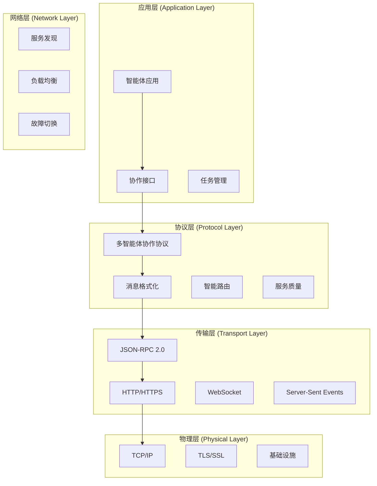

# 通信协议 (Communication Protocol)

## 🎯 协议概览

本通信协议为多智能体社会提供高效、可靠、安全的通信基础设施。协议融合了 MCP 和 A2A 的优势，同时引入了适合智能体社会的创新通信机制。

## 🏗️ 协议架构



## 📝 消息格式规范

### 1. 基础消息结构

基于 JSON-RPC 2.0 扩展的多智能体消息格式：

```json
{
  "jsonrpc": "2.0",
  "id": "unique-message-id",
  "method": "agent.collaboration.method",
  "params": {
    "sender": {
      "agent_id": "agent-001",
      "agent_type": "specialist",
      "capabilities": ["data_analysis", "visualization"],
      "reputation_score": 0.85,
      "current_load": 0.3
    },
    "recipients": {
      "type": "direct|broadcast|multicast|group",
      "targets": ["agent-002", "agent-003"],
      "criteria": {
        "expertise": ["machine_learning"],
        "availability": "> 0.5",
        "trust_level": "> 0.7"
      }
    },
    "message": {
      "type": "collaboration_request|task_assignment|knowledge_share|consensus_vote",
      "priority": "high|medium|low",
      "urgency": 0.8,
      "content": "消息内容",
      "metadata": {
        "context_id": "conversation-123",
        "task_id": "task-456",
        "thread_id": "thread-789",
        "topic": "data_analysis",
        "language": "zh-CN",
        "encryption": "AES-256"
      }
    },
    "collaboration": {
      "mode": "synchronous|asynchronous|hybrid",
      "timeout": 30000,
      "retry_policy": {
        "max_retries": 3,
        "backoff": "exponential",
        "base_delay": 1000
      },
      "consensus_required": true,
      "quorum": 0.6
    },
    "context": {
      "conversation_history": "最近对话摘要",
      "shared_memory_refs": ["memory-001", "memory-002"],
      "relevant_agents": ["agent-004", "agent-005"],
      "environmental_factors": {
        "system_load": 0.4,
        "network_latency": 50,
        "time_of_day": "peak_hours"
      }
    }
  },
  "timestamp": "2024-01-20T10:30:00.000Z",
  "ttl": 300000,
  "signature": "digital-signature-hash"
}
```

### 2. 响应消息格式

```json
{
  "jsonrpc": "2.0",
  "id": "unique-message-id",
  "result": {
    "status": "success|error|partial|pending",
    "response": {
      "content": "响应内容",
      "confidence": 0.9,
      "reasoning": "推理过程说明",
      "alternatives": ["备选方案1", "备选方案2"],
      "resource_cost": {
        "computation": 0.3,
        "memory": 0.2,
        "time": 5000
      }
    },
    "collaboration_state": {
      "participation_level": 0.8,
      "contribution_quality": 0.9,
      "consensus_reached": false,
      "next_actions": ["action1", "action2"]
    },
    "metadata": {
      "processing_time": 2500,
      "model_used": "gpt-4",
      "tools_used": ["web_search", "calculator"],
      "memory_updated": ["memory-001"],
      "side_effects": []
    }
  },
  "timestamp": "2024-01-20T10:30:05.000Z"
}
```

## 🔄 通信模式

### 1. 点对点通信 (Peer-to-Peer)

```python
class P2PCommunication:
    """
    点对点通信 - 直接的智能体间通信
    """

    async def send_direct_message(self, sender_id: str, receiver_id: str,
                                 message: AgentMessage) -> MessageResult:
        """
        发送直接消息
        """
        # 1. 验证发送者和接收者
        sender = await self.agent_registry.get_agent(sender_id)
        receiver = await self.agent_registry.get_agent(receiver_id)

        if not sender or not receiver:
            raise AgentNotFoundError("Invalid sender or receiver")

        # 2. 检查通信权限
        permission_check = await self.permission_manager.check_communication_permission(
            sender, receiver, message.type
        )

        if not permission_check.allowed:
            raise PermissionDeniedError(permission_check.reason)

        # 3. 加密消息内容
        encrypted_message = await self.encryption_service.encrypt_message(
            message, receiver.public_key
        )

        # 4. 路由消息
        delivery_result = await self.message_router.route_message(
            sender_id, receiver_id, encrypted_message
        )

        # 5. 记录通信日志
        await self.communication_logger.log_interaction(
            sender_id, receiver_id, message.type, delivery_result.status
        )

        return MessageResult(
            message_id=message.id,
            delivery_status=delivery_result.status,
            delivery_time=delivery_result.timestamp,
            acknowledgment=delivery_result.acknowledgment
        )

    async def establish_secure_channel(self, agent_a: str, agent_b: str) -> SecureChannel:
        """
        建立安全通信通道
        """
        # 1. 密钥交换
        key_exchange = await self.crypto_service.perform_key_exchange(agent_a, agent_b)

        # 2. 创建加密通道
        channel = SecureChannel(
            participants=[agent_a, agent_b],
            session_key=key_exchange.session_key,
            channel_id=generate_uuid(),
            created_at=datetime.utcnow(),
            ttl=timedelta(hours=24)
        )

        # 3. 注册通道
        await self.channel_registry.register_channel(channel)

        return channel
```

### 2. 群组通信 (Group Communication)

```python
class GroupCommunication:
    """
    群组通信 - 多智能体群组内的通信
    """

    def __init__(self):
        self.group_manager = GroupManager()
        self.consensus_engine = ConsensusEngine()
        self.broadcast_service = BroadcastService()

    async def create_communication_group(self, initiator_id: str,
                                       group_config: GroupConfig) -> CommunicationGroup:
        """
        创建通信群组
        """
        group = CommunicationGroup(
            id=generate_uuid(),
            name=group_config.name,
            description=group_config.description,
            initiator=initiator_id,
            members=[],
            communication_rules=group_config.rules,
            consensus_mechanism=group_config.consensus_mechanism,
            created_at=datetime.utcnow()
        )

        # 邀请初始成员
        for member_id in group_config.initial_members:
            invitation_result = await self._invite_member(group, member_id)
            if invitation_result.accepted:
                group.members.append(member_id)

        await self.group_manager.register_group(group)
        return group

    async def broadcast_to_group(self, sender_id: str, group_id: str,
                               message: GroupMessage) -> BroadcastResult:
        """
        向群组广播消息
        """
        group = await self.group_manager.get_group(group_id)

        # 检查发送权限
        if sender_id not in group.members:
            raise NotGroupMemberError("Sender is not a group member")

        # 检查消息类型权限
        permission_check = await self._check_broadcast_permission(sender_id, group, message)
        if not permission_check.allowed:
            raise PermissionDeniedError(permission_check.reason)

        # 执行广播
        delivery_results = {}

        for member_id in group.members:
            if member_id != sender_id:  # 不发送给自己
                try:
                    result = await self.broadcast_service.deliver_message(
                        sender_id, member_id, message
                    )
                    delivery_results[member_id] = result
                except Exception as e:
                    delivery_results[member_id] = DeliveryResult(
                        status="failed",
                        error=str(e)
                    )

        # 记录群组活动
        await self.group_manager.log_group_activity(
            group_id, GroupActivity(
                type="broadcast",
                initiator=sender_id,
                message_type=message.type,
                participants=list(delivery_results.keys()),
                timestamp=datetime.utcnow()
            )
        )

        return BroadcastResult(
            group_id=group_id,
            message_id=message.id,
            total_recipients=len(group.members) - 1,
            successful_deliveries=len([r for r in delivery_results.values() if r.status == "success"]),
            failed_deliveries=len([r for r in delivery_results.values() if r.status == "failed"]),
            delivery_details=delivery_results
        )

    async def initiate_group_consensus(self, initiator_id: str, group_id: str,
                                     consensus_request: ConsensusRequest) -> ConsensusSession:
        """
        发起群组共识
        """
        group = await self.group_manager.get_group(group_id)

        # 创建共识会话
        session = ConsensusSession(
            id=generate_uuid(),
            group_id=group_id,
            initiator=initiator_id,
            request=consensus_request,
            mechanism=group.consensus_mechanism,
            participants=group.members.copy(),
            status="initiated",
            created_at=datetime.utcnow(),
            deadline=datetime.utcnow() + timedelta(minutes=consensus_request.timeout_minutes)
        )

        # 向群组成员发送共识请求
        consensus_message = GroupMessage(
            type="consensus_request",
            content=consensus_request.content,
            metadata={
                "session_id": session.id,
                "deadline": session.deadline.isoformat(),
                "mechanism": group.consensus_mechanism
            }
        )

        broadcast_result = await self.broadcast_to_group(
            initiator_id, group_id, consensus_message
        )

        # 注册共识会话
        await self.consensus_engine.register_session(session)

        return session
```

### 3. 发布-订阅通信 (Publish-Subscribe)

```python
class PubSubCommunication:
    """
    发布-订阅通信 - 基于主题的异步通信
    """

    def __init__(self):
        self.topic_manager = TopicManager()
        self.subscription_manager = SubscriptionManager()
        self.message_broker = MessageBroker()

    async def create_topic(self, creator_id: str, topic_config: TopicConfig) -> Topic:
        """
        创建通信主题
        """
        topic = Topic(
            id=generate_uuid(),
            name=topic_config.name,
            description=topic_config.description,
            creator=creator_id,
            category=topic_config.category,
            access_policy=topic_config.access_policy,
            message_retention=topic_config.retention_policy,
            quality_of_service=topic_config.qos,
            created_at=datetime.utcnow()
        )

        await self.topic_manager.register_topic(topic)

        # 创建者自动订阅
        await self.subscribe_to_topic(creator_id, topic.id)

        return topic

    async def subscribe_to_topic(self, agent_id: str, topic_id: str,
                               subscription_config: SubscriptionConfig = None) -> Subscription:
        """
        订阅主题
        """
        topic = await self.topic_manager.get_topic(topic_id)

        # 检查访问权限
        access_check = await self._check_topic_access(agent_id, topic)
        if not access_check.allowed:
            raise AccessDeniedError(access_check.reason)

        subscription = Subscription(
            id=generate_uuid(),
            agent_id=agent_id,
            topic_id=topic_id,
            subscription_config=subscription_config or SubscriptionConfig(),
            created_at=datetime.utcnow(),
            status="active"
        )

        await self.subscription_manager.add_subscription(subscription)

        # 通知主题创建者
        if topic.creator != agent_id:
            await self._notify_topic_creator(topic.creator, {
                "type": "new_subscriber",
                "topic_id": topic_id,
                "subscriber_id": agent_id
            })

        return subscription

    async def publish_message(self, publisher_id: str, topic_id: str,
                            message: TopicMessage) -> PublishResult:
        """
        发布消息到主题
        """
        topic = await self.topic_manager.get_topic(topic_id)

        # 检查发布权限
        publish_check = await self._check_publish_permission(publisher_id, topic, message)
        if not publish_check.allowed:
            raise PermissionDeniedError(publish_check.reason)

        # 获取订阅者列表
        subscribers = await self.subscription_manager.get_topic_subscribers(topic_id)

        # 过滤订阅者（基于订阅配置）
        filtered_subscribers = await self._filter_subscribers(subscribers, message)

        # 发布消息
        delivery_results = {}

        for subscription in filtered_subscribers:
            try:
                # 应用订阅配置（消息过滤、转换等）
                transformed_message = await self._transform_message_for_subscriber(
                    message, subscription
                )

                # 异步投递消息
                delivery_task = asyncio.create_task(
                    self.message_broker.deliver_message(
                        publisher_id, subscription.agent_id, transformed_message
                    )
                )

                delivery_results[subscription.agent_id] = delivery_task

            except Exception as e:
                delivery_results[subscription.agent_id] = asyncio.create_task(
                    self._create_failed_result(str(e))
                )

        # 等待所有投递完成
        completed_results = {}
        for agent_id, task in delivery_results.items():
            completed_results[agent_id] = await task

        # 更新主题统计
        await self.topic_manager.update_topic_stats(topic_id, {
            "messages_published": 1,
            "last_activity": datetime.utcnow()
        })

        return PublishResult(
            topic_id=topic_id,
            message_id=message.id,
            publisher_id=publisher_id,
            total_subscribers=len(filtered_subscribers),
            successful_deliveries=len([r for r in completed_results.values() if r.status == "success"]),
            failed_deliveries=len([r for r in completed_results.values() if r.status == "failed"]),
            delivery_details=completed_results
        )
```

## 🛡️ 安全机制

### 1. 身份认证与授权

```python
class SecurityManager:
    """
    安全管理器 - 处理身份认证、授权和加密
    """

    def __init__(self):
        self.auth_service = AuthenticationService()
        self.authz_service = AuthorizationService()
        self.crypto_service = CryptographyService()
        self.key_manager = KeyManager()

    async def authenticate_agent(self, agent_credentials: AgentCredentials) -> AuthToken:
        """
        智能体身份认证
        """
        # 1. 验证证书链
        cert_validation = await self.auth_service.validate_certificate_chain(
            agent_credentials.certificate_chain
        )

        if not cert_validation.valid:
            raise AuthenticationError(f"Invalid certificate: {cert_validation.error}")

        # 2. 验证签名
        signature_validation = await self.auth_service.verify_signature(
            agent_credentials.challenge_response,
            agent_credentials.signature,
            cert_validation.public_key
        )

        if not signature_validation.valid:
            raise AuthenticationError("Invalid signature")

        # 3. 检查智能体状态
        agent_status = await self.auth_service.check_agent_status(
            agent_credentials.agent_id
        )

        if agent_status.status != "active":
            raise AuthenticationError(f"Agent status: {agent_status.status}")

        # 4. 生成访问令牌
        token = await self.auth_service.generate_access_token(
            agent_id=agent_credentials.agent_id,
            capabilities=agent_status.capabilities,
            ttl=timedelta(hours=24)
        )

        return token

    async def authorize_communication(self, sender_token: AuthToken,
                                    receiver_id: str,
                                    message_type: str) -> AuthorizationResult:
        """
        通信授权检查
        """
        # 1. 验证令牌
        token_validation = await self.auth_service.validate_token(sender_token)
        if not token_validation.valid:
            return AuthorizationResult(
                allowed=False,
                reason="Invalid or expired token"
            )

        # 2. 获取授权策略
        policy = await self.authz_service.get_communication_policy(
            sender_token.agent_id, receiver_id, message_type
        )

        # 3. 评估权限
        permission_result = await self.authz_service.evaluate_permission(
            sender_token, policy
        )

        return permission_result
```

### 2. 端到端加密

```python
class E2EEncryption:
    """
    端到端加密 - 确保消息传输安全
    """

    async def encrypt_message(self, message: AgentMessage,
                            recipient_public_key: str) -> EncryptedMessage:
        """
        加密消息
        """
        # 1. 生成随机对称密钥
        symmetric_key = await self.crypto_service.generate_symmetric_key()

        # 2. 使用对称密钥加密消息内容
        encrypted_content = await self.crypto_service.symmetric_encrypt(
            json.dumps(message.to_dict()), symmetric_key
        )

        # 3. 使用接收者公钥加密对称密钥
        encrypted_key = await self.crypto_service.asymmetric_encrypt(
            symmetric_key, recipient_public_key
        )

        # 4. 计算消息摘要
        message_hash = await self.crypto_service.calculate_hash(
            encrypted_content
        )

        # 5. 构造加密消息
        encrypted_message = EncryptedMessage(
            encrypted_content=encrypted_content,
            encrypted_key=encrypted_key,
            message_hash=message_hash,
            encryption_algorithm="AES-256-GCM",
            key_algorithm="RSA-OAEP",
            timestamp=datetime.utcnow()
        )

        return encrypted_message

    async def decrypt_message(self, encrypted_message: EncryptedMessage,
                            recipient_private_key: str) -> AgentMessage:
        """
        解密消息
        """
        # 1. 使用私钥解密对称密钥
        symmetric_key = await self.crypto_service.asymmetric_decrypt(
            encrypted_message.encrypted_key, recipient_private_key
        )

        # 2. 验证消息完整性
        calculated_hash = await self.crypto_service.calculate_hash(
            encrypted_message.encrypted_content
        )

        if calculated_hash != encrypted_message.message_hash:
            raise IntegrityError("Message integrity check failed")

        # 3. 使用对称密钥解密消息内容
        decrypted_content = await self.crypto_service.symmetric_decrypt(
            encrypted_message.encrypted_content, symmetric_key
        )

        # 4. 反序列化消息
        message_dict = json.loads(decrypted_content)
        message = AgentMessage.from_dict(message_dict)

        return message
```

## 📊 服务质量 (Quality of Service)

### 1. 消息优先级和路由

```python
class QoSManager:
    """
    服务质量管理器 - 管理消息优先级、路由和性能
    """

    def __init__(self):
        self.priority_queue = PriorityQueue()
        self.bandwidth_manager = BandwidthManager()
        self.latency_monitor = LatencyMonitor()
        self.congestion_controller = CongestionController()

    async def enqueue_message(self, message: AgentMessage,
                            priority: MessagePriority) -> QueueResult:
        """
        将消息加入优先级队列
        """
        # 1. 计算消息优先级分数
        priority_score = await self._calculate_priority_score(message, priority)

        # 2. 检查队列容量
        if self.priority_queue.size() >= self.max_queue_size:
            # 如果队列满了，根据策略处理
            handling_result = await self._handle_queue_overflow(message, priority_score)
            if not handling_result.success:
                return QueueResult(
                    success=False,
                    reason="Queue overflow",
                    dropped_messages=handling_result.dropped_messages
                )

        # 3. 加入队列
        queue_item = QueueItem(
            message=message,
            priority_score=priority_score,
            enqueue_time=datetime.utcnow(),
            retry_count=0
        )

        await self.priority_queue.enqueue(queue_item)

        # 4. 触发消息处理
        asyncio.create_task(self._process_message_queue())

        return QueueResult(
            success=True,
            queue_position=self.priority_queue.size(),
            estimated_delay=await self._estimate_processing_delay()
        )

    async def _calculate_priority_score(self, message: AgentMessage,
                                      priority: MessagePriority) -> float:
        """
        计算消息优先级分数
        """
        base_score = priority.base_score

        # 紧急度加权
        urgency_weight = message.metadata.get("urgency", 0.5)

        # 发送者声誉加权
        sender_reputation = await self._get_agent_reputation(message.sender.agent_id)

        # 消息类型加权
        type_weight = self._get_message_type_weight(message.type)

        # 时间衰减因子
        age_factor = self._calculate_age_factor(message.timestamp)

        priority_score = (
            base_score * 0.4 +
            urgency_weight * 0.3 +
            sender_reputation * 0.2 +
            type_weight * 0.1
        ) * age_factor

        return min(1.0, max(0.0, priority_score))
```

### 2. 负载均衡和故障转移

```python
class LoadBalancer:
    """
    负载均衡器 - 智能分发消息和管理智能体负载
    """

    def __init__(self):
        self.agent_monitor = AgentMonitor()
        self.health_checker = HealthChecker()
        self.routing_algorithm = AdaptiveRoutingAlgorithm()

    async def route_message(self, message: AgentMessage) -> RoutingResult:
        """
        智能路由消息
        """
        # 1. 获取可用的目标智能体
        target_agents = await self._resolve_target_agents(message.recipients)

        # 2. 过滤健康的智能体
        healthy_agents = []
        for agent_id in target_agents:
            health_status = await self.health_checker.check_agent_health(agent_id)
            if health_status.is_healthy:
                healthy_agents.append(agent_id)

        if not healthy_agents:
            return RoutingResult(
                success=False,
                reason="No healthy target agents available"
            )

        # 3. 获取智能体负载信息
        agent_loads = {}
        for agent_id in healthy_agents:
            load_info = await self.agent_monitor.get_agent_load(agent_id)
            agent_loads[agent_id] = load_info

        # 4. 选择最优路由
        optimal_routing = await self.routing_algorithm.select_optimal_routing(
            message, agent_loads
        )

        # 5. 执行消息投递
        delivery_results = {}
        for agent_id, delivery_plan in optimal_routing.delivery_plans.items():
            try:
                result = await self._deliver_to_agent(agent_id, message, delivery_plan)
                delivery_results[agent_id] = result
            except Exception as e:
                # 故障转移处理
                fallback_result = await self._handle_delivery_failure(
                    agent_id, message, e
                )
                delivery_results[agent_id] = fallback_result

        return RoutingResult(
            success=True,
            delivery_results=delivery_results,
            routing_strategy=optimal_routing.strategy,
            total_latency=optimal_routing.estimated_latency
        )

    async def _handle_delivery_failure(self, failed_agent_id: str,
                                     message: AgentMessage,
                                     error: Exception) -> DeliveryResult:
        """
        处理投递失败的故障转移
        """
        # 1. 记录故障
        await self.health_checker.report_agent_failure(failed_agent_id, error)

        # 2. 寻找备用智能体
        backup_agents = await self._find_backup_agents(
            failed_agent_id, message.recipients.criteria
        )

        if not backup_agents:
            return DeliveryResult(
                status="failed",
                error=f"No backup agents available for {failed_agent_id}",
                original_error=str(error)
            )

        # 3. 选择最佳备用智能体
        best_backup = await self._select_best_backup(backup_agents, message)

        # 4. 重新投递
        try:
            backup_result = await self._deliver_to_agent(best_backup, message)
            backup_result.is_fallback = True
            backup_result.original_target = failed_agent_id
            return backup_result
        except Exception as backup_error:
            return DeliveryResult(
                status="failed",
                error=f"Backup delivery also failed: {str(backup_error)}",
                original_error=str(error),
                backup_error=str(backup_error)
            )
```

## 📈 性能监控和优化

### 1. 通信性能监控

```python
class CommunicationMonitor:
    """
    通信性能监控 - 监控和分析通信性能指标
    """

    def __init__(self):
        self.metrics_collector = MetricsCollector()
        self.performance_analyzer = PerformanceAnalyzer()
        self.alert_manager = AlertManager()

    async def monitor_communication_performance(self) -> MonitoringSession:
        """
        启动通信性能监控
        """
        session = MonitoringSession(
            id=generate_uuid(),
            start_time=datetime.utcnow(),
            metrics_config=self.default_metrics_config
        )

        # 启动实时监控任务
        monitoring_tasks = [
            asyncio.create_task(self._monitor_message_latency(session)),
            asyncio.create_task(self._monitor_throughput(session)),
            asyncio.create_task(self._monitor_error_rates(session)),
            asyncio.create_task(self._monitor_queue_performance(session)),
            asyncio.create_task(self._monitor_agent_availability(session))
        ]

        session.monitoring_tasks = monitoring_tasks

        return session

    async def _monitor_message_latency(self, session: MonitoringSession):
        """
        监控消息延迟
        """
        while session.is_active:
            # 收集延迟数据
            latency_data = await self.metrics_collector.collect_latency_metrics()

            # 分析延迟趋势
            analysis = await self.performance_analyzer.analyze_latency_trends(
                latency_data
            )

            # 检查延迟阈值
            if analysis.average_latency > self.latency_threshold:
                alert = Alert(
                    type="high_latency",
                    severity="warning",
                    message=f"Average latency ({analysis.average_latency}ms) exceeds threshold",
                    timestamp=datetime.utcnow(),
                    metrics=analysis
                )
                await self.alert_manager.send_alert(alert)

            # 更新会话统计
            session.add_latency_measurement(analysis)

            await asyncio.sleep(self.monitoring_interval)

    async def generate_performance_report(self, time_range: TimeRange) -> PerformanceReport:
        """
        生成性能报告
        """
        # 收集性能数据
        performance_data = await self.metrics_collector.collect_performance_data(
            time_range
        )

        # 分析性能趋势
        trends = await self.performance_analyzer.analyze_trends(performance_data)

        # 识别性能瓶颈
        bottlenecks = await self.performance_analyzer.identify_bottlenecks(
            performance_data
        )

        # 生成优化建议
        optimizations = await self._generate_optimization_recommendations(
            trends, bottlenecks
        )

        return PerformanceReport(
            time_range=time_range,
            performance_data=performance_data,
            trends=trends,
            bottlenecks=bottlenecks,
            optimization_recommendations=optimizations,
            generated_at=datetime.utcnow()
        )
```

---

这个通信协议为多智能体系统提供了完整的通信基础设施，支持各种通信模式、安全机制和性能优化。协议设计考虑了可扩展性、可靠性和安全性，为构建大规模多智能体系统奠定了坚实基础。
