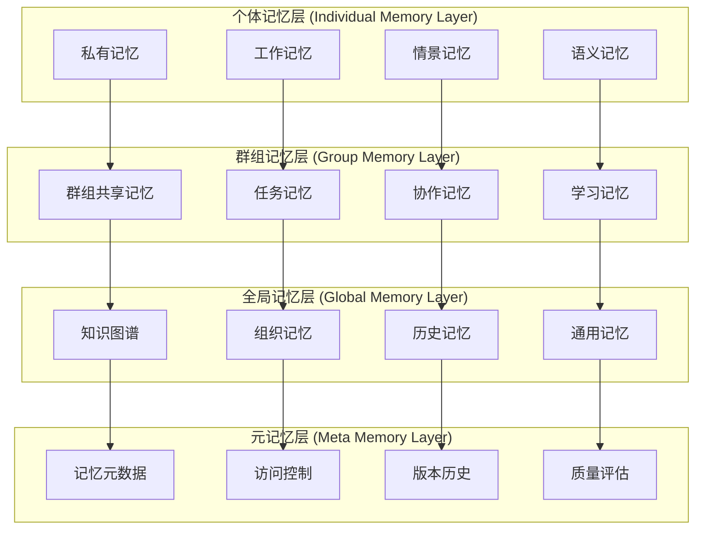

# 记忆共享系统 (Memory Sharing System)

## 🎯 系统概览

记忆共享系统是多智能体协作的核心组件，实现智能体间的知识共享、经验传递和集体学习。系统设计基于分层记忆架构，支持细粒度访问控制、智能记忆推荐和自动知识图谱构建。

## 🧠 记忆架构设计

### 1. 分层记忆模型



### 2. 记忆对象模型

```python
from dataclasses import dataclass, field
from typing import Dict, List, Optional, Any, Set
from datetime import datetime
from enum import Enum
import uuid

class MemoryType(Enum):
    EPISODIC = "episodic"        # 情景记忆
    SEMANTIC = "semantic"        # 语义记忆
    PROCEDURAL = "procedural"    # 程序记忆
    WORKING = "working"          # 工作记忆
    LONG_TERM = "long_term"      # 长期记忆

class AccessLevel(Enum):
    PRIVATE = "private"          # 私有访问
    GROUP = "group"             # 群组访问
    PUBLIC = "public"           # 公共访问
    RESTRICTED = "restricted"    # 受限访问

class MemoryQuality(Enum):
    HIGH = "high"               # 高质量
    MEDIUM = "medium"           # 中等质量
    LOW = "low"                # 低质量
    UNVERIFIED = "unverified"  # 未验证

@dataclass
class MemoryObject:
    """
    记忆对象 - 基础记忆单元
    """
    id: str = field(default_factory=lambda: str(uuid.uuid4()))

    # 基础属性
    content: str = ""
    title: str = ""
    description: str = ""
    memory_type: MemoryType = MemoryType.SEMANTIC

    # 创建信息
    creator_id: str = ""
    created_at: datetime = field(default_factory=datetime.utcnow)
    source: str = ""  # 记忆来源

    # 访问控制
    access_level: AccessLevel = AccessLevel.PRIVATE
    owner_id: str = ""
    authorized_agents: Set[str] = field(default_factory=set)
    authorized_groups: Set[str] = field(default_factory=set)

    # 内容结构
    tags: Set[str] = field(default_factory=set)
    keywords: Set[str] = field(default_factory=set)
    entities: List[Dict[str, Any]] = field(default_factory=list)
    relationships: List[Dict[str, Any]] = field(default_factory=list)

    # 质量和信任度
    quality: MemoryQuality = MemoryQuality.UNVERIFIED
    confidence_score: float = 0.5
    verification_count: int = 0
    trust_score: float = 0.5

    # 使用统计
    access_count: int = 0
    reference_count: int = 0
    last_accessed: Optional[datetime] = None

    # 版本控制
    version: str = "1.0.0"
    previous_versions: List[str] = field(default_factory=list)

    # 关联关系
    related_memories: Set[str] = field(default_factory=set)
    derived_from: Optional[str] = None
    superseded_by: Optional[str] = None

    # 元数据
    metadata: Dict[str, Any] = field(default_factory=dict)

    def to_dict(self) -> Dict[str, Any]:
        """转换为字典格式"""
        return {
            "id": self.id,
            "content": self.content,
            "title": self.title,
            "description": self.description,
            "memory_type": self.memory_type.value,
            "creator_id": self.creator_id,
            "created_at": self.created_at.isoformat(),
            "source": self.source,
            "access_level": self.access_level.value,
            "owner_id": self.owner_id,
            "authorized_agents": list(self.authorized_agents),
            "authorized_groups": list(self.authorized_groups),
            "tags": list(self.tags),
            "keywords": list(self.keywords),
            "entities": self.entities,
            "relationships": self.relationships,
            "quality": self.quality.value,
            "confidence_score": self.confidence_score,
            "verification_count": self.verification_count,
            "trust_score": self.trust_score,
            "access_count": self.access_count,
            "reference_count": self.reference_count,
            "last_accessed": self.last_accessed.isoformat() if self.last_accessed else None,
            "version": self.version,
            "previous_versions": self.previous_versions,
            "related_memories": list(self.related_memories),
            "derived_from": self.derived_from,
            "superseded_by": self.superseded_by,
            "metadata": self.metadata
        }

    @classmethod
    def from_dict(cls, data: Dict[str, Any]) -> 'MemoryObject':
        """从字典创建记忆对象"""
        memory = cls()
        memory.id = data.get("id", str(uuid.uuid4()))
        memory.content = data.get("content", "")
        memory.title = data.get("title", "")
        memory.description = data.get("description", "")
        memory.memory_type = MemoryType(data.get("memory_type", "semantic"))
        memory.creator_id = data.get("creator_id", "")
        memory.created_at = datetime.fromisoformat(data.get("created_at", datetime.utcnow().isoformat()))
        memory.source = data.get("source", "")
        memory.access_level = AccessLevel(data.get("access_level", "private"))
        memory.owner_id = data.get("owner_id", "")
        memory.authorized_agents = set(data.get("authorized_agents", []))
        memory.authorized_groups = set(data.get("authorized_groups", []))
        memory.tags = set(data.get("tags", []))
        memory.keywords = set(data.get("keywords", []))
        memory.entities = data.get("entities", [])
        memory.relationships = data.get("relationships", [])
        memory.quality = MemoryQuality(data.get("quality", "unverified"))
        memory.confidence_score = data.get("confidence_score", 0.5)
        memory.verification_count = data.get("verification_count", 0)
        memory.trust_score = data.get("trust_score", 0.5)
        memory.access_count = data.get("access_count", 0)
        memory.reference_count = data.get("reference_count", 0)
        memory.last_accessed = datetime.fromisoformat(data["last_accessed"]) if data.get("last_accessed") else None
        memory.version = data.get("version", "1.0.0")
        memory.previous_versions = data.get("previous_versions", [])
        memory.related_memories = set(data.get("related_memories", []))
        memory.derived_from = data.get("derived_from")
        memory.superseded_by = data.get("superseded_by")
        memory.metadata = data.get("metadata", {})

        return memory
```

## 🔄 记忆共享机制

### 1. 智能记忆推荐系统

```python
class MemoryRecommendationEngine:
    """
    记忆推荐引擎 - 智能推荐相关记忆给智能体
    """

    def __init__(self):
        self.similarity_calculator = MemorySimilarityCalculator()
        self.relevance_scorer = MemoryRelevanceScorer()
        self.context_analyzer = ContextAnalyzer()
        self.collaborative_filter = CollaborativeFilter()

    async def recommend_memories(self,
                               agent_id: str,
                               current_context: Dict[str, Any],
                               limit: int = 10) -> List[MemoryRecommendation]:
        """
        为智能体推荐相关记忆
        """
        # 1. 分析当前上下文
        context_features = await self.context_analyzer.extract_features(current_context)

        # 2. 获取候选记忆集合
        candidate_memories = await self._get_candidate_memories(agent_id, context_features)

        # 3. 计算记忆相关性
        relevance_scores = {}
        for memory in candidate_memories:
            relevance_score = await self.relevance_scorer.calculate_relevance(
                memory, context_features, agent_id
            )
            relevance_scores[memory.id] = relevance_score

        # 4. 协同过滤增强
        collaborative_scores = await self.collaborative_filter.enhance_scores(
            agent_id, relevance_scores
        )

        # 5. 多样性优化
        diversified_recommendations = await self._diversify_recommendations(
            candidate_memories, collaborative_scores
        )

        # 6. 生成推荐列表
        recommendations = []
        for memory in diversified_recommendations[:limit]:
            recommendation = MemoryRecommendation(
                memory=memory,
                relevance_score=collaborative_scores[memory.id],
                recommendation_reason=await self._generate_recommendation_reason(
                    memory, context_features
                ),
                confidence=await self._calculate_recommendation_confidence(
                    memory, context_features, agent_id
                )
            )
            recommendations.append(recommendation)

        return recommendations

    async def _get_candidate_memories(self,
                                    agent_id: str,
                                    context_features: ContextFeatures) -> List[MemoryObject]:
        """
        获取候选记忆集合
        """
        candidates = []

        # 1. 基于访问权限过滤
        accessible_memories = await self._get_accessible_memories(agent_id)

        # 2. 基于关键词匹配
        keyword_matches = await self._find_keyword_matches(
            accessible_memories, context_features.keywords
        )
        candidates.extend(keyword_matches)

        # 3. 基于实体匹配
        entity_matches = await self._find_entity_matches(
            accessible_memories, context_features.entities
        )
        candidates.extend(entity_matches)

        # 4. 基于语义相似度
        semantic_matches = await self._find_semantic_matches(
            accessible_memories, context_features.content_embedding
        )
        candidates.extend(semantic_matches)

        # 5. 去重并返回
        unique_candidates = list({memory.id: memory for memory in candidates}.values())

        return unique_candidates

class MemorySimilarityCalculator:
    """
    记忆相似度计算器
    """

    def __init__(self):
        self.embedding_model = EmbeddingModel()
        self.graph_analyzer = GraphAnalyzer()

    async def calculate_similarity(self,
                                 memory_a: MemoryObject,
                                 memory_b: MemoryObject) -> float:
        """
        计算两个记忆之间的相似度
        """
        # 1. 内容相似度（语义嵌入）
        content_similarity = await self._calculate_content_similarity(memory_a, memory_b)

        # 2. 结构相似度（实体和关系）
        structure_similarity = await self._calculate_structure_similarity(memory_a, memory_b)

        # 3. 标签相似度
        tag_similarity = self._calculate_tag_similarity(memory_a, memory_b)

        # 4. 时间相似度
        temporal_similarity = self._calculate_temporal_similarity(memory_a, memory_b)

        # 5. 加权平均
        overall_similarity = (
            content_similarity * 0.4 +
            structure_similarity * 0.3 +
            tag_similarity * 0.2 +
            temporal_similarity * 0.1
        )

        return overall_similarity

    async def _calculate_content_similarity(self,
                                          memory_a: MemoryObject,
                                          memory_b: MemoryObject) -> float:
        """
        计算内容语义相似度
        """
        # 获取内容嵌入向量
        embedding_a = await self.embedding_model.encode(memory_a.content)
        embedding_b = await self.embedding_model.encode(memory_b.content)

        # 计算余弦相似度
        similarity = self._cosine_similarity(embedding_a, embedding_b)

        return similarity

    def _calculate_tag_similarity(self,
                                memory_a: MemoryObject,
                                memory_b: MemoryObject) -> float:
        """
        计算标签相似度（Jaccard相似度）
        """
        tags_a = memory_a.tags
        tags_b = memory_b.tags

        if not tags_a and not tags_b:
            return 1.0

        intersection = len(tags_a.intersection(tags_b))
        union = len(tags_a.union(tags_b))

        return intersection / union if union > 0 else 0.0
```

### 2. 记忆版本控制和同步

```python
class MemoryVersionControl:
    """
    记忆版本控制系统 - 管理记忆的版本和变更
    """

    def __init__(self):
        self.version_store = VersionStore()
        self.diff_calculator = MemoryDiffCalculator()
        self.merge_resolver = MemoryMergeResolver()
        self.conflict_detector = MemoryConflictDetector()

    async def create_memory_version(self,
                                  memory: MemoryObject,
                                  changes: Dict[str, Any],
                                  change_reason: str) -> MemoryVersion:
        """
        创建记忆新版本
        """
        # 1. 生成版本号
        new_version = self._generate_version_number(memory.version)

        # 2. 计算变更差异
        diff = await self.diff_calculator.calculate_diff(memory, changes)

        # 3. 创建版本记录
        version = MemoryVersion(
            memory_id=memory.id,
            version_number=new_version,
            previous_version=memory.version,
            changes=changes,
            diff=diff,
            change_reason=change_reason,
            changed_by=changes.get("changed_by", "unknown"),
            changed_at=datetime.utcnow(),
            checksum=await self._calculate_checksum(memory, changes)
        )

        # 4. 保存版本记录
        await self.version_store.save_version(version)

        # 5. 更新记忆对象
        memory.previous_versions.append(memory.version)
        memory.version = new_version

        # 应用变更
        for field, value in changes.items():
            if hasattr(memory, field):
                setattr(memory, field, value)

        return version

    async def merge_memory_versions(self,
                                  base_memory: MemoryObject,
                                  version_a: MemoryVersion,
                                  version_b: MemoryVersion) -> MemoryMergeResult:
        """
        合并记忆版本（三方合并）
        """
        # 1. 检测冲突
        conflicts = await self.conflict_detector.detect_conflicts(
            base_memory, version_a, version_b
        )

        if conflicts:
            # 存在冲突，需要人工或智能解决
            resolution_suggestions = await self.merge_resolver.suggest_conflict_resolutions(
                conflicts
            )

            return MemoryMergeResult(
                success=False,
                conflicts=conflicts,
                resolution_suggestions=resolution_suggestions,
                requires_manual_resolution=True
            )

        # 2. 自动合并
        merged_changes = await self.merge_resolver.auto_merge(
            base_memory, version_a, version_b
        )

        # 3. 创建合并版本
        merge_version = await self.create_memory_version(
            base_memory,
            merged_changes,
            f"Merged versions {version_a.version_number} and {version_b.version_number}"
        )

        return MemoryMergeResult(
            success=True,
            merged_version=merge_version,
            merged_memory=base_memory,
            conflicts=[],
            resolution_suggestions=[]
        )

    async def synchronize_memory_across_agents(self,
                                             memory_id: str,
                                             target_agents: List[str]) -> SyncResult:
        """
        在智能体间同步记忆
        """
        sync_results = {}

        # 1. 获取源记忆
        source_memory = await self.memory_store.get_memory(memory_id)
        if not source_memory:
            return SyncResult(
                success=False,
                error="Source memory not found"
            )

        # 2. 检查同步权限
        sync_permissions = await self._check_sync_permissions(
            source_memory, target_agents
        )

        for agent_id in target_agents:
            try:
                # 检查权限
                if not sync_permissions.get(agent_id, False):
                    sync_results[agent_id] = AgentSyncResult(
                        success=False,
                        error="Insufficient permissions"
                    )
                    continue

                # 获取目标智能体的记忆版本
                target_memory = await self._get_agent_memory_version(agent_id, memory_id)

                if not target_memory:
                    # 目标智能体没有这个记忆，直接复制
                    await self._copy_memory_to_agent(agent_id, source_memory)
                    sync_results[agent_id] = AgentSyncResult(
                        success=True,
                        action="copied",
                        new_version=source_memory.version
                    )
                else:
                    # 需要版本合并
                    merge_result = await self._merge_agent_memory_version(
                        agent_id, target_memory, source_memory
                    )
                    sync_results[agent_id] = AgentSyncResult(
                        success=merge_result.success,
                        action="merged" if merge_result.success else "conflict",
                        new_version=merge_result.merged_version.version_number if merge_result.success else None,
                        conflicts=merge_result.conflicts
                    )

            except Exception as e:
                sync_results[agent_id] = AgentSyncResult(
                    success=False,
                    error=str(e)
                )

        return SyncResult(
            success=all(result.success for result in sync_results.values()),
            agent_results=sync_results,
            total_agents=len(target_agents),
            successful_syncs=len([r for r in sync_results.values() if r.success]),
            failed_syncs=len([r for r in sync_results.values() if not r.success])
        )
```

### 3. 访问控制和隐私保护

```python
class MemoryAccessController:
    """
    记忆访问控制器 - 管理记忆的访问权限和隐私保护
    """

    def __init__(self):
        self.policy_engine = AccessPolicyEngine()
        self.privacy_filter = PrivacyFilter()
        self.audit_logger = AccessAuditLogger()
        self.encryption_service = MemoryEncryptionService()

    async def check_memory_access(self,
                                agent_id: str,
                                memory_id: str,
                                access_type: str) -> AccessCheckResult:
        """
        检查智能体对记忆的访问权限
        """
        # 1. 获取记忆对象
        memory = await self.memory_store.get_memory(memory_id)
        if not memory:
            return AccessCheckResult(
                allowed=False,
                reason="Memory not found"
            )

        # 2. 基础权限检查
        basic_check = await self._check_basic_permissions(agent_id, memory, access_type)
        if not basic_check.allowed:
            return basic_check

        # 3. 策略引擎评估
        policy_result = await self.policy_engine.evaluate_access_policy(
            agent_id, memory, access_type
        )
        if not policy_result.allowed:
            return policy_result

        # 4. 隐私检查
        privacy_check = await self.privacy_filter.check_privacy_constraints(
            agent_id, memory, access_type
        )
        if not privacy_check.allowed:
            return privacy_check

        # 5. 记录访问日志
        await self.audit_logger.log_access_attempt(
            agent_id, memory_id, access_type, "granted"
        )

        return AccessCheckResult(
            allowed=True,
            filtered_content=privacy_check.filtered_content,
            access_conditions=policy_result.conditions
        )

    async def _check_basic_permissions(self,
                                     agent_id: str,
                                     memory: MemoryObject,
                                     access_type: str) -> AccessCheckResult:
        """
        基础权限检查
        """
        # 1. 检查是否是记忆所有者
        if memory.owner_id == agent_id:
            return AccessCheckResult(allowed=True, reason="Owner access")

        # 2. 检查访问级别
        if memory.access_level == AccessLevel.PRIVATE:
            return AccessCheckResult(
                allowed=False,
                reason="Private memory, access denied"
            )
        elif memory.access_level == AccessLevel.PUBLIC:
            return AccessCheckResult(allowed=True, reason="Public access")
        elif memory.access_level == AccessLevel.GROUP:
            # 检查群组成员身份
            if agent_id in memory.authorized_agents:
                return AccessCheckResult(allowed=True, reason="Authorized agent")

            # 检查群组授权
            agent_groups = await self._get_agent_groups(agent_id)
            authorized_groups = memory.authorized_groups.intersection(agent_groups)

            if authorized_groups:
                return AccessCheckResult(
                    allowed=True,
                    reason=f"Group access: {list(authorized_groups)}"
                )

            return AccessCheckResult(
                allowed=False,
                reason="Not authorized for group access"
            )
        elif memory.access_level == AccessLevel.RESTRICTED:
            # 受限访问需要特殊权限检查
            return await self._check_restricted_access(agent_id, memory, access_type)

        return AccessCheckResult(
            allowed=False,
            reason="Unknown access level"
        )

class PrivacyFilter:
    """
    隐私过滤器 - 保护敏感信息
    """

    def __init__(self):
        self.sensitive_detector = SensitiveDataDetector()
        self.anonymizer = DataAnonymizer()
        self.redactor = ContentRedactor()

    async def check_privacy_constraints(self,
                                      agent_id: str,
                                      memory: MemoryObject,
                                      access_type: str) -> PrivacyCheckResult:
        """
        检查隐私约束并过滤敏感内容
        """
        # 1. 检测敏感数据
        sensitive_data = await self.sensitive_detector.detect_sensitive_content(
            memory.content
        )

        if not sensitive_data:
            return PrivacyCheckResult(
                allowed=True,
                filtered_content=memory.content,
                privacy_level="safe"
            )

        # 2. 获取访问者的隐私权限级别
        privacy_clearance = await self._get_agent_privacy_clearance(agent_id)

        # 3. 根据访问类型和权限级别处理敏感数据
        if access_type == "read":
            filtered_content = await self._filter_content_for_reading(
                memory.content, sensitive_data, privacy_clearance
            )
        elif access_type == "reference":
            filtered_content = await self._filter_content_for_reference(
                memory.content, sensitive_data, privacy_clearance
            )
        else:
            # 其他访问类型，使用最严格的过滤
            filtered_content = await self._filter_content_strictly(
                memory.content, sensitive_data
            )

        return PrivacyCheckResult(
            allowed=True,
            filtered_content=filtered_content,
            privacy_level="filtered",
            sensitive_items_removed=len(sensitive_data),
            original_content_length=len(memory.content),
            filtered_content_length=len(filtered_content)
        )

    async def _filter_content_for_reading(self,
                                        content: str,
                                        sensitive_data: List[SensitiveItem],
                                        privacy_clearance: PrivacyClearance) -> str:
        """
        为阅读访问过滤内容
        """
        filtered_content = content

        for item in sensitive_data:
            if item.sensitivity_level > privacy_clearance.max_sensitivity:
                # 需要过滤这个敏感项
                if item.type == "personal_info":
                    # 个人信息匿名化
                    replacement = await self.anonymizer.anonymize_personal_info(item.value)
                elif item.type == "financial":
                    # 财务信息脱敏
                    replacement = await self.redactor.redact_financial_info(item.value)
                elif item.type == "confidential":
                    # 机密信息完全移除
                    replacement = "[CONFIDENTIAL_CONTENT_REMOVED]"
                else:
                    # 其他类型的敏感信息
                    replacement = f"[{item.type.upper()}_FILTERED]"

                filtered_content = filtered_content.replace(item.value, replacement)

        return filtered_content
```

### 4. 自动知识提取和图谱构建

```python
class KnowledgeExtractionEngine:
    """
    知识提取引擎 - 从记忆中自动提取知识并构建知识图谱
    """

    def __init__(self):
        self.nlp_processor = NLPProcessor()
        self.entity_extractor = EntityExtractor()
        self.relation_extractor = RelationExtractor()
        self.knowledge_graph = KnowledgeGraph()
        self.concept_classifier = ConceptClassifier()

    async def extract_knowledge_from_memory(self,
                                          memory: MemoryObject) -> KnowledgeExtractionResult:
        """
        从记忆中提取知识
        """
        # 1. 预处理文本
        processed_text = await self.nlp_processor.preprocess(memory.content)

        # 2. 实体提取
        entities = await self.entity_extractor.extract_entities(processed_text)

        # 3. 关系提取
        relations = await self.relation_extractor.extract_relations(
            processed_text, entities
        )

        # 4. 概念分类
        concepts = await self.concept_classifier.classify_concepts(
            processed_text, entities
        )

        # 5. 事实抽取
        facts = await self._extract_facts(processed_text, entities, relations)

        # 6. 构建知识结构
        knowledge_structure = KnowledgeStructure(
            memory_id=memory.id,
            entities=entities,
            relations=relations,
            concepts=concepts,
            facts=facts,
            extracted_at=datetime.utcnow(),
            extraction_confidence=await self._calculate_extraction_confidence(
                entities, relations, concepts, facts
            )
        )

        # 7. 更新知识图谱
        graph_updates = await self.knowledge_graph.integrate_knowledge_structure(
            knowledge_structure
        )

        return KnowledgeExtractionResult(
            knowledge_structure=knowledge_structure,
            graph_updates=graph_updates,
            new_entities_count=len([e for e in entities if e.is_new]),
            new_relations_count=len([r for r in relations if r.is_new]),
            knowledge_quality_score=await self._assess_knowledge_quality(knowledge_structure)
        )

    async def build_agent_knowledge_profile(self, agent_id: str) -> AgentKnowledgeProfile:
        """
        构建智能体的知识画像
        """
        # 1. 获取智能体所有可访问的记忆
        accessible_memories = await self._get_agent_accessible_memories(agent_id)

        # 2. 提取聚合知识
        aggregated_knowledge = await self._aggregate_knowledge_from_memories(
            accessible_memories
        )

        # 3. 分析知识领域
        knowledge_domains = await self._analyze_knowledge_domains(aggregated_knowledge)

        # 4. 计算专业度分数
        expertise_scores = await self._calculate_expertise_scores(
            agent_id, knowledge_domains
        )

        # 5. 识别知识缺口
        knowledge_gaps = await self._identify_knowledge_gaps(
            agent_id, knowledge_domains, expertise_scores
        )

        # 6. 生成学习建议
        learning_recommendations = await self._generate_learning_recommendations(
            agent_id, knowledge_gaps, knowledge_domains
        )

        return AgentKnowledgeProfile(
            agent_id=agent_id,
            knowledge_domains=knowledge_domains,
            expertise_scores=expertise_scores,
            total_memory_count=len(accessible_memories),
            knowledge_breadth=len(knowledge_domains),
            knowledge_depth=max(expertise_scores.values()) if expertise_scores else 0,
            knowledge_gaps=knowledge_gaps,
            learning_recommendations=learning_recommendations,
            last_updated=datetime.utcnow()
        )

class CollectiveMemoryManager:
    """
    集体记忆管理器 - 管理群体智能和集体记忆
    """

    def __init__(self):
        self.memory_consolidator = MemoryConsolidator()
        self.consensus_builder = MemoryConsensusBuilder()
        self.collective_learner = CollectiveLearner()
        self.wisdom_extractor = CollectiveWisdomExtractor()

    async def consolidate_group_memories(self,
                                       group_id: str,
                                       time_range: TimeRange) -> MemoryConsolidationResult:
        """
        整合群组记忆，形成集体知识
        """
        # 1. 收集群组成员的相关记忆
        group_memories = await self._collect_group_memories(group_id, time_range)

        # 2. 识别重复和冲突的记忆
        duplicate_clusters = await self._identify_duplicate_memories(group_memories)
        conflicting_memories = await self._identify_conflicting_memories(group_memories)

        # 3. 构建记忆共识
        consensus_memories = []
        for cluster in duplicate_clusters:
            consensus_memory = await self.consensus_builder.build_consensus_memory(cluster)
            consensus_memories.append(consensus_memory)

        # 4. 解决记忆冲突
        resolved_conflicts = []
        for conflict in conflicting_memories:
            resolution = await self._resolve_memory_conflict(conflict)
            resolved_conflicts.append(resolution)

        # 5. 提取集体智慧
        collective_insights = await self.wisdom_extractor.extract_collective_wisdom(
            consensus_memories, resolved_conflicts
        )

        # 6. 创建集体记忆
        collective_memory = await self._create_collective_memory(
            group_id, consensus_memories, collective_insights
        )

        return MemoryConsolidationResult(
            group_id=group_id,
            time_range=time_range,
            input_memories_count=len(group_memories),
            consensus_memories=consensus_memories,
            resolved_conflicts=resolved_conflicts,
            collective_insights=collective_insights,
            collective_memory=collective_memory,
            consolidation_quality=await self._assess_consolidation_quality(
                group_memories, consensus_memories, collective_insights
            )
        )

    async def facilitate_collective_learning(self,
                                           group_id: str,
                                           learning_objectives: List[str]) -> CollectiveLearningResult:
        """
        促进集体学习
        """
        # 1. 分析群组当前知识状态
        group_knowledge_state = await self._analyze_group_knowledge_state(group_id)

        # 2. 识别学习需求和机会
        learning_opportunities = await self._identify_learning_opportunities(
            group_knowledge_state, learning_objectives
        )

        # 3. 设计集体学习策略
        learning_strategy = await self.collective_learner.design_learning_strategy(
            group_id, learning_opportunities
        )

        # 4. 执行学习活动
        learning_activities = []
        for activity_plan in learning_strategy.activities:
            activity_result = await self._execute_learning_activity(
                group_id, activity_plan
            )
            learning_activities.append(activity_result)

        # 5. 评估学习效果
        learning_effectiveness = await self._evaluate_learning_effectiveness(
            group_id, learning_activities, learning_objectives
        )

        # 6. 更新群组知识状态
        updated_knowledge_state = await self._update_group_knowledge_state(
            group_id, learning_activities, learning_effectiveness
        )

        return CollectiveLearningResult(
            group_id=group_id,
            learning_objectives=learning_objectives,
            initial_knowledge_state=group_knowledge_state,
            learning_strategy=learning_strategy,
            learning_activities=learning_activities,
            learning_effectiveness=learning_effectiveness,
            updated_knowledge_state=updated_knowledge_state,
            collective_learning_gain=learning_effectiveness.overall_gain
        )
```

## 📊 记忆质量评估和优化

### 记忆质量评估框架

```python
class MemoryQualityAssessment:
    """
    记忆质量评估系统
    """

    def __init__(self):
        self.accuracy_evaluator = AccuracyEvaluator()
        self.relevance_evaluator = RelevanceEvaluator()
        self.completeness_evaluator = CompletenessEvaluator()
        self.timeliness_evaluator = TimelinessEvaluator()
        self.trustworthiness_evaluator = TrustworthinessEvaluator()

    async def assess_memory_quality(self, memory: MemoryObject) -> MemoryQualityReport:
        """
        全面评估记忆质量
        """
        # 并行执行各项质量评估
        assessment_tasks = [
            self.accuracy_evaluator.evaluate(memory),
            self.relevance_evaluator.evaluate(memory),
            self.completeness_evaluator.evaluate(memory),
            self.timeliness_evaluator.evaluate(memory),
            self.trustworthiness_evaluator.evaluate(memory)
        ]

        assessment_results = await asyncio.gather(*assessment_tasks)

        accuracy_score = assessment_results[0].score
        relevance_score = assessment_results[1].score
        completeness_score = assessment_results[2].score
        timeliness_score = assessment_results[3].score
        trustworthiness_score = assessment_results[4].score

        # 计算综合质量分数
        overall_quality_score = (
            accuracy_score * 0.3 +
            relevance_score * 0.2 +
            completeness_score * 0.2 +
            timeliness_score * 0.15 +
            trustworthiness_score * 0.15
        )

        # 生成质量报告
        quality_report = MemoryQualityReport(
            memory_id=memory.id,
            overall_score=overall_quality_score,
            accuracy_score=accuracy_score,
            relevance_score=relevance_score,
            completeness_score=completeness_score,
            timeliness_score=timeliness_score,
            trustworthiness_score=trustworthiness_score,
            detailed_assessments=assessment_results,
            improvement_suggestions=await self._generate_improvement_suggestions(
                assessment_results
            ),
            assessed_at=datetime.utcnow()
        )

        return quality_report
```

---

这个记忆共享系统为多智能体协作提供了完整的记忆管理基础设施，支持智能记忆推荐、版本控制、访问控制、知识提取和质量评估，确保智能体能够有效地共享和利用集体知识。
