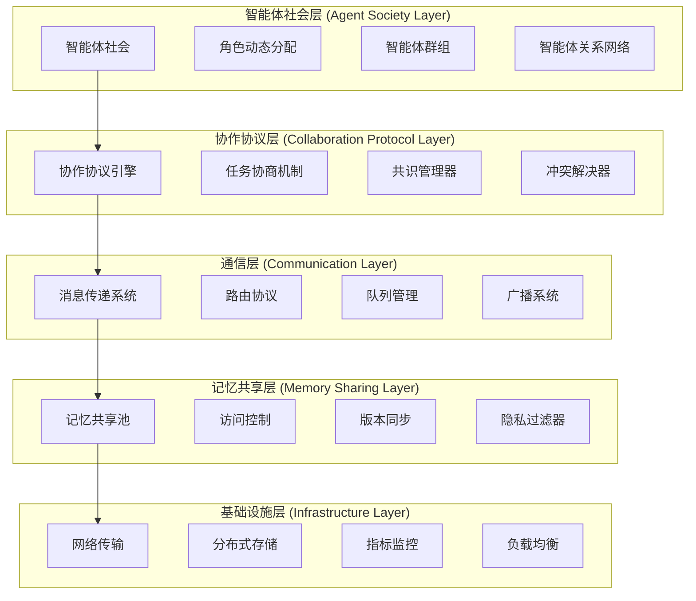

# 多智能体协作协议 (Multi-Agent Collaboration Protocol)

## 🎯 协议概览

本协议是专为 Connet.AI 多智能体聊天室系统设计的全面协作框架，旨在解决现有多智能体框架的局限性，创建一个真正的"智能体社会形态"协作机制。

### 现有框架分析

#### MCP (Model Context Protocol)

- **优势**: 标准化的 AI-工具接口，基于 JSON-RPC 2.0 的可靠通信
- **局限**: 专注于单一 AI 与外部工具的连接，缺乏多智能体协作机制

#### A2A (Agent-to-Agent Protocol)

- **优势**: 智能体能力发现、任务管理生命周期、多模态交互支持
- **局限**: 侧重于任务分发和结果聚合，缺乏深度协作和记忆共享

#### AutoGen

- **优势**: 灵活的多智能体对话框架
- **局限**: "圆桌讨论"模式可能失控，缺乏结构化协作规则

#### CrewAI

- **优势**: 高效的流水线式协作
- **局限**: 固定组织架构，缺乏创造性和适应性

### 协议目标（MVP 聚焦）

我们的协议旨在创建一个**简单、实用、可扩展**的多智能体协作系统，具备以下核心特性：

1. **基础协作能力** - 智能体间消息传递和任务协调
2. **Mem0 驱动记忆** - 利用成熟解决方案实现智能记忆共享
3. **能力发现机制** - 智能体能力注册和匹配
4. **简单任务编排** - 基础的任务分配和结果汇总
5. **渐进式扩展** - 支持未来功能的逐步增强

## 📁 文档结构

```
protocol/
├── README.md                          # 本文档
├── 01-theoretical-foundation.md        # 理论基础
├── 02-communication-protocol.md        # 通信协议
├── 03-collaboration-mechanisms.md      # 协作机制
├── 04-memory-sharing-system.md         # 记忆共享系统
├── 05-consensus-algorithms.md          # 共识算法
├── 06-data-structures.md              # 数据结构定义
├── 07-architecture-design.md          # 架构设计
├── 08-implementation-guide.md         # 实现指南
├── 09-security-privacy.md             # 安全与隐私
├── 10-performance-optimization.md     # 性能优化
├── examples/                          # 示例实现
│   ├── basic-collaboration.py
│   ├── consensus-voting.py
│   ├── memory-sharing.py
│   └── conflict-resolution.py
└── schemas/                           # JSON Schema定义
    ├── agent-descriptor.json
    ├── message-format.json
    ├── collaboration-task.json
    └── memory-object.json
```

## 🏗️ 协议架构预览



## 🔑 核心创新点（基于 Mem0 优化）

### 1. 社会形态协作模型

- 简化的智能体社会结构
- 基于能力的动态角色分配
- 轻量级信任和声誉机制

### 2. Mem0 驱动的智能记忆共享

- **直接集成 Mem0**：利用成熟的记忆管理解决方案
- **多级记忆支持**：User/Session/Agent 三层记忆架构
- **高性能优化**：91% 更快响应，90% 更少 Token 消耗
- **简化 API**：开箱即用的记忆存储和检索

### 3. 轻量级协作机制

- 基于消息传递的简单协作
- 任务分配和结果聚合
- 智能体能力发现和匹配

### 4. 渐进式扩展能力

- MVP 优先，快速上线
- 模块化设计，支持后续扩展
- 基于实际需求逐步增强功能

## 🚀 快速开始

### MVP 优先（推荐）

1. **⚡ 快速开始** - [mvp-quickstart.md](mvp-quickstart.md) - 1-2 周可交付
2. **📋 MVP 实现计划** - [mvp-implementation-plan.md](mvp-implementation-plan.md) - 详细设计
3. **🛠️ 实现指南** - [08-implementation-guide.md](08-implementation-guide.md) - 简化版
4. **💰 LLM 成本优化** - [llm-prompt-optimization.md](llm-prompt-optimization.md) - 缓存友好提示词

### 理论深入（可选）

5. **📚 理论基础** - [01-theoretical-foundation.md](01-theoretical-foundation.md)
6. **📡 通信协议** - [02-communication-protocol.md](02-communication-protocol.md)
7. **💾 记忆共享** - [04-memory-sharing-system.md](04-memory-sharing-system.md)
8. **🏗️ 架构设计** - [07-architecture-design.md](07-architecture-design.md)

## 📋 实施路线图（MVP 优先）

### 🎯 MVP 阶段 (1-2 周) - 最小可执行方案

- [ ] 基础智能体类和注册机制
- [ ] 简单消息传递系统（基于 Redis）
- [ ] 集成 Mem0 记忆管理
- [ ] 基础协作示例（2-3 个智能体协作）
- [ ] 简单的 Web 界面演示

### 🚀 增强阶段 (2-3 周) - 核心功能扩展

- [ ] 智能体能力发现和匹配
- [ ] 任务队列和分配机制
- [ ] 协作会话管理
- [ ] 基础性能监控
- [ ] API 接口完善

### 🌟 优化阶段 (2-4 周) - 生产就绪

- [ ] 高级协作模式
- [ ] 安全认证和权限控制
- [ ] 容器化部署
- [ ] 完整文档和示例
- [ ] 性能调优和监控

### 🔮 扩展阶段 (按需) - 高级特性

- [ ] 分布式部署支持
- [ ] 高级共识算法
- [ ] 智能体社会网络
- [ ] 自适应学习机制

---

_本协议基于最新的多智能体研究成果和实践经验，为构建下一代智能协作系统提供完整的解决方案。_
