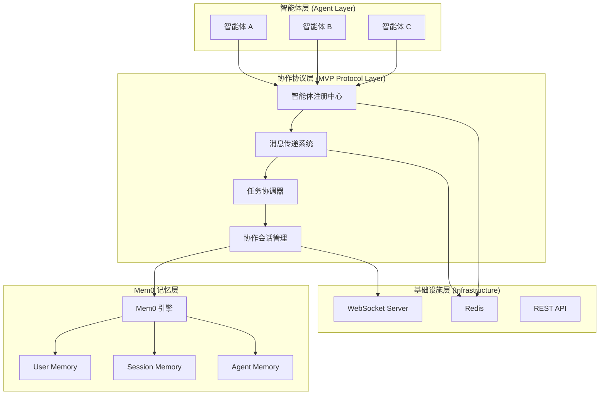

# MVP 实现计划 - 基于 Mem0 的简化多智能体协作协议

## 🎯 MVP 目标

构建一个**最小可执行方案**，实现基础的多智能体协作能力，利用 Mem0 作为记忆管理的核心引擎，快速验证协议设计的可行性。

## 📊 Mem0 集成策略

### 1. Mem0 核心优势分析

基于 [Mem0 项目](https://github.com/mem0ai/mem0) 的深入研究：

**性能优势**：

- ✅ **+26% 准确性提升**（相比 OpenAI Memory）
- ✅ **91% 更快响应速度**
- ✅ **90% 更少 Token 消耗**

**架构优势**：

- ✅ **多级记忆支持**：User/Session/Agent 三层架构
- ✅ **简洁 API 设计**：开箱即用的记忆管理
- ✅ **生产就绪**：成熟的开源解决方案
- ✅ **跨平台支持**：Python/TypeScript SDK

### 2. 替代我们原有复杂设计的部分

**原设计问题**：

- ❌ 自定义记忆管理系统过于复杂
- ❌ 向量数据库集成需要额外开发
- ❌ 记忆访问控制实现复杂
- ❌ 缺乏性能验证和优化

**Mem0 解决方案**：

- ✅ 直接使用经过验证的记忆引擎
- ✅ 内置向量搜索和相关性计算
- ✅ 多级访问控制已实现
- ✅ 性能已通过大规模应用验证

## 🚀 MVP 架构设计

### 1. 整体架构（简化版）



### 2. 核心组件设计

#### 2.1 智能体基础类（简化版）

```python
# mvp_agent.py
import asyncio
import uuid
from typing import Dict, List, Any, Optional
from mem0 import Memory
import redis.asyncio as aioredis

class MVPAgent:
    """MVP 智能体基础类 - 极简设计"""

    def __init__(self, agent_id: str, name: str, capabilities: List[str]):
        self.agent_id = agent_id
        self.name = name
        self.capabilities = capabilities
        self.status = "offline"

        # Mem0 记忆管理
        self.memory = Memory()

        # Redis 消息传递
        self.redis = None

        # 协作会话
        self.active_sessions = set()

    async def initialize(self):
        """初始化智能体"""
        # 连接 Redis
        self.redis = await aioredis.from_url("redis://localhost:6379")

        # 注册智能体
        await self._register_agent()

        # 启动消息监听
        asyncio.create_task(self._listen_for_messages())

        self.status = "online"
        print(f"智能体 {self.name} 已上线")

    async def _register_agent(self):
        """注册智能体到发现服务"""
        agent_info = {
            "agent_id": self.agent_id,
            "name": self.name,
            "capabilities": self.capabilities,
            "status": self.status
        }
        await self.redis.hset("agents", self.agent_id, json.dumps(agent_info))
        await self.redis.sadd("online_agents", self.agent_id)

    async def send_message(self, recipient_id: str, message_type: str, content: Dict):
        """发送消息给其他智能体"""
        message = {
            "id": str(uuid.uuid4()),
            "sender_id": self.agent_id,
            "recipient_id": recipient_id,
            "type": message_type,
            "content": content,
            "timestamp": datetime.utcnow().isoformat()
        }

        # 发送到 Redis 队列
        await self.redis.lpush(f"messages:{recipient_id}", json.dumps(message))

        # 通知接收者
        await self.redis.publish(f"notify:{recipient_id}", "new_message")

    async def store_memory(self, content: str, session_id: str = None):
        """存储记忆到 Mem0"""
        messages = [{"role": "assistant", "content": content}]

        # 存储到不同级别的记忆
        self.memory.add(messages, user_id=self.agent_id)  # Agent 级记忆

        if session_id:
            self.memory.add(messages, user_id=session_id)  # Session 级记忆

    async def search_memory(self, query: str, session_id: str = None, limit: int = 3):
        """从 Mem0 搜索相关记忆"""
        # 搜索 Agent 级记忆
        agent_memories = self.memory.search(
            query=query,
            user_id=self.agent_id,
            limit=limit
        )

        session_memories = []
        if session_id:
            # 搜索 Session 级记忆
            session_memories = self.memory.search(
                query=query,
                user_id=session_id,
                limit=limit
            )

        return {
            "agent_memories": agent_memories,
            "session_memories": session_memories
        }

    async def _listen_for_messages(self):
        """监听消息"""
        pubsub = self.redis.pubsub()
        await pubsub.subscribe(f"notify:{self.agent_id}")

        async for message in pubsub.listen():
            if message['type'] == 'message':
                await self._process_incoming_messages()

    async def _process_incoming_messages(self):
        """处理收到的消息"""
        while True:
            raw_message = await self.redis.rpop(f"messages:{self.agent_id}")
            if not raw_message:
                break

            message = json.loads(raw_message)
            await self.handle_message(message)

    async def handle_message(self, message: Dict):
        """处理消息 - 子类实现"""
        print(f"{self.name} 收到消息: {message}")
```

#### 2.2 协作协调器（简化版）

```python
# mvp_coordinator.py
import asyncio
import json
from typing import Dict, List, Set
from dataclasses import dataclass
from mem0 import Memory

@dataclass
class CollaborationSession:
    """协作会话"""
    session_id: str
    title: str
    participants: Set[str]
    status: str  # active, completed, failed
    created_at: str
    tasks: List[Dict] = None

class MVPCollaborationCoordinator:
    """MVP 协作协调器 - 简化实现"""

    def __init__(self):
        self.redis = None
        self.memory = Memory()  # Mem0 全局记忆管理
        self.active_sessions: Dict[str, CollaborationSession] = {}

    async def initialize(self):
        """初始化协调器"""
        self.redis = await aioredis.from_url("redis://localhost:6379")
        print("协作协调器已启动")

    async def create_collaboration_session(
        self,
        title: str,
        required_capabilities: List[str],
        initiator_id: str
    ) -> str:
        """创建协作会话"""
        session_id = str(uuid.uuid4())

        # 查找具备所需能力的智能体
        suitable_agents = await self._find_agents_by_capabilities(required_capabilities)

        if len(suitable_agents) < 2:
            raise ValueError("没有找到足够的智能体来完成协作")

        # 创建会话
        session = CollaborationSession(
            session_id=session_id,
            title=title,
            participants=set(suitable_agents + [initiator_id]),
            status="active",
            created_at=datetime.utcnow().isoformat()
        )

        self.active_sessions[session_id] = session

        # 通知参与者
        await self._notify_participants(session)

        # 存储会话信息到 Mem0
        session_info = f"协作会话 '{title}' 已创建，参与者: {', '.join(session.participants)}"
        self.memory.add(
            [{"role": "system", "content": session_info}],
            user_id=session_id
        )

        return session_id

    async def _find_agents_by_capabilities(self, capabilities: List[str]) -> List[str]:
        """根据能力查找智能体"""
        suitable_agents = []

        # 获取所有在线智能体
        online_agents = await self.redis.smembers("online_agents")

        for agent_id in online_agents:
            agent_info_json = await self.redis.hget("agents", agent_id.decode())
            if agent_info_json:
                agent_info = json.loads(agent_info_json)
                agent_capabilities = agent_info.get("capabilities", [])

                # 检查是否有匹配的能力
                if any(cap in agent_capabilities for cap in capabilities):
                    suitable_agents.append(agent_id.decode())

        return suitable_agents

    async def _notify_participants(self, session: CollaborationSession):
        """通知参与者加入协作"""
        notification = {
            "type": "collaboration_invite",
            "session_id": session.session_id,
            "title": session.title,
            "participants": list(session.participants)
        }

        for participant_id in session.participants:
            await self.redis.lpush(
                f"messages:{participant_id}",
                json.dumps({
                    "sender_id": "system",
                    "recipient_id": participant_id,
                    "type": "collaboration_invite",
                    "content": notification
                })
            )
            await self.redis.publish(f"notify:{participant_id}", "new_message")

    async def add_task_to_session(
        self,
        session_id: str,
        task_description: str,
        assigned_to: str = None
    ):
        """向会话添加任务"""
        if session_id not in self.active_sessions:
            raise ValueError("协作会话不存在")

        task = {
            "task_id": str(uuid.uuid4()),
            "description": task_description,
            "assigned_to": assigned_to,
            "status": "pending",
            "created_at": datetime.utcnow().isoformat()
        }

        session = self.active_sessions[session_id]
        if session.tasks is None:
            session.tasks = []
        session.tasks.append(task)

        # 存储任务信息到 Mem0
        task_info = f"新任务: {task_description}"
        if assigned_to:
            task_info += f" (分配给: {assigned_to})"

        self.memory.add(
            [{"role": "system", "content": task_info}],
            user_id=session_id
        )

        # 通知相关智能体
        if assigned_to:
            await self._notify_task_assignment(session_id, task, assigned_to)

    async def get_session_context(self, session_id: str, query: str = "") -> Dict:
        """获取会话上下文（使用 Mem0）"""
        if not query:
            query = "协作会话的所有活动和任务"

        # 从 Mem0 搜索会话相关记忆
        memories = self.memory.search(
            query=query,
            user_id=session_id,
            limit=10
        )

        return {
            "session_id": session_id,
            "memories": memories,
            "session_info": self.active_sessions.get(session_id)
        }
```

#### 2.3 示例协作智能体

```python
# example_agents.py
class CodeAgent(MVPAgent):
    """代码智能体示例"""

    def __init__(self):
        super().__init__(
            agent_id="code_agent_001",
            name="代码助手",
            capabilities=["code_generation", "code_review", "debugging"]
        )

    async def handle_message(self, message: Dict):
        """处理收到的消息"""
        if message["type"] == "collaboration_invite":
            await self._handle_collaboration_invite(message["content"])
        elif message["type"] == "task_assignment":
            await self._handle_task_assignment(message["content"])
        elif message["type"] == "code_request":
            await self._handle_code_request(message["content"])

    async def _handle_code_request(self, content: Dict):
        """处理代码请求"""
        request = content["request"]
        session_id = content.get("session_id")

        # 搜索相关记忆
        memories = await self.search_memory(request, session_id)

        # 生成代码（这里简化为模拟）
        code_response = f"# 根据请求 '{request}' 生成的代码\nprint('Hello from Code Agent!')"

        # 存储结果到记忆
        await self.store_memory(
            f"代码请求: {request}\n生成代码: {code_response}",
            session_id
        )

        # 发送响应
        await self.send_message(
            content["requester_id"],
            "code_response",
            {"code": code_response, "request": request}
        )

class AnalysisAgent(MVPAgent):
    """分析智能体示例"""

    def __init__(self):
        super().__init__(
            agent_id="analysis_agent_001",
            name="数据分析师",
            capabilities=["data_analysis", "report_generation", "visualization"]
        )

    async def handle_message(self, message: Dict):
        """处理收到的消息"""
        if message["type"] == "collaboration_invite":
            await self._handle_collaboration_invite(message["content"])
        elif message["type"] == "analysis_request":
            await self._handle_analysis_request(message["content"])

    async def _handle_analysis_request(self, content: Dict):
        """处理分析请求"""
        data = content["data"]
        session_id = content.get("session_id")

        # 搜索相关分析记忆
        memories = await self.search_memory("数据分析", session_id)

        # 执行分析（简化实现）
        analysis_result = f"数据分析结果: 共 {len(data)} 项数据，平均值约为 XX"

        # 存储分析结果
        await self.store_memory(
            f"分析数据: {data}\n分析结果: {analysis_result}",
            session_id
        )

        # 发送分析结果
        await self.send_message(
            content["requester_id"],
            "analysis_response",
            {"result": analysis_result, "data": data}
        )
```

## 🎮 MVP 演示场景

### 场景：智能代码生成与分析协作

```python
# mvp_demo.py
async def run_mvp_demo():
    """运行 MVP 演示"""

    # 1. 初始化协调器
    coordinator = MVPCollaborationCoordinator()
    await coordinator.initialize()

    # 2. 创建智能体
    code_agent = CodeAgent()
    analysis_agent = AnalysisAgent()

    await code_agent.initialize()
    await analysis_agent.initialize()

    # 3. 创建协作会话
    session_id = await coordinator.create_collaboration_session(
        title="Python 数据处理脚本开发",
        required_capabilities=["code_generation", "data_analysis"],
        initiator_id="user_001"
    )

    print(f"协作会话已创建: {session_id}")

    # 4. 添加任务
    await coordinator.add_task_to_session(
        session_id,
        "生成数据读取和预处理的 Python 代码",
        assigned_to=code_agent.agent_id
    )

    await coordinator.add_task_to_session(
        session_id,
        "分析生成代码的性能和优化建议",
        assigned_to=analysis_agent.agent_id
    )

    # 5. 模拟协作流程
    # 代码智能体生成代码
    await code_agent.send_message(
        analysis_agent.agent_id,
        "code_request",
        {
            "request": "生成 CSV 数据读取代码",
            "session_id": session_id,
            "requester_id": code_agent.agent_id
        }
    )

    # 等待处理
    await asyncio.sleep(2)

    # 6. 获取会话总结
    context = await coordinator.get_session_context(session_id)
    print("会话总结:", context)

if __name__ == "__main__":
    asyncio.run(run_mvp_demo())
```

## 📦 MVP 部署结构

### 1. 项目结构

```
mvp-multi-agent-protocol/
├── src/
│   ├── __init__.py
│   ├── mvp_agent.py           # 智能体基础类
│   ├── mvp_coordinator.py     # 协作协调器
│   ├── example_agents.py      # 示例智能体
│   └── mvp_demo.py           # 演示脚本
├── requirements.txt           # 依赖列表
├── docker-compose.yml        # 容器化部署
├── README.md                 # 快速开始指南
└── examples/
    ├── basic_collaboration.py # 基础协作示例
    └── web_interface.py       # 简单Web界面
```

### 2. 依赖列表 (requirements.txt)

```txt
# 核心依赖
mem0ai>=0.1.116
redis>=4.0.0
asyncio-redis>=1.13.0

# Web 界面 (可选)
fastapi>=0.68.0
uvicorn>=0.15.0
websockets>=10.0

# 工具库
pydantic>=1.8.0
python-dotenv>=0.19.0
aiofiles>=0.7.0
```

### 3. Docker 快速部署

```yaml
# docker-compose.yml
version: "3.8"

services:
  redis:
    image: redis:7-alpine
    ports:
      - "6379:6379"
    command: redis-server --appendonly yes
    volumes:
      - redis_data:/data

  mvp-protocol:
    build: .
    ports:
      - "8000:8000"
    depends_on:
      - redis
    environment:
      - REDIS_URL=redis://redis:6379
      - MEM0_API_KEY=${MEM0_API_KEY} # 如果使用托管服务
    volumes:
      - ./src:/app/src
      - ./examples:/app/examples

volumes:
  redis_data:
```

## 🎯 MVP 成功指标

### 1. 功能指标

- ✅ 2-3 个智能体能够成功注册和发现
- ✅ 智能体间能够发送和接收消息
- ✅ 协作会话能够正常创建和管理
- ✅ Mem0 记忆能够正常存储和检索
- ✅ 基础任务分配和执行流程完整

### 2. 性能指标

- ✅ 消息传递延迟 < 100ms
- ✅ 记忆检索响应 < 500ms
- ✅ 并发支持 10+ 智能体
- ✅ 系统可持续运行 1+ 小时无故障

### 3. 可扩展性指标

- ✅ 新智能体能够轻松接入
- ✅ 新协作模式能够快速实现
- ✅ 代码结构清晰，便于后续扩展

## 🚀 快速开始指南

### 1. 环境准备

```bash
# 克隆项目
git clone <mvp-repo-url>
cd mvp-multi-agent-protocol

# 安装依赖
pip install -r requirements.txt

# 启动 Redis
docker run -d -p 6379:6379 redis:7-alpine

# 设置 Mem0
export MEM0_API_KEY="your_api_key"  # 如果使用托管服务
```

### 2. 运行演示

```bash
# 运行基础演示
python src/mvp_demo.py

# 启动 Web 界面（可选）
python examples/web_interface.py
```

### 3. 自定义扩展

```python
# 创建自定义智能体
class MyCustomAgent(MVPAgent):
    def __init__(self):
        super().__init__(
            agent_id="my_agent_001",
            name="我的智能体",
            capabilities=["custom_skill"]
        )

    async def handle_message(self, message: Dict):
        # 实现自定义消息处理逻辑
        pass
```

## 🔮 下一步扩展计划

### 短期扩展 (MVP+)

1. **Web Dashboard**: 可视化协作进度和智能体状态
2. **更多智能体类型**: 文档处理、图像分析等
3. **错误处理增强**: 重试机制、故障恢复
4. **API 接口**: RESTful API 支持外部集成

### 中期扩展

1. **高级协作模式**: 工作流编排、条件分支
2. **安全增强**: 认证授权、消息加密
3. **性能优化**: 连接池、缓存策略
4. **监控告警**: 指标收集、异常监控

### 长期扩展

1. **分布式部署**: Kubernetes 支持、服务发现
2. **机器学习集成**: 智能任务分配、协作模式学习
3. **插件生态**: 第三方智能体、工具集成
4. **企业级特性**: 多租户、审计日志、合规支持

---

这个 MVP 方案将原有复杂设计简化为**可在 1-2 周内实现的最小可执行版本**，利用 Mem0 的成熟记忆管理能力，专注于多智能体协作的核心价值验证。
