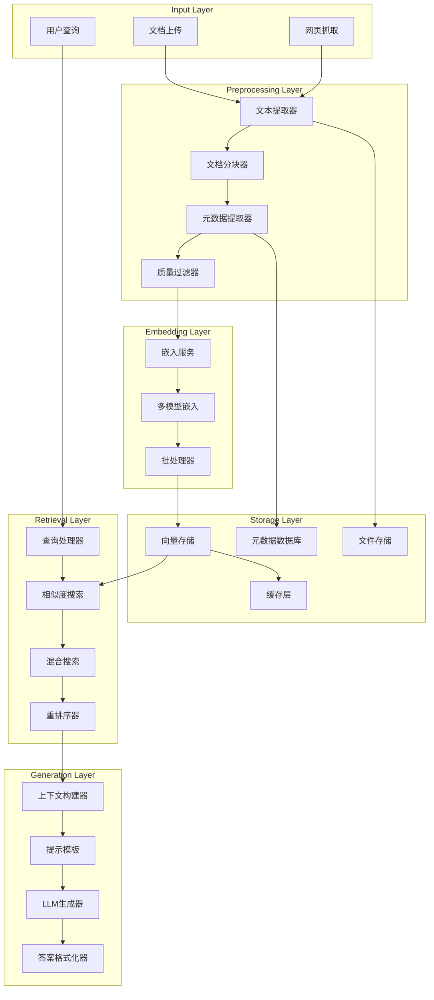

# RAG System Design - 检索增强生成系统

## 🎯 RAG 系统概览

Connet.AI 的 RAG (Retrieval-Augmented Generation) 系统采用多层次、多模态的检索架构，支持个人知识库、共享知识库、实时网络检索和多种文档格式处理。系统设计注重精确性、相关性和实时性，为 AI 对话提供准确的上下文信息。

---

## 🏗️ RAG 系统架构



---

## 📚 文档处理系统

### 1. 多格式文档解析器

```python
class DocumentProcessor:
    """多格式文档处理器"""
    
    def __init__(self):
        self.parsers = {
            '.pdf': PDFParser(),
            '.docx': DocxParser(),
            '.txt': TextParser(),
            '.md': MarkdownParser(),
            '.html': HTMLParser(),
            '.csv': CSVParser(),
            '.json': JSONParser(),
            '.pptx': PowerPointParser(),
            '.xlsx': ExcelParser()
        }
    
    async def process_document(self, file_path: str, metadata: Dict) -> ProcessedDocument:
        """处理单个文档"""
        
        file_extension = Path(file_path).suffix.lower()
        parser = self.parsers.get(file_extension)
        
        if not parser:
            raise UnsupportedFormatError(f"Unsupported file format: {file_extension}")
        
        # 解析文档内容
        parsed_content = await parser.parse(file_path)
        
        # 提取元数据
        document_metadata = await self._extract_metadata(parsed_content, metadata)
        
        # 文档分块
        chunks = await self._split_document(parsed_content)
        
        # 质量评估
        quality_score = await self._assess_quality(parsed_content)
        
        return ProcessedDocument(
            content=parsed_content,
            chunks=chunks,
            metadata=document_metadata,
            quality_score=quality_score,
            processed_at=datetime.utcnow()
        )
    
    async def _split_document(self, content: ParsedContent) -> List[DocumentChunk]:
        """智能文档分块"""
        
        splitter = SmartDocumentSplitter(
            chunk_size=512,          # 基础块大小
            chunk_overlap=50,        # 重叠tokens
            respect_boundaries=True   # 尊重段落边界
        )
        
        chunks = await splitter.split(content)
        
        # 为每个块生成唯一ID和元数据
        processed_chunks = []
        for i, chunk in enumerate(chunks):
            chunk_id = f"{content.document_id}_{i}"
            
            chunk_metadata = {
                'chunk_id': chunk_id,
                'document_id': content.document_id,
                'chunk_index': i,
                'start_position': chunk.start_position,
                'end_position': chunk.end_position,
                'section_title': chunk.section_title,
                'page_number': chunk.page_number
            }
            
            processed_chunk = DocumentChunk(
                id=chunk_id,
                content=chunk.text,
                metadata=chunk_metadata,
                embedding=None  # 稍后生成
            )
            
            processed_chunks.append(processed_chunk)
        
        return processed_chunks
```

### 2. 专业格式解析器

```python
class PDFParser:
    """PDF文档解析器"""
    
    async def parse(self, file_path: str) -> ParsedContent:
        """解析PDF文档"""
        
        import PyPDF2
        import pdfplumber
        
        content_blocks = []
        
        # 使用pdfplumber提取文本和表格
        with pdfplumber.open(file_path) as pdf:
            for page_num, page in enumerate(pdf.pages):
                
                # 提取文本
                text = page.extract_text()
                if text:
                    content_blocks.append({
                        'type': 'text',
                        'content': text,
                        'page': page_num + 1,
                        'bbox': None
                    })
                
                # 提取表格
                tables = page.extract_tables()
                for table in tables:
                    content_blocks.append({
                        'type': 'table',
                        'content': table,
                        'page': page_num + 1,
                        'bbox': None
                    })
                
                # 提取图像位置信息
                images = page.images
                for img in images:
                    content_blocks.append({
                        'type': 'image',
                        'content': f"[Image at page {page_num + 1}]",
                        'page': page_num + 1,
                        'bbox': img['bbox']
                    })
        
        return ParsedContent(
            document_id=str(uuid4()),
            content_blocks=content_blocks,
            total_pages=len(pdf.pages),
            file_path=file_path
        )

class MarkdownParser:
    """Markdown文档解析器"""
    
    async def parse(self, file_path: str) -> ParsedContent:
        """解析Markdown文档"""
        
        import markdown
        from markdown.extensions import codehilite, tables, toc
        
        with open(file_path, 'r', encoding='utf-8') as f:
            md_content = f.read()
        
        # 解析markdown结构
        md = markdown.Markdown(extensions=[
            'codehilite',
            'tables', 
            'toc',
            'meta'
        ])
        
        html_content = md.convert(md_content)
        
        # 提取结构化内容
        content_blocks = await self._extract_md_blocks(md_content)
        
        return ParsedContent(
            document_id=str(uuid4()),
            content_blocks=content_blocks,
            metadata=md.Meta,
            file_path=file_path
        )
    
    async def _extract_md_blocks(self, md_content: str) -> List[Dict]:
        """提取Markdown块结构"""
        
        import re
        
        blocks = []
        lines = md_content.split('\n')
        current_block = {'type': 'text', 'content': '', 'level': 0}
        
        for line in lines:
            # 标题
            header_match = re.match(r'^(#{1,6})\s+(.+)', line)
            if header_match:
                if current_block['content'].strip():
                    blocks.append(current_block)
                
                level = len(header_match.group(1))
                title = header_match.group(2)
                
                current_block = {
                    'type': 'header',
                    'content': title,
                    'level': level,
                    'children': []
                }
                blocks.append(current_block)
                current_block = {'type': 'text', 'content': '', 'level': level}
            
            # 代码块
            elif line.startswith('```'):
                if current_block['content'].strip():
                    blocks.append(current_block)
                
                # 提取语言
                language = line[3:].strip() or 'text'
                current_block = {
                    'type': 'code',
                    'language': language,
                    'content': ''
                }
            
            # 表格
            elif '|' in line and line.strip().startswith('|'):
                if current_block['type'] != 'table':
                    if current_block['content'].strip():
                        blocks.append(current_block)
                    current_block = {'type': 'table', 'content': []}
                
                current_block['content'].append(line.strip())
            
            else:
                current_block['content'] += line + '\n'
        
        if current_block['content'].strip():
            blocks.append(current_block)
        
        return blocks
```

---

## 🔍 向量化与嵌入系统

### 1. 多模型嵌入服务

```python
class EmbeddingService:
    """嵌入服务管理器"""
    
    def __init__(self):
        self.models = {
            'openai_small': OpenAIEmbedding('text-embedding-3-small'),
            'openai_large': OpenAIEmbedding('text-embedding-3-large'),
            'cohere_multilingual': CohereEmbedding('embed-multilingual-v3.0'),
            'bge_large': BGEEmbedding('bge-large-en-v1.5'),
            'local_chinese': LocalChineseEmbedding()
        }
        
        self.default_model = 'openai_small'
        self.batch_size = 100
    
    async def embed_documents(self, documents: List[DocumentChunk], model_name: str = None) -> List[EmbeddedChunk]:
        """批量嵌入文档"""
        
        model_name = model_name or self.default_model
        model = self.models[model_name]
        
        embedded_chunks = []
        
        # 分批处理
        for batch_start in range(0, len(documents), self.batch_size):
            batch_end = min(batch_start + self.batch_size, len(documents))
            batch_docs = documents[batch_start:batch_end]
            
            # 提取文本内容
            texts = [doc.content for doc in batch_docs]
            
            # 批量生成嵌入
            embeddings = await model.embed_batch(texts)
            
            # 创建嵌入块
            for doc, embedding in zip(batch_docs, embeddings):
                embedded_chunk = EmbeddedChunk(
                    chunk_id=doc.id,
                    content=doc.content,
                    embedding=embedding,
                    metadata=doc.metadata,
                    model_name=model_name,
                    created_at=datetime.utcnow()
                )
                embedded_chunks.append(embedded_chunk)
        
        return embedded_chunks
    
    async def embed_query(self, query: str, model_name: str = None) -> QueryEmbedding:
        """嵌入查询"""
        
        model_name = model_name or self.default_model
        model = self.models[model_name]
        
        # 查询预处理
        processed_query = await self._preprocess_query(query)
        
        # 生成嵌入
        embedding = await model.embed_single(processed_query)
        
        return QueryEmbedding(
            query=query,
            processed_query=processed_query,
            embedding=embedding,
            model_name=model_name,
            created_at=datetime.utcnow()
        )
    
    async def _preprocess_query(self, query: str) -> str:
        """查询预处理"""
        
        # 1. 语言检测和标准化
        lang = await self._detect_language(query)
        
        # 2. 查询扩展 (同义词、相关词)
        expanded_query = await self._expand_query(query, lang)
        
        # 3. 噪声移除
        cleaned_query = self._clean_query(expanded_query)
        
        return cleaned_query
```

### 2. 自适应嵌入策略

```python
class AdaptiveEmbeddingStrategy:
    """自适应嵌入策略"""
    
    def __init__(self):
        self.strategy_rules = {
            'technical_content': {
                'model': 'openai_large',
                'chunk_size': 256,
                'overlap': 30
            },
            'conversational': {
                'model': 'openai_small', 
                'chunk_size': 512,
                'overlap': 50
            },
            'multilingual': {
                'model': 'cohere_multilingual',
                'chunk_size': 400,
                'overlap': 40
            },
            'chinese_content': {
                'model': 'local_chinese',
                'chunk_size': 300,
                'overlap': 30
            }
        }
    
    async def determine_strategy(self, content: str, metadata: Dict) -> EmbeddingStrategy:
        """确定嵌入策略"""
        
        content_type = await self._classify_content_type(content, metadata)
        language = await self._detect_primary_language(content)
        
        # 选择策略
        if language == 'zh':
            strategy_key = 'chinese_content'
        elif content_type == 'technical':
            strategy_key = 'technical_content'
        elif content_type == 'conversation':
            strategy_key = 'conversational'
        elif language in ['es', 'fr', 'de', 'ja', 'ko']:
            strategy_key = 'multilingual'
        else:
            strategy_key = 'conversational'
        
        strategy_config = self.strategy_rules[strategy_key]
        
        return EmbeddingStrategy(
            model_name=strategy_config['model'],
            chunk_size=strategy_config['chunk_size'],
            chunk_overlap=strategy_config['overlap'],
            content_type=content_type,
            language=language
        )
    
    async def _classify_content_type(self, content: str, metadata: Dict) -> str:
        """分类内容类型"""
        
        # 基于文件类型和内容特征的分类
        file_type = metadata.get('file_type', '').lower()
        
        technical_indicators = [
            'function', 'class', 'import', 'def ', '```',
            'API', 'HTTP', 'JSON', 'SQL', 'database'
        ]
        
        conversational_indicators = [
            '我想', '请帮我', '如何', '什么是', '为什么',
            'I want', 'please help', 'how to', 'what is', 'why'
        ]
        
        technical_score = sum(1 for indicator in technical_indicators if indicator in content)
        conversational_score = sum(1 for indicator in conversational_indicators if indicator in content)
        
        if file_type in ['py', 'js', 'java', 'cpp', 'md'] or technical_score > conversational_score:
            return 'technical'
        else:
            return 'conversational'
```

---

## 🔎 检索系统

### 1. 混合检索引擎

```python
class HybridSearchEngine:
    """混合检索引擎 - 结合向量搜索和关键词搜索"""
    
    def __init__(self, vector_store: VectorStore, keyword_index: KeywordIndex):
        self.vector_store = vector_store
        self.keyword_index = keyword_index
        self.reranker = CrossEncoderReranker()
    
    async def search(self, query: str, user_id: str, filters: Dict = None, top_k: int = 10) -> List[SearchResult]:
        """混合搜索"""
        
        # 并行执行向量搜索和关键词搜索
        vector_task = self._vector_search(query, user_id, filters, top_k * 2)
        keyword_task = self._keyword_search(query, user_id, filters, top_k * 2)
        
        vector_results, keyword_results = await asyncio.gather(vector_task, keyword_task)
        
        # 合并和去重
        combined_results = self._merge_results(vector_results, keyword_results)
        
        # 重排序
        reranked_results = await self.reranker.rerank(query, combined_results)
        
        return reranked_results[:top_k]
    
    async def _vector_search(self, query: str, user_id: str, filters: Dict, top_k: int) -> List[SearchResult]:
        """向量相似度搜索"""
        
        # 生成查询嵌入
        embedding_service = EmbeddingService()
        query_embedding = await embedding_service.embed_query(query)
        
        # 构建搜索过滤器
        search_filters = self._build_search_filters(user_id, filters)
        
        # 执行向量搜索
        vector_results = await self.vector_store.similarity_search(
            query_vector=query_embedding.embedding,
            top_k=top_k,
            filters=search_filters
        )
        
        # 转换为SearchResult格式
        search_results = []
        for result in vector_results:
            search_result = SearchResult(
                chunk_id=result.id,
                content=result.content,
                metadata=result.metadata,
                score=result.similarity_score,
                search_type='vector',
                retrieved_at=datetime.utcnow()
            )
            search_results.append(search_result)
        
        return search_results
    
    async def _keyword_search(self, query: str, user_id: str, filters: Dict, top_k: int) -> List[SearchResult]:
        """关键词搜索"""
        
        # 查询预处理
        processed_query = await self._preprocess_keyword_query(query)
        
        # 构建搜索过滤器
        search_filters = self._build_search_filters(user_id, filters)
        
        # 执行关键词搜索 (使用Elasticsearch或类似)
        keyword_results = await self.keyword_index.search(
            query=processed_query,
            filters=search_filters,
            top_k=top_k
        )
        
        # 转换为SearchResult格式
        search_results = []
        for result in keyword_results:
            search_result = SearchResult(
                chunk_id=result.id,
                content=result.content,
                metadata=result.metadata,
                score=result.bm25_score,
                search_type='keyword',
                retrieved_at=datetime.utcnow()
            )
            search_results.append(search_result)
        
        return search_results
    
    def _merge_results(self, vector_results: List[SearchResult], keyword_results: List[SearchResult]) -> List[SearchResult]:
        """合并搜索结果"""
        
        # 去重 (基于chunk_id)
        result_map = {}
        
        # 处理向量搜索结果
        for result in vector_results:
            result_map[result.chunk_id] = result
        
        # 处理关键词搜索结果 (合并分数)
        for result in keyword_results:
            if result.chunk_id in result_map:
                # 合并分数 (加权平均)
                existing = result_map[result.chunk_id]
                combined_score = (existing.score * 0.6) + (result.score * 0.4)
                existing.score = combined_score
                existing.search_type = 'hybrid'
            else:
                result_map[result.chunk_id] = result
        
        # 按分数排序
        merged_results = list(result_map.values())
        merged_results.sort(key=lambda x: x.score, reverse=True)
        
        return merged_results
```

### 2. 智能重排序器

```python
class CrossEncoderReranker:
    """交叉编码器重排序"""
    
    def __init__(self):
        self.model_name = "cross-encoder/ms-marco-MiniLM-L-6-v2"
        self.batch_size = 32
        self.model = None  # 延迟加载
    
    async def rerank(self, query: str, search_results: List[SearchResult]) -> List[SearchResult]:
        """重排序搜索结果"""
        
        if not self.model:
            await self._load_model()
        
        # 准备查询-文档对
        query_doc_pairs = []
        for result in search_results:
            pair = [query, result.content]
            query_doc_pairs.append(pair)
        
        # 批量计算相关性分数
        relevance_scores = []
        for batch_start in range(0, len(query_doc_pairs), self.batch_size):
            batch_end = min(batch_start + self.batch_size, len(query_doc_pairs))
            batch_pairs = query_doc_pairs[batch_start:batch_end]
            
            batch_scores = await self._score_batch(batch_pairs)
            relevance_scores.extend(batch_scores)
        
        # 更新结果分数
        for result, relevance_score in zip(search_results, relevance_scores):
            # 结合原始分数和重排序分数
            result.rerank_score = relevance_score
            result.final_score = (result.score * 0.3) + (relevance_score * 0.7)
        
        # 按最终分数排序
        reranked_results = sorted(search_results, key=lambda x: x.final_score, reverse=True)
        
        return reranked_results
    
    async def _load_model(self):
        """延迟加载重排序模型"""
        from sentence_transformers import CrossEncoder
        self.model = CrossEncoder(self.model_name)
    
    async def _score_batch(self, pairs: List[List[str]]) -> List[float]:
        """批量计算分数"""
        # 注意：实际实现中应该异步处理
        scores = self.model.predict(pairs)
        return scores.tolist()
```

---

## 💾 向量存储系统

### 1. 多后端向量存储

```python
class VectorStore:
    """向量存储抽象层"""
    
    def __init__(self, backend_type: str = 'pgvector'):
        self.backends = {
            'pgvector': PGVectorBackend(),
            'chromadb': ChromaDBBackend(),
            'pinecone': PineconeBackend(),
            'weaviate': WeaviateBackend(),
            'qdrant': QdrantBackend()
        }
        
        self.backend = self.backends[backend_type]
        self.cache = RedisCache()
    
    async def store(self, embedded_chunks: List[EmbeddedChunk]):
        """存储嵌入向量"""
        
        # 批量存储到向量数据库
        await self.backend.batch_insert(embedded_chunks)
        
        # 更新缓存索引
        for chunk in embedded_chunks:
            cache_key = f"vector:{chunk.chunk_id}"
            await self.cache.set(cache_key, chunk.to_dict(), ttl=3600)
    
    async def similarity_search(self, query_vector: List[float], top_k: int = 10, filters: Dict = None) -> List[VectorSearchResult]:
        """相似度搜索"""
        
        # 检查缓存
        cache_key = f"search:{hash(str(query_vector))}:{top_k}:{hash(str(filters))}"
        cached_result = await self.cache.get(cache_key)
        if cached_result:
            return [VectorSearchResult.from_dict(item) for item in cached_result]
        
        # 执行向量搜索
        results = await self.backend.search(
            query_vector=query_vector,
            top_k=top_k,
            filters=filters
        )
        
        # 缓存结果
        await self.cache.set(cache_key, [r.to_dict() for r in results], ttl=1800)
        
        return results
    
    async def delete(self, chunk_ids: List[str]):
        """删除向量"""
        
        await self.backend.delete(chunk_ids)
        
        # 清除缓存
        for chunk_id in chunk_ids:
            cache_key = f"vector:{chunk_id}"
            await self.cache.delete(cache_key)

class PGVectorBackend:
    """PostgreSQL + pgvector 后端"""
    
    async def batch_insert(self, embedded_chunks: List[EmbeddedChunk]):
        """批量插入向量"""
        
        insert_data = []
        for chunk in embedded_chunks:
            insert_data.append({
                'id': chunk.chunk_id,
                'content': chunk.content,
                'embedding': chunk.embedding,
                'metadata': json.dumps(chunk.metadata),
                'created_at': chunk.created_at
            })
        
        # 使用批量插入
        async with get_db_session() as session:
            stmt = insert(VectorEmbeddingModel).values(insert_data)
            await session.execute(stmt)
            await session.commit()
    
    async def search(self, query_vector: List[float], top_k: int, filters: Dict = None) -> List[VectorSearchResult]:
        """向量相似度搜索"""
        
        async with get_db_session() as session:
            # 构建查询
            query = select(
                VectorEmbeddingModel.id,
                VectorEmbeddingModel.content,
                VectorEmbeddingModel.metadata,
                VectorEmbeddingModel.embedding.cosine_distance(query_vector).label('distance')
            ).order_by('distance').limit(top_k)
            
            # 应用过滤器
            if filters:
                for key, value in filters.items():
                    if key == 'user_id':
                        query = query.where(VectorEmbeddingModel.metadata['user_id'].astext == str(value))
                    elif key == 'document_type':
                        query = query.where(VectorEmbeddingModel.metadata['document_type'].astext == value)
            
            result = await session.execute(query)
            rows = result.fetchall()
            
            search_results = []
            for row in rows:
                search_result = VectorSearchResult(
                    id=row.id,
                    content=row.content,
                    metadata=json.loads(row.metadata),
                    similarity_score=1.0 - row.distance,  # 转换为相似度分数
                    distance=row.distance
                )
                search_results.append(search_result)
            
            return search_results
```

---

## 🎯 上下文构建与生成

### 1. 智能上下文构建器

```python
class ContextBuilder:
    """智能上下文构建器"""
    
    def __init__(self):
        self.max_context_length = 8000  # tokens
        self.context_strategies = {
            'comprehensive': ComprehensiveStrategy(),
            'focused': FocusedStrategy(),
            'conversational': ConversationalStrategy()
        }
    
    async def build_context(self, query: str, search_results: List[SearchResult], 
                          conversation_context: Dict, strategy: str = 'comprehensive') -> GenerationContext:
        """构建生成上下文"""
        
        strategy_impl = self.context_strategies[strategy]
        
        # 1. 选择最相关的文档块
        selected_chunks = await strategy_impl.select_chunks(
            query=query,
            search_results=search_results,
            max_length=self.max_context_length
        )
        
        # 2. 构建引用映射
        citation_map = await self._build_citation_map(selected_chunks)
        
        # 3. 整合对话上下文
        integrated_context = await self._integrate_conversation_context(
            selected_chunks, conversation_context
        )
        
        # 4. 生成提示模板
        prompt_template = await self._generate_prompt_template(
            query=query,
            context_chunks=integrated_context,
            citation_map=citation_map
        )
        
        return GenerationContext(
            query=query,
            context_chunks=integrated_context,
            prompt_template=prompt_template,
            citation_map=citation_map,
            total_tokens=await self._count_tokens(prompt_template),
            strategy=strategy
        )
    
    async def _build_citation_map(self, chunks: List[SearchResult]) -> Dict[str, CitationInfo]:
        """构建引用映射"""
        
        citation_map = {}
        
        for i, chunk in enumerate(chunks):
            citation_id = f"[{i+1}]"
            
            metadata = chunk.metadata
            citation_info = CitationInfo(
                citation_id=citation_id,
                source_title=metadata.get('title', 'Unknown'),
                source_url=metadata.get('url', ''),
                page_number=metadata.get('page_number'),
                section=metadata.get('section_title', ''),
                relevance_score=chunk.final_score,
                chunk_id=chunk.chunk_id
            )
            
            citation_map[citation_id] = citation_info
        
        return citation_map
    
    async def _generate_prompt_template(self, query: str, context_chunks: List[SearchResult], 
                                      citation_map: Dict[str, CitationInfo]) -> str:
        """生成提示模板"""
        
        # 构建上下文部分
        context_text = ""
        for i, chunk in enumerate(context_chunks):
            citation_id = f"[{i+1}]"
            context_text += f"\n\n{citation_id} {chunk.content}\n"
        
        # 构建完整提示
        prompt = f"""基于以下提供的上下文信息，回答用户的问题。请确保：

1. 答案准确且基于提供的上下文
2. 在答案中包含适当的引用标记 [数字]
3. 如果上下文中没有足够信息，请明确说明
4. 保持回答的清晰和有条理

上下文信息：
{context_text}

用户问题：{query}

请提供详细的回答："""

        return prompt

class ComprehensiveStrategy:
    """全面策略 - 选择多样化的相关内容"""
    
    async def select_chunks(self, query: str, search_results: List[SearchResult], max_length: int) -> List[SearchResult]:
        """选择多样化的内容块"""
        
        selected = []
        current_length = 0
        
        # 按相关性分组
        high_relevance = [r for r in search_results if r.final_score > 0.8]
        medium_relevance = [r for r in search_results if 0.5 < r.final_score <= 0.8]
        low_relevance = [r for r in search_results if r.final_score <= 0.5]
        
        # 优先选择高相关性内容
        for result in high_relevance[:3]:
            token_count = await self._estimate_tokens(result.content)
            if current_length + token_count <= max_length:
                selected.append(result)
                current_length += token_count
        
        # 填充中等相关性内容
        for result in medium_relevance[:2]:
            token_count = await self._estimate_tokens(result.content)
            if current_length + token_count <= max_length:
                selected.append(result)
                current_length += token_count
        
        return selected
```

### 2. 生成质量控制

```python
class GenerationQualityController:
    """生成质量控制器"""
    
    async def validate_generation(self, generation_context: GenerationContext, 
                                generated_response: str) -> QualityAssessment:
        """验证生成质量"""
        
        assessment = QualityAssessment()
        
        # 1. 事实准确性检查
        accuracy_score = await self._check_factual_accuracy(
            generation_context, generated_response
        )
        assessment.accuracy_score = accuracy_score
        
        # 2. 引用完整性检查
        citation_score = await self._check_citation_completeness(
            generation_context, generated_response
        )
        assessment.citation_score = citation_score
        
        # 3. 相关性检查
        relevance_score = await self._check_answer_relevance(
            generation_context.query, generated_response
        )
        assessment.relevance_score = relevance_score
        
        # 4. 流畅度检查
        fluency_score = await self._check_response_fluency(generated_response)
        assessment.fluency_score = fluency_score
        
        # 计算总体质量分数
        assessment.overall_score = (
            accuracy_score * 0.4 +
            citation_score * 0.2 +
            relevance_score * 0.3 +
            fluency_score * 0.1
        )
        
        return assessment
    
    async def _check_factual_accuracy(self, context: GenerationContext, response: str) -> float:
        """检查事实准确性"""
        
        # 提取回答中的关键陈述
        key_statements = await self._extract_key_statements(response)
        
        accuracy_scores = []
        
        for statement in key_statements:
            # 在上下文中验证每个陈述
            verification_score = await self._verify_statement_in_context(
                statement, context.context_chunks
            )
            accuracy_scores.append(verification_score)
        
        return sum(accuracy_scores) / len(accuracy_scores) if accuracy_scores else 0.0
    
    async def _check_citation_completeness(self, context: GenerationContext, response: str) -> float:
        """检查引用完整性"""
        
        import re
        
        # 提取回答中的引用
        citations_used = re.findall(r'\[(\d+)\]', response)
        available_citations = list(context.citation_map.keys())
        
        if not available_citations:
            return 1.0  # 没有可引用内容时满分
        
        # 计算引用使用率
        unique_citations_used = set(f"[{c}]" for c in citations_used)
        citation_coverage = len(unique_citations_used) / len(available_citations)
        
        # 检查引用的准确性
        valid_citations = sum(1 for c in unique_citations_used if c in available_citations)
        citation_accuracy = valid_citations / len(unique_citations_used) if unique_citations_used else 1.0
        
        return (citation_coverage * 0.6) + (citation_accuracy * 0.4)
```

---

## 📊 性能优化与监控

### 1. 缓存优化策略

```python
class RAGCacheManager:
    """RAG 系统缓存管理器"""
    
    def __init__(self):
        self.redis_client = Redis()
        self.cache_configs = {
            'embeddings': {'ttl': 86400, 'max_size': 50000},
            'search_results': {'ttl': 1800, 'max_size': 10000},
            'generated_responses': {'ttl': 3600, 'max_size': 5000},
            'document_metadata': {'ttl': 43200, 'max_size': 20000}
        }
    
    async def cache_embedding(self, text: str, embedding: List[float], model_name: str):
        """缓存嵌入结果"""
        
        cache_key = f"embedding:{model_name}:{hash(text)}"
        cache_data = {
            'embedding': embedding,
            'created_at': datetime.utcnow().isoformat(),
            'model': model_name
        }
        
        config = self.cache_configs['embeddings']
        await self.redis_client.setex(
            cache_key,
            config['ttl'],
            json.dumps(cache_data)
        )
    
    async def get_cached_embedding(self, text: str, model_name: str) -> Optional[List[float]]:
        """获取缓存的嵌入"""
        
        cache_key = f"embedding:{model_name}:{hash(text)}"
        cached_data = await self.redis_client.get(cache_key)
        
        if cached_data:
            data = json.loads(cached_data)
            return data['embedding']
        
        return None
    
    async def cache_search_results(self, query_hash: str, results: List[SearchResult]):
        """缓存搜索结果"""
        
        cache_key = f"search_results:{query_hash}"
        cache_data = {
            'results': [r.to_dict() for r in results],
            'cached_at': datetime.utcnow().isoformat()
        }
        
        config = self.cache_configs['search_results']
        await self.redis_client.setex(
            cache_key,
            config['ttl'],
            json.dumps(cache_data)
        )
```

### 2. 性能监控系统

```python
class RAGPerformanceMonitor:
    """RAG 性能监控系统"""
    
    def __init__(self):
        self.metrics_store = MetricsStore()
        self.alert_manager = AlertManager()
    
    async def track_search_performance(self, search_metrics: SearchMetrics):
        """跟踪搜索性能"""
        
        await self.metrics_store.record({
            'metric_type': 'search_performance',
            'response_time': search_metrics.response_time,
            'result_count': search_metrics.result_count,
            'relevance_score': search_metrics.avg_relevance_score,
            'cache_hit_rate': search_metrics.cache_hit_rate,
            'timestamp': datetime.utcnow()
        })
        
        # 检查性能阈值
        if search_metrics.response_time > 5000:  # 5秒
            await self.alert_manager.send_alert(
                'high_search_latency',
                f'Search latency: {search_metrics.response_time}ms'
            )
    
    async def track_generation_quality(self, quality_metrics: QualityMetrics):
        """跟踪生成质量"""
        
        await self.metrics_store.record({
            'metric_type': 'generation_quality',
            'accuracy_score': quality_metrics.accuracy_score,
            'citation_score': quality_metrics.citation_score,
            'relevance_score': quality_metrics.relevance_score,
            'user_satisfaction': quality_metrics.user_satisfaction,
            'timestamp': datetime.utcnow()
        })
        
        # 检查质量阈值
        if quality_metrics.accuracy_score < 0.7:
            await self.alert_manager.send_alert(
                'low_generation_quality',
                f'Generation accuracy: {quality_metrics.accuracy_score}'
            )
    
    async def generate_performance_report(self, time_range: DateRange) -> PerformanceReport:
        """生成性能报告"""
        
        metrics = await self.metrics_store.query(
            start_date=time_range.start,
            end_date=time_range.end
        )
        
        report = PerformanceReport(
            time_range=time_range,
            total_searches=len([m for m in metrics if m['metric_type'] == 'search_performance']),
            avg_search_time=self._calculate_avg_search_time(metrics),
            cache_hit_rate=self._calculate_cache_hit_rate(metrics),
            avg_generation_quality=self._calculate_avg_quality(metrics),
            top_queries=self._get_top_queries(metrics),
            performance_trends=self._analyze_trends(metrics)
        )
        
        return report
```

---

## 🔒 安全与隐私

### 1. 数据隐私保护

```python
class RAGPrivacyProtection:
    """RAG 隐私保护系统"""
    
    async def sanitize_document(self, document: ProcessedDocument) -> ProcessedDocument:
        """文档隐私清理"""
        
        sanitized_chunks = []
        
        for chunk in document.chunks:
            # PII 检测和脱敏
            sanitized_content = await self._remove_pii(chunk.content)
            
            # 敏感信息标记
            sensitivity_level = await self._assess_sensitivity(sanitized_content)
            
            sanitized_chunk = DocumentChunk(
                id=chunk.id,
                content=sanitized_content,
                metadata={
                    **chunk.metadata,
                    'sensitivity_level': sensitivity_level,
                    'sanitized': True
                }
            )
            
            sanitized_chunks.append(sanitized_chunk)
        
        return ProcessedDocument(
            content=document.content,
            chunks=sanitized_chunks,
            metadata={
                **document.metadata,
                'privacy_processed': True
            },
            quality_score=document.quality_score
        )
    
    async def _remove_pii(self, text: str) -> str:
        """移除个人身份信息"""
        
        import re
        
        # 邮箱脱敏
        text = re.sub(r'\b[A-Za-z0-9._%+-]+@[A-Za-z0-9.-]+\.[A-Z|a-z]{2,}\b', '[EMAIL]', text)
        
        # 电话号码脱敏
        text = re.sub(r'\b\d{3}[-.]?\d{3}[-.]?\d{4}\b', '[PHONE]', text)
        
        # 社会安全号码脱敏
        text = re.sub(r'\b\d{3}-\d{2}-\d{4}\b', '[SSN]', text)
        
        # 信用卡号脱敏
        text = re.sub(r'\b\d{4}[- ]?\d{4}[- ]?\d{4}[- ]?\d{4}\b', '[CREDIT_CARD]', text)
        
        return text
    
    async def enforce_access_control(self, user_id: str, document_chunks: List[SearchResult]) -> List[SearchResult]:
        """强制访问控制"""
        
        filtered_chunks = []
        
        for chunk in document_chunks:
            # 检查用户权限
            has_access = await self._check_document_access(user_id, chunk.metadata)
            
            if has_access:
                # 根据用户权限级别过滤内容
                filtered_content = await self._filter_content_by_permission(
                    chunk.content, user_id, chunk.metadata
                )
                
                filtered_chunk = SearchResult(
                    chunk_id=chunk.chunk_id,
                    content=filtered_content,
                    metadata=chunk.metadata,
                    score=chunk.score,
                    search_type=chunk.search_type
                )
                
                filtered_chunks.append(filtered_chunk)
        
        return filtered_chunks
```

这个 RAG 系统设计提供了完整的文档处理、向量化、检索和生成功能，支持多种文档格式、智能检索策略和质量控制机制，确保为 AI 对话提供准确、相关且安全的上下文信息。