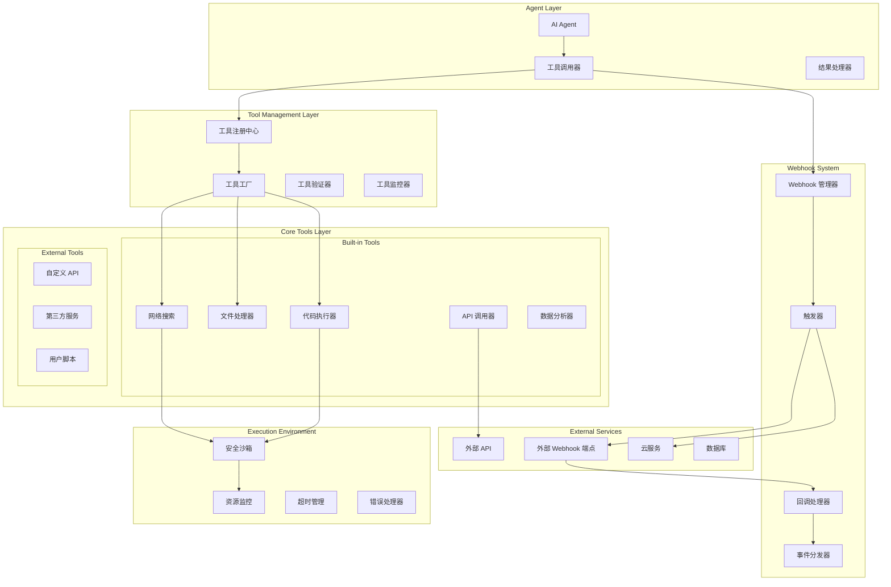

# Tools & Webhook System - 工具与 Webhook 系统

## 🛠️ 系统概览

Connet.AI 的工具与 Webhook 系统为 AI Agent 提供了强大的外部集成能力，支持 API 调用、文件处理、数据分析、代码执行等多种工具类型，同时通过 Webhook 机制实现与外部系统的实时交互和异步通信。

---

## 🏗️ 系统架构



---

## 🔧 工具系统核心架构

### 1. 基础工具接口

```python
from abc import ABC, abstractmethod
from typing import Dict, Any, List, Optional
from dataclasses import dataclass
from enum import Enum

class ToolType(Enum):
    """工具类型枚举"""
    API_CALL = "api_call"
    FILE_PROCESSING = "file_processing"
    DATA_ANALYSIS = "data_analysis"
    CODE_EXECUTION = "code_execution"
    WEB_SEARCH = "web_search"
    DATABASE_QUERY = "database_query"
    WEBHOOK = "webhook"
    CUSTOM = "custom"

@dataclass
class ToolParameter:
    """工具参数定义"""
    name: str
    type: str  # string, integer, boolean, array, object
    description: str
    required: bool = True
    default_value: Any = None
    enum_values: List[str] = None
    validation_rules: Dict[str, Any] = None

@dataclass
class ToolResult:
    """工具执行结果"""
    success: bool
    result: Any
    error_message: Optional[str] = None
    execution_time: float = 0.0
    metadata: Dict[str, Any] = None
    artifacts: List[str] = None  # 生成的文件或资源

class BaseTool(ABC):
    """工具基类"""
    
    def __init__(self, name: str, description: str, tool_type: ToolType):
        self.name = name
        self.description = description
        self.tool_type = tool_type
        self.parameters: List[ToolParameter] = []
        self.required_permissions: List[str] = []
        self.rate_limit: Optional[Dict[str, int]] = None
        self.timeout_seconds: int = 30
        
    @abstractmethod
    async def execute(self, parameters: Dict[str, Any], context: 'ToolExecutionContext') -> ToolResult:
        """执行工具"""
        pass
    
    @abstractmethod
    def validate_parameters(self, parameters: Dict[str, Any]) -> List[str]:
        """验证参数"""
        pass
    
    def get_schema(self) -> Dict[str, Any]:
        """获取工具模式定义"""
        return {
            "name": self.name,
            "description": self.description,
            "type": self.tool_type.value,
            "parameters": [
                {
                    "name": param.name,
                    "type": param.type,
                    "description": param.description,
                    "required": param.required,
                    "default": param.default_value,
                    "enum": param.enum_values
                }
                for param in self.parameters
            ],
            "required_permissions": self.required_permissions,
            "timeout": self.timeout_seconds
        }

@dataclass
class ToolExecutionContext:
    """工具执行上下文"""
    user_id: str
    conversation_id: str
    agent_id: str
    execution_id: str
    permissions: List[str]
    resource_limits: Dict[str, int]
    metadata: Dict[str, Any]
```

### 2. 工具注册和管理系统

```python
class ToolRegistry:
    """工具注册中心"""
    
    def __init__(self):
        self.tools: Dict[str, BaseTool] = {}
        self.categories: Dict[str, List[str]] = {}
        self.permissions_manager = ToolPermissionsManager()
        self.validator = ToolValidator()
        
    async def register_tool(self, tool: BaseTool, category: str = "general") -> bool:
        """注册工具"""
        
        # 验证工具
        validation_result = await self.validator.validate_tool(tool)
        if not validation_result.is_valid:
            raise ToolValidationError(f"Tool validation failed: {validation_result.errors}")
        
        # 注册工具
        self.tools[tool.name] = tool
        
        # 添加到分类
        if category not in self.categories:
            self.categories[category] = []
        self.categories[category].append(tool.name)
        
        return True
    
    def get_tool(self, name: str) -> Optional[BaseTool]:
        """获取工具"""
        return self.tools.get(name)
    
    def list_tools(self, category: str = None, user_permissions: List[str] = None) -> List[BaseTool]:
        """列出可用工具"""
        
        if category:
            tool_names = self.categories.get(category, [])
        else:
            tool_names = list(self.tools.keys())
        
        available_tools = []
        for name in tool_names:
            tool = self.tools[name]
            
            # 检查权限
            if user_permissions and not self.permissions_manager.check_permissions(
                tool.required_permissions, user_permissions
            ):
                continue
            
            available_tools.append(tool)
        
        return available_tools
    
    async def execute_tool(self, tool_name: str, parameters: Dict[str, Any], 
                          context: ToolExecutionContext) -> ToolResult:
        """执行工具"""
        
        tool = self.get_tool(tool_name)
        if not tool:
            return ToolResult(
                success=False,
                result=None,
                error_message=f"Tool '{tool_name}' not found"
            )
        
        # 检查权限
        if not self.permissions_manager.check_permissions(
            tool.required_permissions, context.permissions
        ):
            return ToolResult(
                success=False,
                result=None,
                error_message="Insufficient permissions"
            )
        
        # 验证参数
        validation_errors = tool.validate_parameters(parameters)
        if validation_errors:
            return ToolResult(
                success=False,
                result=None,
                error_message=f"Parameter validation failed: {', '.join(validation_errors)}"
            )
        
        # 执行工具
        try:
            start_time = time.time()
            result = await asyncio.wait_for(
                tool.execute(parameters, context),
                timeout=tool.timeout_seconds
            )
            execution_time = time.time() - start_time
            result.execution_time = execution_time
            
            return result
            
        except asyncio.TimeoutError:
            return ToolResult(
                success=False,
                result=None,
                error_message=f"Tool execution timed out after {tool.timeout_seconds} seconds"
            )
        except Exception as e:
            return ToolResult(
                success=False,
                result=None,
                error_message=f"Tool execution failed: {str(e)}"
            )

class ToolManager:
    """工具管理器"""
    
    def __init__(self):
        self.registry = ToolRegistry()
        self.execution_monitor = ToolExecutionMonitor()
        self.resource_manager = ResourceManager()
        
    async def batch_execute(self, tool_calls: List['ToolCall'], 
                           context: ToolExecutionContext) -> List[ToolResult]:
        """批量执行工具"""
        
        # 检查资源限制
        if not await self.resource_manager.check_batch_limits(tool_calls, context):
            return [
                ToolResult(
                    success=False,
                    result=None,
                    error_message="Resource limit exceeded for batch execution"
                )
            ] * len(tool_calls)
        
        # 并发执行
        execution_tasks = []
        for tool_call in tool_calls:
            task = self.registry.execute_tool(
                tool_call.tool_name,
                tool_call.parameters,
                context
            )
            execution_tasks.append(task)
        
        results = await asyncio.gather(*execution_tasks, return_exceptions=True)
        
        # 处理异常
        processed_results = []
        for result in results:
            if isinstance(result, Exception):
                processed_results.append(
                    ToolResult(
                        success=False,
                        result=None,
                        error_message=str(result)
                    )
                )
            else:
                processed_results.append(result)
        
        return processed_results
```

---

## 🔍 内置工具实现

### 1. 网络搜索工具

```python
class WebSearchTool(BaseTool):
    """网络搜索工具"""
    
    def __init__(self):
        super().__init__(
            name="web_search",
            description="Search the web for information",
            tool_type=ToolType.WEB_SEARCH
        )
        
        self.parameters = [
            ToolParameter(
                name="query",
                type="string",
                description="Search query",
                required=True
            ),
            ToolParameter(
                name="num_results",
                type="integer",
                description="Number of results to return",
                required=False,
                default_value=10
            ),
            ToolParameter(
                name="language",
                type="string",
                description="Search language",
                required=False,
                default_value="en",
                enum_values=["en", "zh", "es", "fr"]
            ),
            ToolParameter(
                name="safe_search",
                type="boolean",
                description="Enable safe search",
                required=False,
                default_value=True
            )
        ]
        
        self.search_engines = {
            'google': GoogleSearchEngine(),
            'bing': BingSearchEngine(),
            'duckduckgo': DuckDuckGoEngine()
        }
        
        self.default_engine = 'google'
    
    async def execute(self, parameters: Dict[str, Any], context: ToolExecutionContext) -> ToolResult:
        """执行网络搜索"""
        
        query = parameters["query"]
        num_results = parameters.get("num_results", 10)
        language = parameters.get("language", "en")
        safe_search = parameters.get("safe_search", True)
        
        try:
            # 选择搜索引擎
            search_engine = self.search_engines[self.default_engine]
            
            # 执行搜索
            search_results = await search_engine.search(
                query=query,
                num_results=num_results,
                language=language,
                safe_search=safe_search
            )
            
            # 处理结果
            processed_results = []
            for result in search_results:
                processed_result = {
                    'title': result.title,
                    'url': result.url,
                    'snippet': result.snippet,
                    'published_date': result.published_date,
                    'relevance_score': result.relevance_score
                }
                processed_results.append(processed_result)
            
            return ToolResult(
                success=True,
                result={
                    'query': query,
                    'results': processed_results,
                    'total_results': len(processed_results)
                },
                metadata={
                    'search_engine': self.default_engine,
                    'language': language,
                    'safe_search': safe_search
                }
            )
            
        except Exception as e:
            return ToolResult(
                success=False,
                result=None,
                error_message=f"Web search failed: {str(e)}"
            )
    
    def validate_parameters(self, parameters: Dict[str, Any]) -> List[str]:
        """验证参数"""
        errors = []
        
        # 验证查询
        if not parameters.get("query") or not parameters["query"].strip():
            errors.append("Query cannot be empty")
        
        # 验证结果数量
        num_results = parameters.get("num_results", 10)
        if not isinstance(num_results, int) or num_results < 1 or num_results > 50:
            errors.append("Number of results must be between 1 and 50")
        
        return errors

class GoogleSearchEngine:
    """Google 搜索引擎"""
    
    async def search(self, query: str, num_results: int = 10, **kwargs) -> List['SearchResult']:
        """执行 Google 搜索"""
        
        # 构建搜索请求
        search_params = {
            'q': query,
            'num': num_results,
            'hl': kwargs.get('language', 'en'),
            'safe': 'active' if kwargs.get('safe_search', True) else 'off'
        }
        
        # 调用 Google Search API
        async with aiohttp.ClientSession() as session:
            async with session.get(
                'https://www.googleapis.com/customsearch/v1',
                params={
                    **search_params,
                    'key': await self._get_api_key(),
                    'cx': await self._get_search_engine_id()
                }
            ) as response:
                data = await response.json()
                
                results = []
                for item in data.get('items', []):
                    result = SearchResult(
                        title=item['title'],
                        url=item['link'],
                        snippet=item['snippet'],
                        relevance_score=self._calculate_relevance_score(item, query)
                    )
                    results.append(result)
                
                return results
```

### 2. 代码执行工具

```python
class CodeExecutorTool(BaseTool):
    """代码执行工具"""
    
    def __init__(self):
        super().__init__(
            name="code_executor",
            description="Execute code in a secure sandbox environment",
            tool_type=ToolType.CODE_EXECUTION
        )
        
        self.parameters = [
            ToolParameter(
                name="code",
                type="string",
                description="Code to execute",
                required=True
            ),
            ToolParameter(
                name="language",
                type="string",
                description="Programming language",
                required=True,
                enum_values=["python", "javascript", "sql", "bash"]
            ),
            ToolParameter(
                name="timeout",
                type="integer",
                description="Execution timeout in seconds",
                required=False,
                default_value=30
            ),
            ToolParameter(
                name="memory_limit_mb",
                type="integer",
                description="Memory limit in MB",
                required=False,
                default_value=128
            )
        ]
        
        self.executors = {
            'python': PythonExecutor(),
            'javascript': JavaScriptExecutor(),
            'sql': SQLExecutor(),
            'bash': BashExecutor()
        }
        
        self.required_permissions = ["code_execution"]
    
    async def execute(self, parameters: Dict[str, Any], context: ToolExecutionContext) -> ToolResult:
        """执行代码"""
        
        code = parameters["code"]
        language = parameters["language"]
        timeout = parameters.get("timeout", 30)
        memory_limit = parameters.get("memory_limit_mb", 128)
        
        try:
            # 获取执行器
            executor = self.executors.get(language)
            if not executor:
                return ToolResult(
                    success=False,
                    result=None,
                    error_message=f"Unsupported language: {language}"
                )
            
            # 安全检查
            security_check = await self._security_check(code, language)
            if not security_check.is_safe:
                return ToolResult(
                    success=False,
                    result=None,
                    error_message=f"Security check failed: {security_check.risk_description}"
                )
            
            # 创建安全沙箱
            sandbox = SecureSandbox(
                language=language,
                timeout=timeout,
                memory_limit_mb=memory_limit,
                network_access=False,  # 默认不允许网络访问
                file_system_access='limited'
            )
            
            # 执行代码
            execution_result = await sandbox.execute(code)
            
            return ToolResult(
                success=execution_result.success,
                result={
                    'output': execution_result.output,
                    'error_output': execution_result.error_output,
                    'exit_code': execution_result.exit_code,
                    'execution_time': execution_result.execution_time,
                    'memory_used_mb': execution_result.memory_used_mb
                },
                artifacts=execution_result.generated_files,
                metadata={
                    'language': language,
                    'sandbox_id': execution_result.sandbox_id
                }
            )
            
        except Exception as e:
            return ToolResult(
                success=False,
                result=None,
                error_message=f"Code execution failed: {str(e)}"
            )
    
    async def _security_check(self, code: str, language: str) -> 'SecurityCheckResult':
        """安全检查"""
        
        security_checker = CodeSecurityChecker()
        
        # 检查恶意模式
        malicious_patterns = await security_checker.check_malicious_patterns(code, language)
        if malicious_patterns:
            return SecurityCheckResult(
                is_safe=False,
                risk_level="high",
                risk_description=f"Detected malicious patterns: {', '.join(malicious_patterns)}"
            )
        
        # 检查危险函数调用
        dangerous_functions = await security_checker.check_dangerous_functions(code, language)
        if dangerous_functions:
            return SecurityCheckResult(
                is_safe=False,
                risk_level="medium",
                risk_description=f"Detected dangerous functions: {', '.join(dangerous_functions)}"
            )
        
        return SecurityCheckResult(is_safe=True)
    
    def validate_parameters(self, parameters: Dict[str, Any]) -> List[str]:
        """验证参数"""
        errors = []
        
        # 验证代码
        if not parameters.get("code") or not parameters["code"].strip():
            errors.append("Code cannot be empty")
        
        # 验证语言
        language = parameters.get("language")
        if language not in self.executors:
            errors.append(f"Unsupported language: {language}")
        
        # 验证超时时间
        timeout = parameters.get("timeout", 30)
        if not isinstance(timeout, int) or timeout < 1 or timeout > 300:
            errors.append("Timeout must be between 1 and 300 seconds")
        
        return errors

class SecureSandbox:
    """安全沙箱环境"""
    
    def __init__(self, language: str, timeout: int = 30, memory_limit_mb: int = 128, 
                 network_access: bool = False, file_system_access: str = 'limited'):
        self.language = language
        self.timeout = timeout
        self.memory_limit_mb = memory_limit_mb
        self.network_access = network_access
        self.file_system_access = file_system_access
        self.sandbox_id = str(uuid4())
        
    async def execute(self, code: str) -> 'ExecutionResult':
        """在沙箱中执行代码"""
        
        if self.language == 'python':
            return await self._execute_python(code)
        elif self.language == 'javascript':
            return await self._execute_javascript(code)
        elif self.language == 'sql':
            return await self._execute_sql(code)
        else:
            raise UnsupportedLanguageError(f"Language {self.language} not supported")
    
    async def _execute_python(self, code: str) -> 'ExecutionResult':
        """执行 Python 代码"""
        
        # 创建受限的 Python 环境
        restricted_globals = {
            '__builtins__': {
                'print': print,
                'len': len,
                'range': range,
                'str': str,
                'int': int,
                'float': float,
                'list': list,
                'dict': dict,
                'tuple': tuple,
                'set': set,
                # 允许的内置函数...
            },
            # 允许的模块
            'math': __import__('math'),
            'json': __import__('json'),
            'datetime': __import__('datetime'),
        }
        
        # 捕获输出
        import io
        import contextlib
        
        output_buffer = io.StringIO()
        error_buffer = io.StringIO()
        
        start_time = time.time()
        
        try:
            with contextlib.redirect_stdout(output_buffer), contextlib.redirect_stderr(error_buffer):
                # 执行代码
                exec(code, restricted_globals)
            
            execution_time = time.time() - start_time
            
            return ExecutionResult(
                success=True,
                output=output_buffer.getvalue(),
                error_output=error_buffer.getvalue(),
                exit_code=0,
                execution_time=execution_time,
                sandbox_id=self.sandbox_id
            )
            
        except Exception as e:
            execution_time = time.time() - start_time
            
            return ExecutionResult(
                success=False,
                output=output_buffer.getvalue(),
                error_output=f"{error_buffer.getvalue()}\n{str(e)}",
                exit_code=1,
                execution_time=execution_time,
                sandbox_id=self.sandbox_id
            )
```

### 3. API 调用工具

```python
class APICallTool(BaseTool):
    """API 调用工具"""
    
    def __init__(self):
        super().__init__(
            name="api_call",
            description="Make HTTP API calls to external services",
            tool_type=ToolType.API_CALL
        )
        
        self.parameters = [
            ToolParameter(
                name="url",
                type="string",
                description="API endpoint URL",
                required=True
            ),
            ToolParameter(
                name="method",
                type="string",
                description="HTTP method",
                required=False,
                default_value="GET",
                enum_values=["GET", "POST", "PUT", "DELETE", "PATCH"]
            ),
            ToolParameter(
                name="headers",
                type="object",
                description="HTTP headers",
                required=False
            ),
            ToolParameter(
                name="params",
                type="object",
                description="Query parameters",
                required=False
            ),
            ToolParameter(
                name="data",
                type="object",
                description="Request body data",
                required=False
            ),
            ToolParameter(
                name="auth",
                type="object",
                description="Authentication configuration",
                required=False
            )
        ]
        
        self.required_permissions = ["api_call"]
        self.rate_limiter = APIRateLimiter()
        
    async def execute(self, parameters: Dict[str, Any], context: ToolExecutionContext) -> ToolResult:
        """执行 API 调用"""
        
        url = parameters["url"]
        method = parameters.get("method", "GET").upper()
        headers = parameters.get("headers", {})
        params = parameters.get("params", {})
        data = parameters.get("data", {})
        auth_config = parameters.get("auth", {})
        
        try:
            # 安全检查
            security_check = await self._security_check(url, headers, data)
            if not security_check.is_safe:
                return ToolResult(
                    success=False,
                    result=None,
                    error_message=f"Security check failed: {security_check.error_message}"
                )
            
            # 速率限制检查
            if not await self.rate_limiter.check_rate_limit(context.user_id, url):
                return ToolResult(
                    success=False,
                    result=None,
                    error_message="Rate limit exceeded for this API endpoint"
                )
            
            # 设置认证
            if auth_config:
                headers = await self._setup_authentication(headers, auth_config)
            
            # 执行 HTTP 请求
            async with aiohttp.ClientSession(timeout=aiohttp.ClientTimeout(total=30)) as session:
                
                request_kwargs = {
                    'headers': headers,
                    'params': params if method == 'GET' else None
                }
                
                if method in ['POST', 'PUT', 'PATCH'] and data:
                    if headers.get('Content-Type', '').startswith('application/json'):
                        request_kwargs['json'] = data
                    else:
                        request_kwargs['data'] = data
                
                async with session.request(method, url, **request_kwargs) as response:
                    
                    # 读取响应
                    response_text = await response.text()
                    
                    # 尝试解析 JSON
                    try:
                        response_data = await response.json()
                    except:
                        response_data = response_text
                    
                    return ToolResult(
                        success=response.status < 400,
                        result={
                            'status_code': response.status,
                            'headers': dict(response.headers),
                            'data': response_data,
                            'url': str(response.url)
                        },
                        metadata={
                            'request_method': method,
                            'response_size': len(response_text),
                            'content_type': response.headers.get('Content-Type', '')
                        }
                    )
                    
        except asyncio.TimeoutError:
            return ToolResult(
                success=False,
                result=None,
                error_message="API call timed out"
            )
        except Exception as e:
            return ToolResult(
                success=False,
                result=None,
                error_message=f"API call failed: {str(e)}"
            )
    
    async def _security_check(self, url: str, headers: Dict, data: Dict) -> 'APISecurityCheck':
        """API 安全检查"""
        
        # 检查 URL 白名单
        if not await self._is_url_allowed(url):
            return APISecurityCheck(
                is_safe=False,
                error_message=f"URL not in allowed list: {url}"
            )
        
        # 检查敏感信息泄露
        sensitive_patterns = ['password', 'secret', 'token', 'key']
        for pattern in sensitive_patterns:
            if pattern in str(data).lower():
                return APISecurityCheck(
                    is_safe=False,
                    error_message=f"Potential sensitive information detected: {pattern}"
                )
        
        return APISecurityCheck(is_safe=True)
    
    async def _setup_authentication(self, headers: Dict, auth_config: Dict) -> Dict:
        """设置认证信息"""
        
        auth_type = auth_config.get('type', '').lower()
        
        if auth_type == 'bearer':
            token = auth_config.get('token')
            headers['Authorization'] = f'Bearer {token}'
        elif auth_type == 'api_key':
            key = auth_config.get('key')
            key_name = auth_config.get('key_name', 'X-API-Key')
            headers[key_name] = key
        elif auth_type == 'basic':
            username = auth_config.get('username')
            password = auth_config.get('password')
            import base64
            credentials = base64.b64encode(f'{username}:{password}'.encode()).decode()
            headers['Authorization'] = f'Basic {credentials}'
        
        return headers
    
    def validate_parameters(self, parameters: Dict[str, Any]) -> List[str]:
        """验证参数"""
        errors = []
        
        # 验证 URL
        url = parameters.get("url")
        if not url:
            errors.append("URL is required")
        elif not url.startswith(('http://', 'https://')):
            errors.append("URL must start with http:// or https://")
        
        # 验证 HTTP 方法
        method = parameters.get("method", "GET").upper()
        if method not in ["GET", "POST", "PUT", "DELETE", "PATCH"]:
            errors.append(f"Unsupported HTTP method: {method}")
        
        return errors
```

---

## 🔗 Webhook 系统

### 1. Webhook 管理器

```python
class WebhookManager:
    """Webhook 管理器"""
    
    def __init__(self):
        self.webhook_registry = WebhookRegistry()
        self.trigger_manager = WebhookTriggerManager()
        self.callback_handler = WebhookCallbackHandler()
        self.retry_manager = WebhookRetryManager()
        
    async def register_webhook(self, webhook_config: WebhookConfig) -> str:
        """注册 Webhook"""
        
        # 验证配置
        validation_result = await self._validate_webhook_config(webhook_config)
        if not validation_result.is_valid:
            raise WebhookValidationError(validation_result.errors)
        
        # 生成 Webhook ID
        webhook_id = str(uuid4())
        
        # 存储配置
        webhook = Webhook(
            id=webhook_id,
            config=webhook_config,
            status="active",
            created_at=datetime.utcnow()
        )
        
        await self.webhook_registry.store_webhook(webhook)
        
        return webhook_id
    
    async def trigger_webhook(self, webhook_id: str, event_data: Dict[str, Any], 
                            context: WebhookContext) -> WebhookTriggerResult:
        """触发 Webhook"""
        
        webhook = await self.webhook_registry.get_webhook(webhook_id)
        if not webhook:
            return WebhookTriggerResult(
                success=False,
                error="Webhook not found"
            )
        
        if webhook.status != "active":
            return WebhookTriggerResult(
                success=False,
                error="Webhook is not active"
            )
        
        # 构建 Webhook 负载
        payload = await self._build_webhook_payload(event_data, webhook.config, context)
        
        # 触发 Webhook
        trigger_result = await self.trigger_manager.trigger(webhook, payload)
        
        # 记录日志
        await self._log_webhook_trigger(webhook_id, payload, trigger_result)
        
        # 处理重试
        if not trigger_result.success and webhook.config.retry_enabled:
            await self.retry_manager.schedule_retry(webhook_id, payload)
        
        return trigger_result
    
    async def handle_webhook_callback(self, webhook_id: str, 
                                    callback_data: Dict[str, Any]) -> WebhookCallbackResult:
        """处理 Webhook 回调"""
        
        return await self.callback_handler.handle_callback(webhook_id, callback_data)

@dataclass
class WebhookConfig:
    """Webhook 配置"""
    name: str
    url: str
    method: str = "POST"
    headers: Dict[str, str] = None
    secret: Optional[str] = None
    timeout_seconds: int = 30
    retry_enabled: bool = True
    max_retries: int = 3
    retry_delay_seconds: int = 60
    event_filters: List[str] = None
    transform_template: Optional[str] = None

class WebhookTriggerManager:
    """Webhook 触发管理器"""
    
    async def trigger(self, webhook: Webhook, payload: Dict[str, Any]) -> WebhookTriggerResult:
        """触发 Webhook"""
        
        try:
            # 准备请求
            headers = webhook.config.headers or {}
            headers['Content-Type'] = 'application/json'
            headers['User-Agent'] = 'Connet.AI-Webhook/1.0'
            
            # 添加签名（如果有密钥）
            if webhook.config.secret:
                signature = self._generate_signature(payload, webhook.config.secret)
                headers['X-Webhook-Signature'] = signature
            
            # 发送请求
            async with aiohttp.ClientSession(
                timeout=aiohttp.ClientTimeout(total=webhook.config.timeout_seconds)
            ) as session:
                
                async with session.request(
                    method=webhook.config.method,
                    url=webhook.config.url,
                    json=payload,
                    headers=headers
                ) as response:
                    
                    response_text = await response.text()
                    
                    return WebhookTriggerResult(
                        success=response.status < 400,
                        status_code=response.status,
                        response_body=response_text,
                        response_headers=dict(response.headers),
                        trigger_time=datetime.utcnow()
                    )
                    
        except asyncio.TimeoutError:
            return WebhookTriggerResult(
                success=False,
                error="Webhook request timed out"
            )
        except Exception as e:
            return WebhookTriggerResult(
                success=False,
                error=f"Webhook trigger failed: {str(e)}"
            )
    
    def _generate_signature(self, payload: Dict[str, Any], secret: str) -> str:
        """生成 Webhook 签名"""
        import hmac
        import hashlib
        import json
        
        payload_json = json.dumps(payload, sort_keys=True)
        signature = hmac.new(
            secret.encode('utf-8'),
            payload_json.encode('utf-8'),
            hashlib.sha256
        ).hexdigest()
        
        return f'sha256={signature}'

class WebhookCallbackHandler:
    """Webhook 回调处理器"""
    
    async def handle_callback(self, webhook_id: str, 
                            callback_data: Dict[str, Any]) -> WebhookCallbackResult:
        """处理回调"""
        
        try:
            # 获取 Webhook 配置
            webhook = await self._get_webhook(webhook_id)
            if not webhook:
                return WebhookCallbackResult(
                    success=False,
                    error="Webhook not found"
                )
            
            # 验证回调
            validation_result = await self._validate_callback(webhook, callback_data)
            if not validation_result.is_valid:
                return WebhookCallbackResult(
                    success=False,
                    error=f"Callback validation failed: {validation_result.error}"
                )
            
            # 处理回调数据
            processed_data = await self._process_callback_data(callback_data, webhook.config)
            
            # 触发事件
            await self._trigger_callback_events(webhook_id, processed_data)
            
            return WebhookCallbackResult(
                success=True,
                processed_data=processed_data
            )
            
        except Exception as e:
            return WebhookCallbackResult(
                success=False,
                error=f"Callback handling failed: {str(e)}"
            )
    
    async def _process_callback_data(self, callback_data: Dict[str, Any], 
                                   config: WebhookConfig) -> Dict[str, Any]:
        """处理回调数据"""
        
        processed_data = callback_data.copy()
        
        # 应用转换模板
        if config.transform_template:
            template_processor = CallbackDataProcessor()
            processed_data = await template_processor.apply_template(
                callback_data, config.transform_template
            )
        
        # 添加元数据
        processed_data['_webhook_metadata'] = {
            'received_at': datetime.utcnow().isoformat(),
            'webhook_id': config.name,
            'processing_version': '1.0'
        }
        
        return processed_data
```

### 2. 事件驱动的 Webhook 系统

```python
class EventDrivenWebhookSystem:
    """事件驱动的 Webhook 系统"""
    
    def __init__(self):
        self.event_dispatcher = EventDispatcher()
        self.webhook_manager = WebhookManager()
        self.subscription_manager = WebhookSubscriptionManager()
        
    async def subscribe_to_event(self, event_type: str, webhook_id: str, 
                               filters: Dict[str, Any] = None) -> str:
        """订阅事件"""
        
        subscription_id = str(uuid4())
        
        subscription = WebhookSubscription(
            id=subscription_id,
            event_type=event_type,
            webhook_id=webhook_id,
            filters=filters or {},
            created_at=datetime.utcnow(),
            status="active"
        )
        
        await self.subscription_manager.store_subscription(subscription)
        
        return subscription_id
    
    async def emit_event(self, event_type: str, event_data: Dict[str, Any], 
                        context: EventContext) -> List[WebhookTriggerResult]:
        """发出事件并触发相关 Webhooks"""
        
        # 获取订阅了此事件的 Webhook
        subscriptions = await self.subscription_manager.get_subscriptions_for_event(event_type)
        
        trigger_results = []
        
        for subscription in subscriptions:
            # 检查过滤条件
            if not await self._check_event_filters(event_data, subscription.filters):
                continue
            
            # 触发 Webhook
            webhook_context = WebhookContext(
                event_type=event_type,
                subscription_id=subscription.id,
                original_context=context
            )
            
            result = await self.webhook_manager.trigger_webhook(
                subscription.webhook_id, 
                event_data, 
                webhook_context
            )
            
            trigger_results.append(result)
        
        return trigger_results
    
    async def _check_event_filters(self, event_data: Dict[str, Any], 
                                 filters: Dict[str, Any]) -> bool:
        """检查事件是否满足过滤条件"""
        
        if not filters:
            return True
        
        for filter_key, filter_value in filters.items():
            if filter_key not in event_data:
                return False
            
            event_value = event_data[filter_key]
            
            # 支持多种过滤类型
            if isinstance(filter_value, dict):
                if 'equals' in filter_value and event_value != filter_value['equals']:
                    return False
                if 'contains' in filter_value and filter_value['contains'] not in str(event_value):
                    return False
                if 'gt' in filter_value and event_value <= filter_value['gt']:
                    return False
                if 'lt' in filter_value and event_value >= filter_value['lt']:
                    return False
            else:
                if event_value != filter_value:
                    return False
        
        return True

# 预定义事件类型
class WebhookEvents:
    """Webhook 事件类型"""
    
    # 对话事件
    MESSAGE_RECEIVED = "message.received"
    MESSAGE_SENT = "message.sent"
    CONVERSATION_STARTED = "conversation.started"
    CONVERSATION_ENDED = "conversation.ended"
    
    # Agent 事件
    AGENT_CREATED = "agent.created"
    AGENT_UPDATED = "agent.updated"
    AGENT_DEPLOYED = "agent.deployed"
    AGENT_ERROR = "agent.error"
    
    # 工具事件
    TOOL_EXECUTED = "tool.executed"
    TOOL_FAILED = "tool.failed"
    TOOL_COMPLETED = "tool.completed"
    
    # 文件事件
    FILE_UPLOADED = "file.uploaded"
    FILE_PROCESSED = "file.processed"
    FILE_SHARED = "file.shared"
    
    # 系统事件
    SYSTEM_MAINTENANCE = "system.maintenance"
    SYSTEM_ALERT = "system.alert"
    RATE_LIMIT_EXCEEDED = "system.rate_limit_exceeded"
```

---

## 📊 监控与分析

### 1. 工具使用分析

```python
class ToolUsageAnalytics:
    """工具使用分析系统"""
    
    def __init__(self):
        self.metrics_collector = ToolMetricsCollector()
        self.analytics_engine = AnalyticsEngine()
        
    async def track_tool_usage(self, tool_name: str, execution_context: ToolExecutionContext,
                             execution_result: ToolResult):
        """跟踪工具使用"""
        
        usage_record = ToolUsageRecord(
            tool_name=tool_name,
            user_id=execution_context.user_id,
            agent_id=execution_context.agent_id,
            conversation_id=execution_context.conversation_id,
            execution_time=execution_result.execution_time,
            success=execution_result.success,
            error_message=execution_result.error_message,
            timestamp=datetime.utcnow()
        )
        
        await self.metrics_collector.record_usage(usage_record)
    
    async def generate_usage_report(self, user_id: str = None, 
                                  time_range: DateRange = None) -> ToolUsageReport:
        """生成使用报告"""
        
        # 获取使用数据
        usage_data = await self.metrics_collector.get_usage_data(user_id, time_range)
        
        # 分析使用模式
        usage_patterns = await self.analytics_engine.analyze_usage_patterns(usage_data)
        
        # 生成洞察
        insights = await self._generate_usage_insights(usage_data, usage_patterns)
        
        return ToolUsageReport(
            time_range=time_range,
            total_executions=len(usage_data),
            success_rate=self._calculate_success_rate(usage_data),
            most_used_tools=usage_patterns.most_used_tools,
            avg_execution_time=usage_patterns.avg_execution_time,
            usage_trends=usage_patterns.trends,
            insights=insights
        )
    
    async def optimize_tool_performance(self) -> List[OptimizationRecommendation]:
        """优化工具性能"""
        
        # 分析性能瓶颈
        performance_data = await self.metrics_collector.get_performance_metrics()
        bottlenecks = await self.analytics_engine.identify_bottlenecks(performance_data)
        
        recommendations = []
        
        for bottleneck in bottlenecks:
            if bottleneck.type == 'execution_time':
                recommendations.append(OptimizationRecommendation(
                    type='performance',
                    tool_name=bottleneck.tool_name,
                    description=f"High execution time detected for {bottleneck.tool_name}",
                    suggested_actions=[
                        "Consider adding caching",
                        "Optimize algorithm complexity",
                        "Implement parallel processing"
                    ]
                ))
            elif bottleneck.type == 'error_rate':
                recommendations.append(OptimizationRecommendation(
                    type='reliability',
                    tool_name=bottleneck.tool_name,
                    description=f"High error rate detected for {bottleneck.tool_name}",
                    suggested_actions=[
                        "Improve error handling",
                        "Add input validation",
                        "Implement retry logic"
                    ]
                ))
        
        return recommendations

class WebhookAnalytics:
    """Webhook 分析系统"""
    
    async def analyze_webhook_performance(self, webhook_id: str, 
                                        time_range: DateRange) -> WebhookPerformanceReport:
        """分析 Webhook 性能"""
        
        # 获取触发记录
        trigger_records = await self._get_webhook_triggers(webhook_id, time_range)
        
        # 计算指标
        metrics = {
            'total_triggers': len(trigger_records),
            'success_rate': self._calculate_success_rate(trigger_records),
            'avg_response_time': self._calculate_avg_response_time(trigger_records),
            'error_rate': self._calculate_error_rate(trigger_records),
            'retry_rate': self._calculate_retry_rate(trigger_records)
        }
        
        # 分析趋势
        trends = await self._analyze_webhook_trends(trigger_records)
        
        return WebhookPerformanceReport(
            webhook_id=webhook_id,
            time_range=time_range,
            metrics=metrics,
            trends=trends,
            recommendations=await self._generate_webhook_recommendations(metrics, trends)
        )
```

这个工具与 Webhook 系统设计提供了完整的外部集成能力，支持多种工具类型、安全执行环境、事件驱动的 Webhook 机制，以及全面的监控分析功能，为 AI Agent 提供了强大的扩展能力。