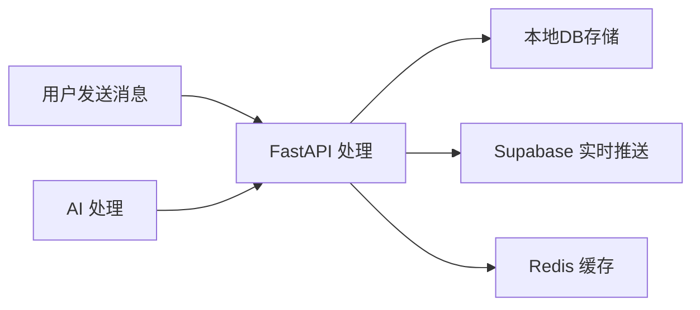
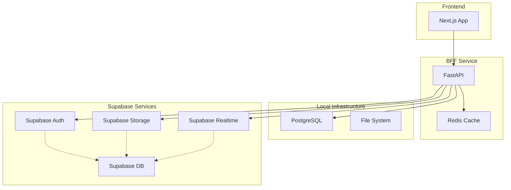

# BFF 数据库和服务架构流程设计

## 概述

基于 **FastAPI + Supabase + 本地数据库** 的混合架构，本文档分析应用功能并提供数据存储和服务使用建议。

## 架构原则

### 1. 数据分层策略

- **本地数据库**: 核心业务数据、敏感数据、复杂关系数据
- **Supabase**: 用户认证、实时功能、文件存储、简单配置数据
- **Redis 缓存**: 会话数据、临时数据、高频访问数据

### 2. 服务分工原则

- **FastAPI 服务**: 业务逻辑、数据处理、AI 集成
- **Supabase 服务**: 认证、实时通信、文件管理
- **混合服务**: 数据同步、备份、统计分析

---

## 功能模块分析与建议

### 🔐 用户认证与授权模块

#### **建议：主要使用 Supabase Auth**

**Supabase 负责：**

- ✅ 用户注册/登录
- ✅ 密码重置
- ✅ OAuth 第三方登录 (Google, GitHub, etc.)
- ✅ JWT Token 管理
- ✅ 邮箱验证
- ✅ 多因素认证 (MFA)

**本地数据库负责：**

- ✅ 用户扩展信息 (profiles, preferences)
- ✅ 用户角色和权限配置
- ✅ 企业级权限管理
- ✅ 用户操作审计日志

```python
# 数据流示例
# 1. Supabase Auth 处理登录
# 2. 本地数据库存储用户扩展信息
# 3. Redis 缓存用户会话和权限
```

**技术实现：**

- 使用 Supabase 的 `supabase.auth` API
- 本地维护 `user_profiles` 表
- Redis 缓存用户权限数据

---

### 💬 聊天和对话管理

#### **建议：混合架构 (本地为主 + Supabase 实时)**

**本地数据库负责：**

- ✅ 对话历史存储 (conversations, messages)
- ✅ AI Agent 配置和知识库
- ✅ 复杂的对话流程控制
- ✅ 消息搜索和索引
- ✅ 对话分析和统计

**Supabase 负责：**

- ✅ 实时消息推送 (Realtime subscriptions)
- ✅ 在线状态管理
- ✅ 临时消息缓存

**Redis 负责：**

- ✅ 活跃对话缓存
- ✅ 用户输入状态 (typing indicators)
- ✅ 消息队列



**核心表结构：**

- `conversations` (本地)
- `messages` (本地)
- `conversation_participants` (本地)
- `agent_knowledge_base` (本地)

---

### 📁 文件管理系统

#### **建议：Supabase Storage + 本地元数据**

**Supabase Storage 负责：**

- ✅ 文件存储 (images, documents, media)
- ✅ CDN 分发
- ✅ 自动压缩和优化
- ✅ 访问权限控制
- ✅ 文件预览生成

**本地数据库负责：**

- ✅ 文件元数据 (file_model)
- ✅ 文件权限配置 (file_permission_model)
- ✅ 文件版本控制
- ✅ 文件分类和标签
- ✅ 文件使用统计

**Redis 负责：**

- ✅ 文件上传进度
- ✅ 临时下载链接缓存

```python
# 文件上传流程
async def upload_file():
    # 1. 上传到 Supabase Storage
    file_url = await supabase.storage.upload()

    # 2. 本地数据库存储元数据
    await file_repository.create({
        "filename": filename,
        "url": file_url,
        "size": file_size,
        "user_id": user_id
    })

    # 3. Redis 缓存文件信息
    await redis.setex(f"file:{file_id}", 3600, file_data)
```

---

### 👥 联系人管理

#### **建议：本地数据库为主**

**本地数据库负责：**

- ✅ 联系人信息存储 (contact_model)
- ✅ 联系人分组和标签
- ✅ 联系人关系图谱
- ✅ 联系人导入/导出
- ✅ 重复联系人检测

**Supabase 负责：**

- ✅ 头像存储 (Storage)
- ✅ 联系人在线状态同步

**Redis 负责：**

- ✅ 联系人搜索缓存
- ✅ 频繁访问的联系人信息

---

### 📱 社交时间线

#### **建议：混合架构**

**本地数据库负责：**

- ✅ 帖子内容存储 (timeline_post_model)
- ✅ 评论管理 (timeline_comment_model)
- ✅ 点赞数据 (timeline_like_model)
- ✅ 内容审核和过滤
- ✅ 推荐算法数据

**Supabase 负责：**

- ✅ 媒体文件存储 (图片、视频)
- ✅ 实时点赞和评论推送
- ✅ 在线用户活动状态

**Redis 负责：**

- ✅ 热门内容缓存
- ✅ 用户时间线缓存
- ✅ 推荐内容缓存

---

### 🤖 AI Agent 管理

#### **建议：本地数据库为主**

**本地数据库负责：**

- ✅ Agent 配置 (agent_model)
- ✅ 知识库管理 (agent_knowledge_base_model)
- ✅ 训练数据存储
- ✅ Agent 性能指标
- ✅ 对话上下文管理

**Supabase 负责：**

- ✅ Agent 媒体资源存储
- ✅ 公共 Agent 模板共享

**Redis 负责：**

- ✅ Agent 会话状态
- ✅ 高频使用的知识库缓存
- ✅ AI 响应缓存

---

### 🔔 通知系统

#### **建议：混合架构**

**本地数据库负责：**

- ✅ 通知历史记录
- ✅ 用户通知偏好设置
- ✅ 通知模板管理
- ✅ 通知统计分析

**Supabase 负责：**

- ✅ 实时通知推送
- ✅ WebSocket 连接管理
- ✅ 推送通知服务集成

**Redis 负责：**

- ✅ 未读通知计数
- ✅ 通知队列
- ✅ 用户在线状态

---

## 数据同步策略

### 1. 双向同步机制

```python
# 用户认证数据同步
class UserSyncService:
    async def sync_user_from_supabase(self, supabase_user):
        """从 Supabase 同步用户基础信息到本地"""
        local_user = await self.user_repo.get_by_supabase_id(supabase_user.id)
        if not local_user:
            await self.user_repo.create_from_supabase(supabase_user)
        else:
            await self.user_repo.update_from_supabase(local_user.id, supabase_user)

    async def sync_profile_to_supabase(self, user_id, profile_data):
        """同步用户扩展信息到 Supabase（可选）"""
        await supabase.table('user_profiles').upsert(profile_data)
```

### 2. 缓存失效策略

```python
# Redis 缓存管理
class CacheManager:
    async def invalidate_user_cache(self, user_id):
        """用户数据变更时清除相关缓存"""
        await redis.delete(f"user:{user_id}")
        await redis.delete(f"user_permissions:{user_id}")
        await redis.delete(f"user_conversations:{user_id}")
```

---

## 性能优化建议

### 1. 数据库优化

**本地数据库：**

- 为高频查询字段添加索引
- 使用数据库分区优化大表查询
- 实施读写分离

**Supabase：**

- 利用 Row Level Security (RLS)
- 使用 Supabase 的内置索引优化
- 合理设计 Realtime 订阅

### 2. 缓存策略

```python
# 多级缓存策略
class DataService:
    async def get_user_data(self, user_id):
        # L1: Redis 缓存
        cached = await redis.get(f"user:{user_id}")
        if cached:
            return cached

        # L2: 本地数据库
        user = await local_db.get_user(user_id)
        if user:
            await redis.setex(f"user:{user_id}", 3600, user)
            return user

        # L3: Supabase 同步
        supabase_user = await supabase.auth.get_user(user_id)
        if supabase_user:
            await self.sync_user_from_supabase(supabase_user)
            return await local_db.get_user(user_id)
```

---

## 安全考虑

### 1. 数据隔离

- **敏感数据**: 仅存储在本地数据库
- **公开数据**: 可使用 Supabase
- **临时数据**: Redis 设置过期时间

### 2. 访问控制

- 使用 Supabase RLS 控制数据访问
- 本地数据库实施严格的权限检查
- API 层统一权限验证

### 3. 数据备份

- 本地数据库定期备份
- Supabase 数据定期导出备份
- Redis 数据持久化配置

---

## 部署架构



---

## 开发建议

### 1. 数据访问层设计

```python
# 统一的数据访问接口
class UserRepository:
    def __init__(self, local_db, supabase, redis):
        self.local_db = local_db
        self.supabase = supabase
        self.redis = redis

    async def authenticate(self, email, password):
        """使用 Supabase Auth"""
        return await self.supabase.auth.sign_in(email, password)

    async def get_profile(self, user_id):
        """从本地数据库获取用户资料"""
        return await self.local_db.get_user_profile(user_id)

    async def cache_session(self, user_id, session_data):
        """缓存用户会话到 Redis"""
        await self.redis.setex(f"session:{user_id}", 3600, session_data)
```

### 2. 错误处理和降级

```python
# 服务降级策略
class ServiceFallback:
    async def get_user_avatar(self, user_id):
        try:
            # 优先从 Supabase Storage 获取
            return await supabase.storage.get_avatar(user_id)
        except Exception:
            # 降级到本地存储
            return await local_storage.get_avatar(user_id)
        except Exception:
            # 返回默认头像
            return "/default-avatar.png"
```

### 3. 监控和日志

```python
# 统一的日志记录
import logging
from app.utils.logging import get_logger

logger = get_logger(__name__)

class DataOperationLogger:
    async def log_database_operation(self, operation, table, user_id, result):
        """记录数据库操作日志"""
        logger.info(
            "Database Operation",
            extra={
                "operation": operation,
                "table": table,
                "user_id": user_id,
                "success": result.success,
                "duration": result.duration,
                "source": "local_db" if "local" in table else "supabase"
            }
        )
```

---

## 总结

这个混合架构充分利用了 FastAPI、Supabase 和本地数据库的优势：

- **Supabase**: 处理认证、实时功能、文件存储等标准化需求
- **本地数据库**: 存储核心业务数据、复杂关系数据、敏感信息
- **Redis**: 提供高性能缓存和会话管理
- **FastAPI**: 统一业务逻辑处理和 API 服务

这种架构既保证了数据的安全性和可控性，又充分利用了 Supabase 的便利性和实时功能，为应用的扩展和维护提供了良好的基础。
