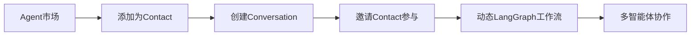

# Connet.AI 后端文档中心

> 基于最新架构设计 (2025-08-22) 的完整后端实现指南

## 📋 文档导航

### 🏗️ 架构设计
- **[整体架构概览](architecture-overview.md)** - 系统整体架构和技术选型
- **[数据库设计](database-design.md)** - 完整的数据模型和关系设计
- **[LangGraph集成架构](langgraph-architecture.md)** - 多智能体工作流引擎

### 🚀 实施指南
- **[开发实施计划](implementation-plan.md)** - 阶段性开发计划和TODO清单
- **[迁移策略](migration-strategy.md)** - 从现有架构到新架构的迁移
- **[代码重构指南](refactoring-guide.md)** - 现有代码的重构策略

### 📊 项目管理
- **[开发进度追踪](progress-tracker.md)** - 当前开发状态和完成情况
- **[任务管理](task-management.md)** - 任务分配和优先级管理

### 🔧 部署运维
- **[部署指南](deployment-guide.md)** - 环境配置和部署步骤
- **[故障排除](troubleshooting.md)** - 常见问题和解决方案

## 🎯 核心业务流程

## 📚 相关文档

- **[AI理论基础](../AI/protocol/README.md)** - 多智能体协作理论框架
- **[前端实现](../frontend/README.md)** - 前端集成和UI设计
- **[API文档](../api/README.md)** - 完整的API接口文档

## 🗂️ 历史文档

历史版本的文档已移至 [`archive/`](archive/) 目录，包含：
- 早期架构设计和理论探索
- 废弃的实施方案
- 开发过程中的决策记录

## 🔄 文档维护

- **更新频率**: 重大架构变更时更新
- **版本控制**: 使用Git追踪文档变更
- **负责人**: 架构团队
- **反馈**: 通过Issue或PR提出改进建议

---

> 📝 **最后更新**: 2025-08-22  
> 🏷️ **当前版本**: v2.0 (基于Contact实例化架构)