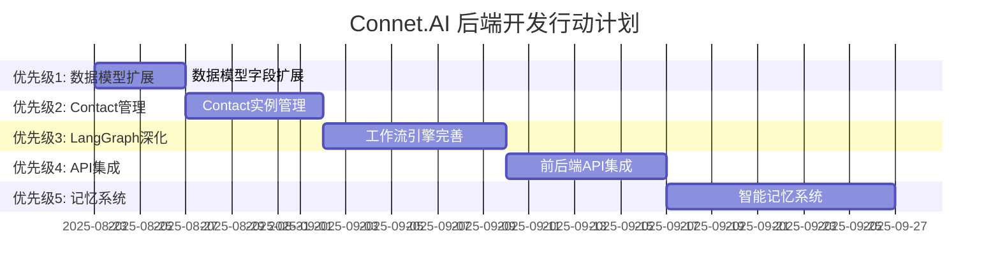
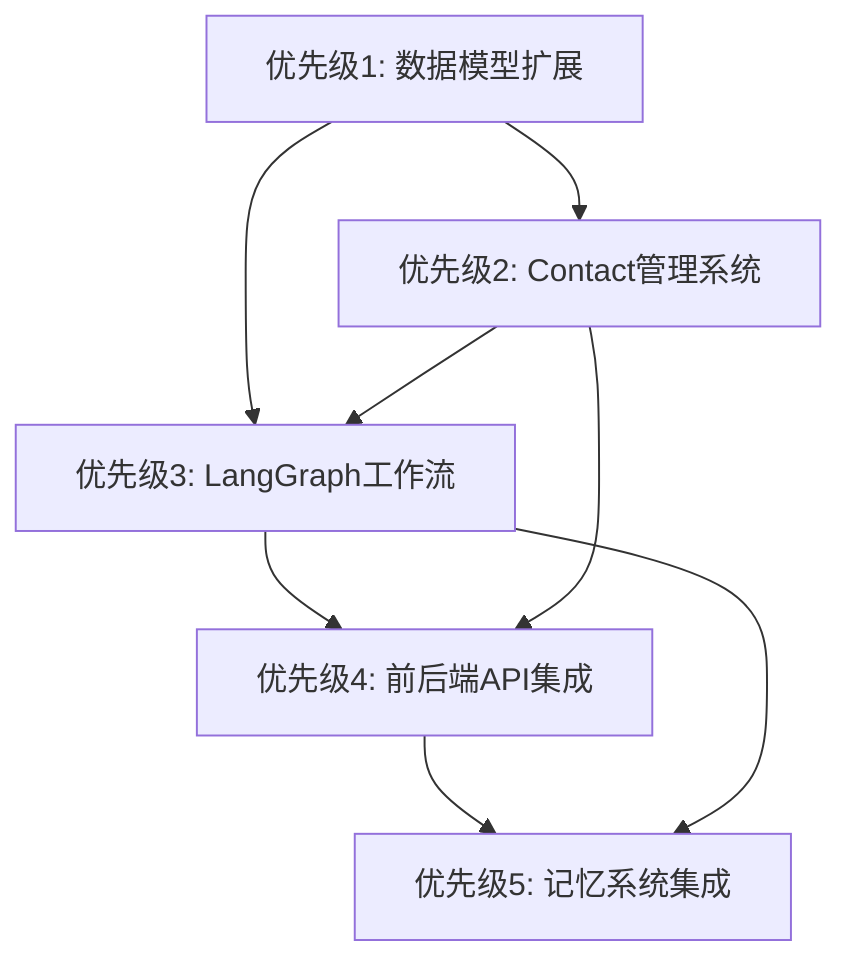

# Connet.AI 后端开发行动计划

> 基于当前实现状态（65% 完成度）的接下来 5 个最重要实施任务

## 📊 当前状态总结

经过对 BFF 服务实现的深入分析，我们已经完成：
- ✅ **基础架构**: FastAPI + DDD 架构完整搭建 (90%)
- ✅ **数据模型**: 17+ 个核心模型已实现 (85%)  
- ✅ **LangGraph 框架**: 12 个服务模块已创建 (70%)
- ✅ **API 端点**: 12 个模块已实现 (75%)

## 🎯 接下来 5 个最重要的实施任务

### 优先级 1: 数据模型扩展迁移 🚀
**预计时间**: 3-4 天  
**复杂度**: 中等  
**阻塞程度**: 高 - 阻塞所有后续功能

#### 任务详情
- **扩展 agents 表**: 添加 `node_type`、`execution_config`、`resource_limits`、`dependencies` 字段
- **扩展 contacts 表**: 添加 `agent_id` 外键、`custom_system_prompt`、`instance_config`、`resource_limits` 字段
- **扩展 conversation_participants 表**: 添加 `workflow_priority`、`conversation_permissions` 字段
- **创建 conversation_memories 表**: 实现对话记忆存储
- **运行 Alembic 迁移脚本**: 更新数据库结构

#### 验收标准
- [ ] 所有字段扩展迁移脚本执行成功
- [ ] 现有数据迁移无损失
- [ ] 新字段约束和索引创建完成
- [ ] 开发和测试环境验证通过

---

### 优先级 2: Contact 实例管理系统完善 🔧
**预计时间**: 5-6 天  
**复杂度**: 高  
**依赖**: 优先级 1 完成

#### 任务详情
- **完善 ContactInstanceManager**: 实现 Agent 到 Contact 的转换逻辑
- **个性化配置系统**: 为每个 Contact 实例提供独立的 system_prompt 和参数配置
- **权限验证系统**: 实现 Contact 级别的权限管理和验证
- **Contact Repository 扩展**: 实现 `get_user_contact_by_agent`、`create_contact_instance`、`update_contact_config` 方法
- **参与者管理功能**: 动态管理对话中的 Contact 参与者

#### 验收标准
- [ ] Agent 可以成功转换为用户的 Contact 实例
- [ ] Contact 个性化配置生效且可持久化
- [ ] Contact 权限验证机制正常工作
- [ ] 支持一个 Agent 被多用户添加为不同配置的 Contact

---

### 优先级 3: LangGraph 工作流引擎深度实现 ⚡
**预计时间**: 7-8 天  
**复杂度**: 高  
**依赖**: 优先级 1、2 完成

#### 任务详情
- **完善动态工作流构建器**: 根据对话参与者动态构建 LangGraph 工作流
- **实现 @mention 路由系统**: 解析 @mention 并路由到对应的 Contact
- **多 Contact 协作模式**: 
  - 并行处理模式：多个 Contact 同时响应
  - 顺序处理模式：Contact 按优先级依次处理
  - 辩论模式：Contact 之间进行观点交流
- **Contact 节点处理器**: 实现基于 Contact 实例的 LangGraph 节点
- **工作流状态管理**: 完善 ConversationState 和执行跟踪

#### 验收标准
- [ ] 可以根据 @mention 自动路由到正确的 Contact
- [ ] 支持多种协作模式的工作流执行
- [ ] 工作流执行状态可以实时跟踪
- [ ] Contact 个性化配置在工作流中生效

---

### 优先级 4: 前后端 API 深度集成 🔗
**预计时间**: 6-7 天  
**复杂度**: 中-高  
**依赖**: 优先级 1-3 完成

#### 任务详情
- **重构 ai_chat.py**: 移除所有 mock 数据，集成真实的 LangGraph 工作流
- **实现流式响应**: 支持 Server-Sent Events (SSE) 或 WebSocket 流式输出
- **WebSocket 实时通信**: 实现工作流执行状态的实时推送
- **API 接口优化**: 优化现有的 12 个端点模块的性能和错误处理
- **Agent 市场接口完善**: 支持 Agent 浏览、搜索、添加到 Contact 的完整流程

#### 验收标准
- [ ] 前端可以通过 API 获取真实的 AI 响应
- [ ] 支持流式输出，用户可以看到逐步生成的内容  
- [ ] WebSocket 连接稳定，状态更新及时
- [ ] Agent 市场功能完整可用
- [ ] API 响应时间 < 2s (P95)

---

### 优先级 5: 智能记忆系统集成 🧠
**预计时间**: 8-10 天  
**复杂度**: 高  
**依赖**: 优先级 1-4 完成

#### 任务详情
- **Mem0 集成**: 接入 Mem0 服务或实现本地向量数据库
- **分层记忆管理**: 实现短期、中期、长期记忆的分层存储和检索
- **记忆检索优化**: 基于上下文的智能记忆召回
- **ConversationMemoryManager 完善**: 重构现有的 AIMemoryService
- **记忆与工作流集成**: 在 LangGraph 执行过程中自动使用相关记忆

#### 验收标准
- [ ] 记忆存储和检索功能正常工作
- [ ] Contact 可以基于历史对话记忆提供个性化回应
- [ ] 记忆检索性能 < 100ms
- [ ] 支持跨对话的记忆共享和隔离
- [ ] 记忆系统支持多种嵌入模型

---

## 📈 实施时间线

## 🎯 关键里程碑

| 里程碑 | 完成时间 | 验收标准 |
|--------|----------|----------|
| **M1: 数据基础完成** | 2025-08-27 | 所有表扩展迁移完成，数据完整性验证通过 |
| **M2: Contact 系统可用** | 2025-09-03 | Agent 到 Contact 转换和个性化配置功能完整 |
| **M3: 工作流引擎完成** | 2025-09-12 | @mention 路由和多 Contact 协作模式可用 |
| **M4: 前端集成完成** | 2025-09-20 | 前端可获取真实 AI 响应，支持流式输出 |
| **M5: 记忆系统上线** | 2025-10-01 | 智能记忆检索和个性化回应功能完整 |

## ⚠️ 风险控制

### 技术风险
1. **数据迁移风险** (优先级 1)
   - **缓解措施**: 分步迁移，完整备份，回滚方案
   - **应急预案**: 使用备份数据快速恢复

2. **LangGraph 复杂性** (优先级 3)
   - **缓解措施**: 渐进式实现，从简单工作流开始
   - **应急预案**: 降级到单 Contact 处理模式

3. **性能瓶颈** (优先级 4-5)
   - **缓解措施**: 缓存策略，异步处理，负载测试
   - **应急预案**: 特性开关，降级处理

### 业务风险
1. **开发时间压力**
   - **缓解措施**: MVP 优先，增量交付
   - **应急预案**: 调整优先级和范围

## 📊 成功指标

### 技术指标
- **API 响应时间**: P95 < 2s
- **数据库查询**: 平均 < 100ms  
- **工作流执行**: 平均 < 30s
- **记忆检索**: < 100ms
- **WebSocket 连通率**: > 99%

### 功能指标
- **Contact 转换成功率**: > 99%
- **工作流执行成功率**: > 95%
- **@mention 路由准确率**: > 98%
- **记忆召回相关性**: > 85%

## 🔗 依赖关系

## 📞 团队协调

### 开发分工建议
- **后端核心**: 优先级 1-3 (数据模型、Contact 管理、LangGraph)
- **API 集成**: 优先级 4 (前后端对接、流式响应)
- **AI 系统**: 优先级 5 (记忆系统、向量检索)

### 并行开发可能
- 优先级 1 完成后，优先级 2 和 3 可以并行开发
- 优先级 4 的部分工作可以与优先级 3 并行进行
- 测试框架建设可以在整个过程中持续进行

---

> 📝 **文档维护**: 每个优先级完成后更新进度  
> 🔄 **最后更新**: 2025-08-23  
> 📋 **负责人**: 开发团队  
> 🎯 **预期完成**: 2025-10-01