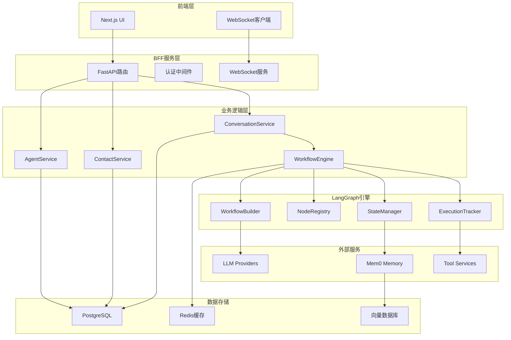
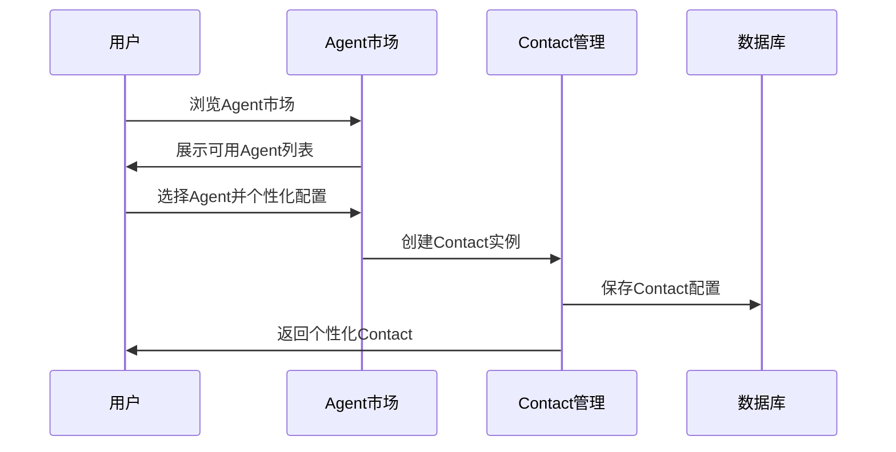
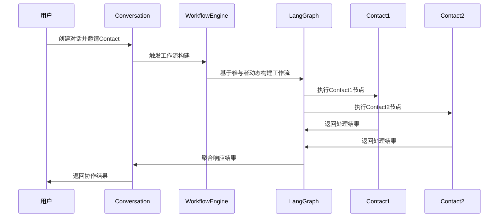

# Connet.AI 整体架构概览

> 基于Contact实例化和LangGraph的多智能体协作平台架构

## 📋 目录
- [核心架构原则](#核心架构原则)
- [系统架构图](#系统架构图)
- [核心业务流程](#核心业务流程)
- [技术栈选型](#技术栈选型)
- [服务架构设计](#服务架构设计)
- [相关文档](#相关文档)

## 🎯 核心架构原则

### 1. Contact实例化模式
- **Agent定义**: 市场中的智能体模板，定义基础能力和配置
- **Contact实例**: 用户个人的智能体实例，支持完全个性化配置
- **动态工作流**: 基于对话参与者动态构建LangGraph工作流

### 2. 分层架构设计
```
┌─────────────────────────────────────────┐
│           Frontend (Next.js)           │
├─────────────────────────────────────────┤
│         BFF Service (FastAPI)          │
├─────────────────────────────────────────┤
│       LangGraph Workflow Engine        │
├─────────────────────────────────────────┤
│    External Services (LLM, Mem0)       │
├─────────────────────────────────────────┤
│      Database (PostgreSQL + Redis)     │
└─────────────────────────────────────────┘
```

### 3. 核心设计原则
- **渐进式迁移**: 基于现有BFF架构扩展，保持向后兼容
- **完整追溯**: 每个工作流执行步骤的完整记录和Token统计
- **动态协作**: 支持实时添加/移除参与者的灵活协作模式
- **个性化配置**: Contact级别的细粒度权限和配置管理

## 🏗️ 系统架构图



## 🔄 核心业务流程

### 1. Agent市场到Contact转换


### 2. Contact协作流程


## 💻 技术栈选型

### 核心技术栈
- **Backend Framework**: FastAPI (Python 3.11+)
- **Database**: PostgreSQL 15+ (主数据库) + Redis 7+ (缓存)
- **Workflow Engine**: LangGraph (状态图管理)
- **Memory System**: Mem0 (统一记忆管理)
- **Vector Database**: pgvector (PostgreSQL扩展)
- **Authentication**: JWT + Supabase Auth
- **Real-time**: WebSocket + Server-Sent Events

### 外部服务集成
- **LLM Providers**: OpenAI, Anthropic, Google, Azure
- **Memory Management**: Mem0 Cloud Service
- **File Storage**: Supabase Storage
- **Email Service**: SendGrid / AWS SES
- **Monitoring**: Prometheus + Grafana

### 开发工具链
- **Package Management**: pip + requirements.txt
- **Database Migration**: Alembic
- **Code Quality**: Black, isort, flake8
- **Testing**: pytest + pytest-asyncio
- **Documentation**: Sphinx + MkDocs

## 🏢 服务架构设计

### 1. BFF Service (Backend for Frontend)
```
bff/
├── app/
│   ├── api/v1/endpoints/        # API路由层
│   ├── services/                # 业务逻辑层
│   │   ├── langgraph/          # LangGraph集成
│   │   ├── tools/              # 工具调用系统
│   │   └── monitoring/         # 监控追踪
│   ├── infrastructure/          # 基础设施层
│   │   ├── database/           # 数据库模型和仓库
│   │   ├── external/           # 外部服务集成
│   │   └── cache/              # 缓存系统
│   └── agents/                 # 智能体实现
│       ├── builtin/            # 内置智能体
│       └── registry.py         # 智能体注册器
```

### 2. 数据模型层次
详细的数据库设计请参考 [数据库设计文档](database-design.md)

核心表关系：
- `agents` → `contacts` → `conversation_participants` → `workflow_executions`
- 支持用户从市场选择Agent创建个性化Contact参与对话

### 3. LangGraph工作流层
详细的LangGraph集成设计请参考 [LangGraph集成架构](langgraph-architecture.md)

核心组件：
- **DynamicWorkflowBuilder**: 基于参与者构建工作流
- **ContactAgentNode**: Contact实例化的智能体节点
- **MentionRouter**: @mention路由系统
- **ExecutionTracker**: 完整的执行追踪

## 📊 性能和扩展性

### 1. 性能优化策略
- **数据库优化**: 索引优化、查询缓存、连接池管理
- **缓存策略**: Redis多层缓存、查询结果缓存
- **异步处理**: FastAPI异步架构、并发控制
- **资源管理**: Contact级别的资源限制和监控

### 2. 扩展性设计
- **水平扩展**: 支持多实例部署和负载均衡
- **模块化架构**: 独立的服务模块便于单独扩展
- **插件系统**: 支持动态加载新的智能体和工具
- **API版本控制**: 保持向后兼容的API演进

## 🔒 安全性设计

### 1. 认证和授权
- **JWT Token**: 用户身份认证
- **Role-Based Access**: 基于角色的权限控制
- **Contact Permissions**: Contact级别的细粒度权限
- **API Rate Limiting**: 防止滥用的限流机制

### 2. 数据安全
- **数据加密**: 敏感数据的加密存储
- **Privacy Controls**: 用户数据隐私控制
- **Audit Logging**: 完整的操作审计日志
- **Secure Communication**: HTTPS/WSS加密通信

## 📚 相关文档

### 核心架构文档
- **[系统目录架构](system-directory-architecture.md)** - 完整的代码目录结构和模块组织
- **[数据库设计](database-design.md)** - 详细的数据模型和关系设计
- **[LangGraph集成架构](langgraph-architecture.md)** - 工作流引擎集成方案
- **[业务商业化模型](business-model.md)** - 游戏化体系和收费模式设计
- **[用户体验策略](user-psychology-strategy.md)** - 用户心理学分析和转化策略

### 实施相关文档
- **[实施计划](implementation-plan.md)** - 分阶段的开发实施计划
- **[迁移策略](migration-strategy.md)** - 现有系统的迁移方案
- **[部署指南](deployment-guide.md)** - 生产环境部署指南

### 历史归档
- **[历史文档归档](../archive/)** - 包含详细设计过程的历史文档

---

> 📝 **文档维护**: 架构团队  
> 🔄 **最后更新**: 2025-08-22  
> 📋 **相关决策**: [ADR-001: Contact实例化模式](../decisions/adr-001-contact-pattern.md)