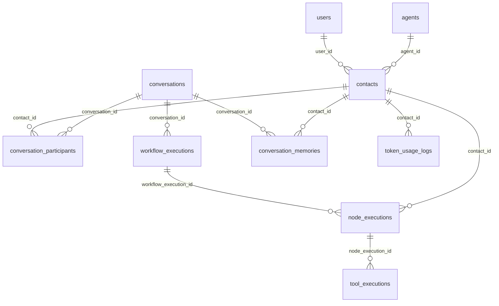

# Connet.AI 数据库设计

> 基于Contact实例化模式的完整数据模型设计

## 📋 目录
- [设计原则](#设计原则)
- [核心数据模型](#核心数据模型)
- [关系设计](#关系设计)
- [扩展表结构](#扩展表结构)
- [索引优化](#索引优化)
- [迁移策略](#迁移策略)

## 🎯 设计原则

### 1. 数据模型层次
```
Agent定义 (agents) 
    ↓ (一对多)
Contact实例 (contacts)
    ↓ (多对多)
对话参与 (conversation_participants)
    ↓ (一对多)
工作流执行 (workflow_executions)
```

### 2. 核心设计理念
- **清晰分离**: Agent定义与Contact实例完全分离
- **个性化支持**: Contact级别的完整配置定制
- **完整追溯**: 每个执行步骤的详细记录
- **性能优化**: 基于查询模式的索引设计

## 🗄️ 核心数据模型

### 1. Agent定义表 (现有扩展)
基于现有 `agents` 表，添加LangGraph支持字段：

```sql
-- 扩展现有 agents 表
ALTER TABLE agents ADD COLUMN node_type VARCHAR(50) DEFAULT 'agent';
ALTER TABLE agents ADD COLUMN execution_config JSONB DEFAULT '{}';
ALTER TABLE agents ADD COLUMN resource_limits JSONB DEFAULT '{}';
ALTER TABLE agents ADD COLUMN dependencies JSONB DEFAULT '[]';

-- 示例数据结构
{
  "node_type": "agent",
  "execution_config": {
    "timeout_ms": 30000,
    "max_retries": 3,
    "parallel_safe": true
  },
  "resource_limits": {
    "max_tokens": 8000,
    "max_tools_per_call": 5,
    "memory_limit_mb": 512
  },
  "dependencies": ["web_search", "code_executor"]
}
```

### 2. Contact实例表 (扩展)
扩展现有 `contacts` 表，支持Agent实例化：

```sql
-- 扩展现有 contacts 表
ALTER TABLE contacts ADD COLUMN agent_id UUID REFERENCES agents(id);
ALTER TABLE contacts ADD COLUMN custom_system_prompt TEXT;
ALTER TABLE contacts ADD COLUMN custom_personality JSONB DEFAULT '{}';
ALTER TABLE contacts ADD COLUMN instance_config JSONB DEFAULT '{}';
ALTER TABLE contacts ADD COLUMN resource_limits JSONB DEFAULT '{}';
ALTER TABLE contacts ADD COLUMN permissions JSONB DEFAULT '[]';
ALTER TABLE contacts ADD COLUMN last_interaction_at TIMESTAMP;

-- 确保用户不能重复添加同一个Agent
ALTER TABLE contacts ADD CONSTRAINT unique_user_agent UNIQUE(user_id, agent_id);

-- 示例Contact实例配置
{
  "instance_config": {
    "model_preferences": {
      "default_model": "gpt-4-turbo",
      "temperature": 0.7,
      "max_tokens": 4000
    },
    "tools": ["web_search", "calculator"],
    "conversation_style": "professional",
    "response_format": "detailed"
  },
  "resource_limits": {
    "max_tokens_per_day": 50000,
    "max_cost_per_month": 10.0,
    "rate_limit_per_hour": 100
  },
  "permissions": ["web_access", "file_read", "calculation"]
}
```

### 3. 对话参与者表 (扩展)
扩展现有 `conversation_participants` 表，支持工作流配置：

```sql
-- 扩展现有 conversation_participants 表
ALTER TABLE conversation_participants ADD COLUMN workflow_priority INTEGER DEFAULT 50;
ALTER TABLE conversation_participants ADD COLUMN conversation_permissions JSONB DEFAULT '[]';
ALTER TABLE conversation_participants ADD COLUMN notification_settings JSONB DEFAULT '{}';
ALTER TABLE conversation_participants ADD COLUMN max_response_length INTEGER;
ALTER TABLE conversation_participants ADD COLUMN response_delay_ms INTEGER DEFAULT 0;

-- 示例工作流配置
{
  "workflow_priority": 80,  -- 1-100，数值越高优先级越高
  "conversation_permissions": ["read", "write", "mention_others"],
  "notification_settings": {
    "mention_notifications": true,
    "response_notifications": false,
    "workflow_status": true
  },
  "max_response_length": 2000,
  "response_delay_ms": 1000  -- 避免过快响应
}
```

## 🆕 扩展表结构

### 1. 工作流执行记录表
```sql
CREATE TABLE workflow_executions (
    id UUID PRIMARY KEY DEFAULT gen_random_uuid(),
    conversation_id UUID REFERENCES conversations(id) NOT NULL,
    trigger_message_id UUID REFERENCES messages(id),
    
    -- 工作流配置
    workflow_type VARCHAR(100) NOT NULL,  -- single_agent, mention_routing, parallel_discussion等
    participant_contacts JSONB NOT NULL,  -- 参与的contact IDs列表
    routing_strategy VARCHAR(100) DEFAULT 'auto',  -- auto, parallel, sequential, consensus
    
    -- 执行状态
    status VARCHAR(50) DEFAULT 'running',  -- running, completed, failed, timeout
    started_at TIMESTAMP DEFAULT NOW(),
    completed_at TIMESTAMP,
    total_duration_ms INTEGER,
    
    -- 结果数据
    input_data JSONB NOT NULL,      -- 输入数据
    output_data JSONB,              -- 输出数据
    execution_path JSONB DEFAULT '[]',  -- 执行路径追踪
    error_details JSONB,            -- 错误详情
    
    -- 成本统计
    total_tokens INTEGER DEFAULT 0,
    total_cost_usd DECIMAL(10, 6) DEFAULT 0.0,
    
    metadata JSONB DEFAULT '{}'
);
```

### 2. 节点执行记录表
```sql
CREATE TABLE node_executions (
    id UUID PRIMARY KEY DEFAULT gen_random_uuid(),
    workflow_execution_id UUID REFERENCES workflow_executions(id) NOT NULL,
    contact_id UUID REFERENCES contacts(id) NOT NULL,  -- 执行节点的contact
    
    -- 节点信息
    node_id VARCHAR(100) NOT NULL,          -- LangGraph中的节点ID
    node_type VARCHAR(50) NOT NULL,         -- agent, tool, decision, aggregator
    execution_order INTEGER,                -- 执行顺序
    
    -- 执行数据
    input_state JSONB,                      -- 输入状态
    output_state JSONB,                     -- 输出状态
    
    -- 执行状态
    status VARCHAR(50) DEFAULT 'pending',   -- pending, running, completed, failed
    started_at TIMESTAMP DEFAULT NOW(),
    completed_at TIMESTAMP,
    duration_ms INTEGER,
    retry_count INTEGER DEFAULT 0,
    
    -- 模型调用信息
    model_used VARCHAR(100),
    prompt_tokens INTEGER DEFAULT 0,
    completion_tokens INTEGER DEFAULT 0,
    cost_usd DECIMAL(10, 6) DEFAULT 0.0,
    
    -- 错误处理
    error_message TEXT,
    error_type VARCHAR(100),
    
    metadata JSONB DEFAULT '{}'
);
```

### 3. 工具执行记录表
```sql
CREATE TABLE tool_executions (
    id UUID PRIMARY KEY DEFAULT gen_random_uuid(),
    node_execution_id UUID REFERENCES node_executions(id) NOT NULL,
    
    -- 工具信息
    tool_name VARCHAR(100) NOT NULL,
    tool_function VARCHAR(100) NOT NULL,
    
    -- 执行数据
    input_parameters JSONB,
    output_result JSONB,
    
    -- 执行状态
    status VARCHAR(50) DEFAULT 'pending',
    started_at TIMESTAMP DEFAULT NOW(),
    completed_at TIMESTAMP,
    duration_ms INTEGER,
    retry_count INTEGER DEFAULT 0,
    
    -- 错误信息
    error_message TEXT,
    error_type VARCHAR(100),
    
    metadata JSONB DEFAULT '{}'
);
```

### 4. 对话记忆关联表
```sql
CREATE TABLE conversation_memories (
    id UUID PRIMARY KEY DEFAULT gen_random_uuid(),
    conversation_id UUID REFERENCES conversations(id) NOT NULL,
    contact_id UUID REFERENCES contacts(id),  -- 哪个contact的记忆，NULL表示共享记忆
    
    -- 记忆分类
    memory_type VARCHAR(50) NOT NULL,         -- individual, shared, contextual
    memory_category VARCHAR(100),             -- preference, knowledge, pattern, entity
    
    -- 记忆内容
    content TEXT NOT NULL,
    summary TEXT,                             -- 记忆摘要
    keywords JSONB DEFAULT '[]',              -- 关键词
    
    -- 记忆属性
    importance_score DECIMAL(3,2) DEFAULT 0.5,  -- 重要性评分 0-1
    confidence_score DECIMAL(3,2) DEFAULT 1.0,  -- 置信度评分 0-1
    access_frequency INTEGER DEFAULT 0,         -- 访问频率
    
    -- 时效性
    created_at TIMESTAMP DEFAULT NOW(),
    expires_at TIMESTAMP,                     -- 过期时间
    last_accessed_at TIMESTAMP DEFAULT NOW(),
    
    -- 元数据
    source_message_id UUID REFERENCES messages(id),  -- 来源消息
    extraction_method VARCHAR(100),           -- 提取方法
    metadata JSONB DEFAULT '{}'
);
```

### 5. Token使用统计表
```sql
CREATE TABLE token_usage_logs (
    id UUID PRIMARY KEY DEFAULT gen_random_uuid(),
    workflow_execution_id UUID REFERENCES workflow_executions(id),
    node_execution_id UUID REFERENCES node_executions(id),
    contact_id UUID REFERENCES contacts(id),  -- 使用Token的Contact
    
    -- 模型信息
    model_name VARCHAR(100),
    provider VARCHAR(50),
    
    -- Token统计
    prompt_tokens INTEGER DEFAULT 0,
    completion_tokens INTEGER DEFAULT 0,
    total_tokens INTEGER DEFAULT 0,
    cost_usd DECIMAL(10, 6),
    
    -- 时间信息
    recorded_at TIMESTAMP DEFAULT NOW(),
    
    -- 配置快照
    model_config JSONB,  -- 调用时的模型配置
    contact_config JSONB  -- Contact的个性化配置
);
```

## 🔗 关系设计

### 1. 核心关系图


### 2. 业务流程映射
```sql
-- 用户添加Agent为Contact
INSERT INTO contacts (user_id, agent_id, custom_name, instance_config)
SELECT 
    :user_id,
    :agent_id,
    :custom_name,
    :instance_config
WHERE NOT EXISTS (
    SELECT 1 FROM contacts 
    WHERE user_id = :user_id AND agent_id = :agent_id
);

-- Contact参与对话
INSERT INTO conversation_participants (conversation_id, contact_id, user_id, role)
VALUES (:conversation_id, :contact_id, :user_id, 'participant');

-- 工作流执行追踪
INSERT INTO workflow_executions (conversation_id, workflow_type, participant_contacts, input_data)
VALUES (:conversation_id, 'mention_routing', :contact_ids_json, :input_data);
```

## 📊 索引优化

### 1. 性能关键索引
```sql
-- Contact查询优化
CREATE INDEX idx_contacts_user_agent ON contacts(user_id, agent_id);
CREATE INDEX idx_contacts_user_status ON contacts(user_id, status) 
    WHERE status = 'active';

-- 对话参与者查询优化
CREATE INDEX idx_conversation_participants_conversation ON conversation_participants(conversation_id);
CREATE INDEX idx_conversation_participants_active ON conversation_participants(conversation_id, is_active) 
    WHERE is_active = true;

-- 工作流执行查询优化
CREATE INDEX idx_workflow_executions_conversation ON workflow_executions(conversation_id);
CREATE INDEX idx_workflow_executions_status_time ON workflow_executions(status, started_at);

-- 节点执行查询优化
CREATE INDEX idx_node_executions_workflow ON node_executions(workflow_execution_id);
CREATE INDEX idx_node_executions_contact ON node_executions(contact_id);
CREATE INDEX idx_node_executions_time ON node_executions(started_at);

-- 记忆查询优化
CREATE INDEX idx_conversation_memories_conversation_type ON conversation_memories(conversation_id, memory_type);
CREATE INDEX idx_conversation_memories_contact ON conversation_memories(contact_id) 
    WHERE contact_id IS NOT NULL;

-- Token使用统计查询优化
CREATE INDEX idx_token_usage_contact_time ON token_usage_logs(contact_id, recorded_at);
CREATE INDEX idx_token_usage_workflow ON token_usage_logs(workflow_execution_id);
```

### 2. JSONB字段索引
```sql
-- 支持Contact配置查询
CREATE INDEX idx_contacts_instance_config_model ON contacts 
    USING GIN ((instance_config->'model_preferences'));

-- 支持执行路径查询
CREATE INDEX idx_workflow_executions_path ON workflow_executions 
    USING GIN (execution_path);

-- 支持记忆关键词查询
CREATE INDEX idx_conversation_memories_keywords ON conversation_memories 
    USING GIN (keywords);
```

## 🔄 迁移策略

### 1. 阶段性迁移
```sql
-- 阶段1: 扩展现有表
BEGIN;
    -- 扩展agents表
    ALTER TABLE agents ADD COLUMN IF NOT EXISTS node_type VARCHAR(50) DEFAULT 'agent';
    ALTER TABLE agents ADD COLUMN IF NOT EXISTS execution_config JSONB DEFAULT '{}';
    
    -- 扩展contacts表
    ALTER TABLE contacts ADD COLUMN IF NOT EXISTS agent_id UUID;
    ALTER TABLE contacts ADD COLUMN IF NOT EXISTS instance_config JSONB DEFAULT '{}';
    
    -- 扩展conversation_participants表
    ALTER TABLE conversation_participants ADD COLUMN IF NOT EXISTS workflow_priority INTEGER DEFAULT 50;
COMMIT;

-- 阶段2: 创建新表
CREATE TABLE IF NOT EXISTS workflow_executions (...);
CREATE TABLE IF NOT EXISTS node_executions (...);
CREATE TABLE IF NOT EXISTS tool_executions (...);

-- 阶段3: 添加外键约束
ALTER TABLE contacts ADD CONSTRAINT fk_contacts_agent 
    FOREIGN KEY (agent_id) REFERENCES agents(id);
```

### 2. 数据迁移脚本
```python
# 迁移现有联系人数据为Contact实例
async def migrate_contacts_to_instances():
    """将现有contacts数据迁移为Agent实例"""
    
    # 为现有contacts创建默认Agent定义
    default_agent = await create_default_agent_definition()
    
    # 更新现有contacts关联到默认Agent
    await db.execute("""
        UPDATE contacts 
        SET agent_id = :agent_id,
            instance_config = jsonb_build_object(
                'migrated_from_legacy', true,
                'migration_date', NOW()::text
            )
        WHERE agent_id IS NULL
    """, {"agent_id": default_agent.id})
```

### 3. 向后兼容策略
```python
# API兼容层
class ContactCompatibilityService:
    """确保新Contact API与现有代码兼容"""
    
    async def get_legacy_contact_format(self, contact_id: UUID):
        """返回兼容旧格式的Contact数据"""
        contact = await self.contact_repo.get_full_contact_info(contact_id)
        
        # 转换为旧格式，确保现有代码不受影响
        return {
            "id": contact.id,
            "name": contact.custom_name or contact.agent_display_name,
            "user_id": contact.user_id,
            # ... 其他兼容字段
        }
```

## 📈 性能监控

### 1. 查询性能指标
```sql
-- 监控关键查询性能
-- Contact查询性能
EXPLAIN (ANALYZE, BUFFERS) 
SELECT c.*, a.display_name 
FROM contacts c 
JOIN agents a ON c.agent_id = a.id 
WHERE c.user_id = :user_id AND c.status = 'active';

-- 工作流执行查询性能
EXPLAIN (ANALYZE, BUFFERS)
SELECT we.*, array_agg(ne.contact_id) as participants
FROM workflow_executions we
LEFT JOIN node_executions ne ON we.id = ne.workflow_execution_id
WHERE we.conversation_id = :conversation_id
GROUP BY we.id;
```

### 2. 存储空间优化
```sql
-- 定期清理过期数据
DELETE FROM token_usage_logs 
WHERE recorded_at < NOW() - INTERVAL '90 days';

DELETE FROM conversation_memories 
WHERE expires_at IS NOT NULL AND expires_at < NOW();

-- 压缩JSONB字段
UPDATE contacts 
SET instance_config = jsonb_strip_nulls(instance_config)
WHERE instance_config::text LIKE '%null%';
```

## 📚 相关文档

- **[架构概览](architecture-overview.md)** - 系统整体架构设计
- **[LangGraph集成](langgraph-architecture.md)** - 工作流引擎数据模型
- **[实施计划](implementation-plan.md)** - 数据库实施步骤
- **[迁移策略](migration-strategy.md)** - 详细的迁移方案

---

> 📝 **数据库版本**: PostgreSQL 15+ with pgvector  
> 🔄 **最后更新**: 2025-08-22  
> 🏷️ **Schema版本**: v2.0 (Contact实例化模式)