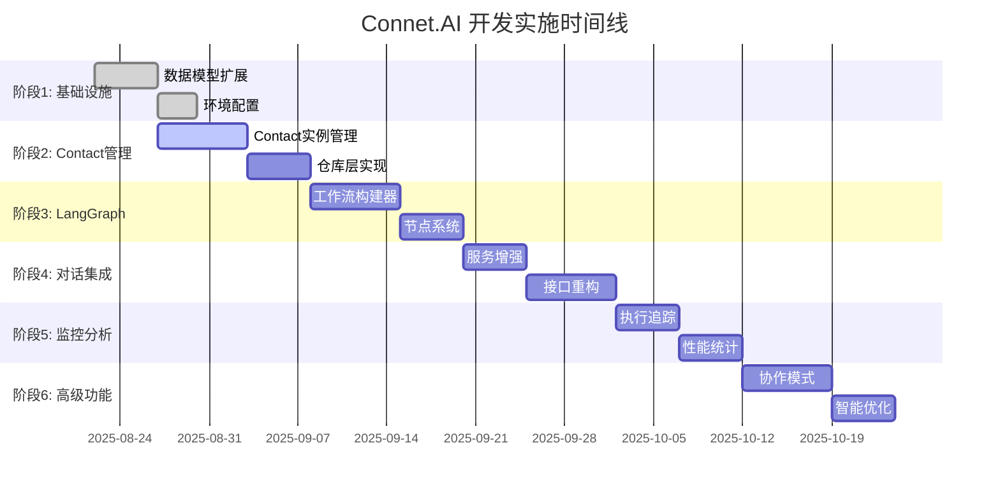

# Connet.AI 开发实施计划

> 基于Contact实例化架构的分阶段开发计划

## 📋 目录
- [实施概览](#实施概览)
- [阶段规划](#阶段规划)
- [任务清单](#任务清单)
- [依赖关系](#依赖关系)
- [验收标准](#验收标准)
- [风险控制](#风险控制)

## 🎯 实施概览

### 核心目标
基于现有BFF架构，实现Contact实例化的多智能体协作平台，支持Agent市场→Contact→Conversation→Group Chat的完整业务流程。

### 实施原则
- **渐进式迁移**: 保持现有功能正常运行
- **向后兼容**: API接口保持兼容性
- **模块化开发**: 独立模块便于并行开发
- **完整测试**: 每个阶段都有完整的测试覆盖

## 📅 阶段规划

### 阶段1: 数据模型重构和基础设施 (Week 1-2)
**目标**: 扩展现有数据模型，建立LangGraph基础设施

**关键交付物**:
- 扩展后的数据库表结构
- LangGraph依赖环境配置
- 基础的Contact实例管理

### 阶段2: Contact实例管理和核心服务 (Week 2-4)
**目标**: 实现Contact实例的完整生命周期管理

**关键交付物**:
- Contact实例管理器
- Agent市场集成
- 个性化配置系统

### 阶段3: LangGraph工作流引擎 (Week 3-5)
**目标**: 实现动态工作流构建和执行

**关键交付物**:
- 动态工作流构建器
- Contact智能体节点系统
- 基础协作模式

### 阶段4: 对话流程集成 (Week 4-6)
**目标**: 集成LangGraph到现有对话系统

**关键交付物**:
- 重构后的聊天接口
- 实时状态推送
- 参与者管理

### 阶段5: 监控追踪和分析 (Week 5-7)
**目标**: 完善监控、追踪和分析系统

**关键交付物**:
- 执行追踪系统
- Token使用统计
- 性能监控

### 阶段6: 高级功能和优化 (Week 6-8)
**目标**: 实现高级协作模式和系统优化

**关键交付物**:
- 高级协作模式
- 智能路由决策
- 性能优化

## ✅ 任务清单

### 阶段1: 数据模型重构和基础设施

#### 1.1 核心数据模型扩展
- [ ] **扩展agents表** (依赖: 无)
  - [ ] 添加`node_type`字段
  - [ ] 添加`execution_config`字段  
  - [ ] 添加`resource_limits`字段
  - [ ] 添加`dependencies`字段
  - [ ] 创建Alembic迁移脚本
  - [ ] 验证数据迁移完整性

- [ ] **扩展contacts表** (依赖: 1.1.1)
  - [ ] 添加`agent_id`外键
  - [ ] 添加`custom_system_prompt`字段
  - [ ] 添加`instance_config`字段
  - [ ] 添加`resource_limits`字段
  - [ ] 添加`permissions`字段
  - [ ] 创建唯一约束`(user_id, agent_id)`

- [ ] **扩展conversation_participants表** (依赖: 1.1.2)
  - [ ] 添加`workflow_priority`字段
  - [ ] 添加`conversation_permissions`字段
  - [ ] 添加`notification_settings`字段
  - [ ] 添加`max_response_length`字段

- [ ] **创建新扩展表** (依赖: 1.1.3)
  - [ ] 创建`workflow_executions`表
  - [ ] 创建`node_executions`表
  - [ ] 创建`tool_executions`表
  - [ ] 创建`conversation_memories`表
  - [ ] 创建`token_usage_logs`表

#### 1.2 索引和性能优化
- [ ] **创建性能索引** (依赖: 1.1.4)
  - [ ] Contact查询索引
  - [ ] 工作流执行索引
  - [ ] 记忆检索索引
  - [ ] Token统计索引

- [ ] **JSONB字段索引** (依赖: 1.2.1)
  - [ ] Contact配置索引
  - [ ] 执行路径索引
  - [ ] 记忆关键词索引

#### 1.3 环境和依赖配置
- [ ] **LangGraph环境配置** (依赖: 无)
  - [ ] 添加LangGraph依赖到`requirements.txt`
  - [ ] 配置环境变量
  - [ ] 设置特性开关系统
  - [ ] 配置开发和测试环境

- [ ] **Mem0集成配置** (依赖: 1.3.1)
  - [ ] 添加Mem0依赖
  - [ ] 配置API密钥
  - [ ] 设置向量数据库连接

### 阶段2: Contact实例管理和核心服务

#### 2.1 Contact实例管理系统
- [ ] **扩展ContactRepository** (依赖: 1.1.2)
  - [ ] 实现`get_user_contact_by_agent`方法
  - [ ] 实现`create_contact_instance`方法
  - [ ] 实现`update_contact_config`方法
  - [ ] 实现`get_contact_with_agent_info`方法

- [ ] **ContactInstanceManager服务** (依赖: 2.1.1)
  - [ ] 实现`add_agent_to_contacts`方法
  - [ ] 实现`get_conversation_participants`方法
  - [ ] 实现`add_participant_to_conversation`方法
  - [ ] 实现Contact个性化配置管理
  - [ ] 实现Contact权限验证

#### 2.2 新增仓库层实现
- [ ] **WorkflowExecutionRepository** (依赖: 1.1.4)
  - [ ] 实现基础CRUD操作
  - [ ] 实现执行状态查询
  - [ ] 实现性能统计查询

- [ ] **NodeExecutionRepository** (依赖: 2.2.1)
  - [ ] 实现节点执行记录
  - [ ] 实现Contact执行统计
  - [ ] 实现错误追踪查询

- [ ] **TokenUsageRepository** (依赖: 2.2.2)
  - [ ] 实现Token使用记录
  - [ ] 实现成本统计查询
  - [ ] 实现使用趋势分析

#### 2.3 API模式扩展
- [ ] **扩展AI相关模式** (依赖: 2.1.2)
  - [ ] 扩展`schemas/ai.py`
  - [ ] 创建`schemas/workflows.py`
  - [ ] 创建`schemas/langgraph.py`
  - [ ] 创建`schemas/analytics.py`

### 阶段3: LangGraph工作流引擎

#### 3.1 动态工作流构建器
- [ ] **DynamicWorkflowBuilder** (依赖: 2.2.3)
  - [ ] 实现`build_workflow_for_conversation`方法
  - [ ] 实现工作流类型识别
  - [ ] 实现基于Contact的工作流构建
  - [ ] 实现工作流重构机制

- [ ] **工作流类型支持** (依赖: 3.1.1)
  - [ ] 实现单Contact工作流
  - [ ] 实现@mention路由工作流
  - [ ] 实现并行讨论工作流
  - [ ] 实现顺序处理工作流

#### 3.2 LangGraph节点系统
- [ ] **ContactAgentNode** (依赖: 3.1.2)
  - [ ] 实现基于Contact的智能体节点
  - [ ] 集成Contact个性化配置
  - [ ] 实现Contact权限检查
  - [ ] 集成Contact级别记忆

- [ ] **路由和聚合节点** (依赖: 3.2.1)
  - [ ] 实现MentionRouter
  - [ ] 实现ResponseAggregator
  - [ ] 实现ConsensusBuilder
  - [ ] 实现ConflictResolver

#### 3.3 记忆系统增强
- [ ] **ConversationMemoryManager** (依赖: 1.3.2)
  - [ ] 重构现有AIMemoryService
  - [ ] 集成Mem0客户端
  - [ ] 实现分层记忆管理
  - [ ] 实现记忆检索优化

- [ ] **记忆与工作流集成** (依赖: 3.3.1)
  - [ ] 集成记忆到LangGraph状态
  - [ ] 实现记忆引用追踪
  - [ ] 支持跨节点记忆共享

### 阶段4: 对话流程集成

#### 4.1 现有服务增强
- [ ] **AIAgentService增强** (依赖: 3.2.2)
  - [ ] 增强Agent市场功能
  - [ ] 实现Agent到Contact转换
  - [ ] 支持Agent版本管理
  - [ ] 集成LangGraph节点注册

- [ ] **ConversationService增强** (依赖: 4.1.1)
  - [ ] 支持Contact参与者管理
  - [ ] 实现动态工作流触发
  - [ ] 支持1v1到群聊转换
  - [ ] 集成实时状态同步

#### 4.2 聊天接口重构
- [ ] **ai_chat.py重构** (依赖: 4.1.2)
  - [ ] 移除mock逻辑
  - [ ] 集成LangGraph工作流
  - [ ] 实现@mention解析
  - [ ] 支持流式响应

- [ ] **实时状态推送** (依赖: 4.2.1)
  - [ ] 扩展WebSocket支持
  - [ ] 实现工作流状态推送
  - [ ] 支持Contact执行进度
  - [ ] 实现错误状态通知

#### 4.3 Agent市场接口
- [ ] **ai_agents.py扩展** (依赖: 4.1.1)
  - [ ] 实现Agent浏览和搜索
  - [ ] 实现Agent添加到Contact接口
  - [ ] 支持Agent评分系统
  - [ ] 实现Agent版本管理

#### 4.4 Contact管理接口
- [ ] **contacts.py扩展** (依赖: 2.1.2)
  - [ ] 实现Contact个性化配置接口
  - [ ] 支持Contact使用统计
  - [ ] 实现Contact权限管理
  - [ ] 支持Contact分组功能

### 阶段5: 监控追踪和分析

#### 5.1 执行追踪系统
- [ ] **WorkflowExecutionTracker** (依赖: 3.2.2)
  - [ ] 实现完整工作流追踪
  - [ ] 实现节点级别执行记录
  - [ ] 支持执行路径可视化
  - [ ] 实现错误追踪和诊断

#### 5.2 Token使用统计
- [ ] **ContactTokenUsageService** (依赖: 5.1.1)
  - [ ] 实现基于Contact的Token统计
  - [ ] 支持多维度使用分析
  - [ ] 实现成本分析和预算控制
  - [ ] 支持使用趋势预测

#### 5.3 性能监控系统
- [ ] **PerformanceMonitor** (依赖: 5.2.1)
  - [ ] 实现系统性能监控
  - [ ] 监控工作流执行时间
  - [ ] 实现性能异常检测
  - [ ] 集成智能告警机制

### 阶段6: 高级功能和优化

#### 6.1 高级协作模式
- [ ] **辩论模式** (依赖: 3.2.2)
  - [ ] 实现Contact辩论工作流
  - [ ] 支持观点对抗和论证
  - [ ] 实现辩论结果评估

- [ ] **头脑风暴模式** (依赖: 6.1.1)
  - [ ] 实现创意生成协作
  - [ ] 支持创意评估和筛选
  - [ ] 实现方案合并优化

#### 6.2 智能路由和决策
- [ ] **智能Contact推荐** (依赖: 5.2.1)
  - [ ] 基于上下文的Contact推荐
  - [ ] 实现能力匹配算法
  - [ ] 支持历史表现学习

- [ ] **动态工作流优化** (依赖: 6.2.1)
  - [ ] 基于性能数据的流程优化
  - [ ] 实现负载均衡和调度
  - [ ] 支持协作效果学习

## 🔗 依赖关系

### 关键路径分析

### 技术依赖
- **LangGraph**: 工作流引擎核心
- **Mem0**: 统一记忆管理
- **PostgreSQL**: 数据存储和索引
- **Redis**: 缓存和状态管理
- **WebSocket**: 实时状态推送

## 🎯 验收标准

### 阶段1验收标准
- [ ] 所有数据库迁移脚本执行成功
- [ ] 现有功能测试全部通过
- [ ] LangGraph环境配置完成
- [ ] 基础Contact实例可创建和查询

### 阶段2验收标准
- [ ] Contact实例管理功能完整
- [ ] Agent市场集成正常
- [ ] 个性化配置生效
- [ ] 单元测试覆盖率>80%

### 阶段3验收标准
- [ ] 动态工作流构建成功
- [ ] 基础协作模式可执行
- [ ] Contact节点正常工作
- [ ] 执行状态可追踪

### 阶段4验收标准
- [ ] 聊天接口支持多Contact
- [ ] @mention路由正常
- [ ] 实时状态推送工作
- [ ] API接口向后兼容

### 阶段5验收标准
- [ ] 完整执行追踪可用
- [ ] Token统计准确
- [ ] 性能监控正常
- [ ] 分析报告可生成

### 阶段6验收标准
- [ ] 高级协作模式可用
- [ ] 智能推荐准确
- [ ] 性能优化显著
- [ ] 用户满意度提升

## ⚠️ 风险控制

### 技术风险
1. **LangGraph版本兼容性**
   - 缓解措施: 锁定版本，建立测试环境
   - 应急预案: 准备降级方案

2. **数据迁移风险**
   - 缓解措施: 分阶段迁移，完整备份
   - 应急预案: 快速回滚机制

3. **性能影响**
   - 缓解措施: 渐进式发布，监控告警
   - 应急预案: 特性开关快速禁用

### 业务风险
1. **用户体验中断**
   - 缓解措施: 向后兼容，平滑迁移
   - 应急预案: 保持旧版本可用

2. **功能延期**
   - 缓解措施: MVP优先，增量交付
   - 应急预案: 调整优先级和范围

### 质量控制
- **代码审查**: 所有PR必须审查
- **自动测试**: CI/CD流水线验证
- **性能测试**: 关键路径性能验证
- **用户测试**: 内部用户体验测试

## 📊 进度跟踪

### 关键指标
- **完成进度**: 按阶段跟踪完成百分比
- **代码质量**: 测试覆盖率、代码规范
- **性能指标**: 响应时间、成功率
- **用户反馈**: 满意度、使用频率

### 报告机制
- **日报**: 开发进度和阻塞问题
- **周报**: 阶段完成情况和风险评估
- **里程碑报告**: 重要节点的详细总结

## 📚 相关文档

- **[架构概览](architecture-overview.md)** - 系统整体架构
- **[数据库设计](database-design.md)** - 数据模型详细设计
- **[LangGraph集成](langgraph-architecture.md)** - 工作流引擎集成
- **[迁移策略](migration-strategy.md)** - 详细迁移方案
- **[部署指南](deployment-guide.md)** - 生产环境部署

---

> 📝 **项目经理**: 开发团队  
> 🔄 **最后更新**: 2025-08-22  
> 📋 **当前阶段**: 阶段1 - 数据模型重构