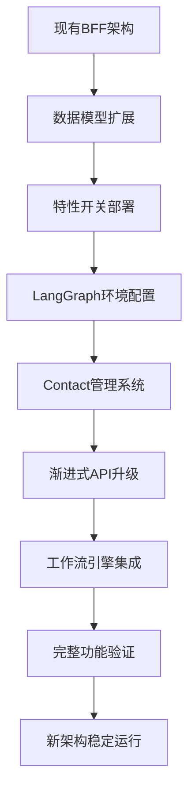

# Connet.AI 迁移策略

> 从现有BFF架构到Contact实例化LangGraph架构的渐进式迁移方案

## 📋 迁移概述

### 迁移目标
- **零停机迁移**: 现有功能持续可用
- **渐进式升级**: 分阶段引入新功能
- **向后兼容**: 保持现有API接口稳定
- **平滑切换**: 用户无感知的功能升级

### 迁移原则
- **特性开关控制**: 新功能通过开关逐步启用
- **数据完整性保证**: 所有迁移操作可回滚
- **性能监控**: 实时监控迁移对性能的影响
- **风险控制**: 每个阶段都有应急预案

## 🎯 迁移路径

### 核心迁移流程


## 📅 分阶段迁移计划

### 阶段1: 基础设施准备 (Week 1-2)
**目标**: 扩展数据模型，建立迁移基础

#### 1.1 数据库扩展
```sql
-- 阶段1迁移脚本示例
BEGIN;

-- 扩展agents表
ALTER TABLE agents ADD COLUMN IF NOT EXISTS node_type VARCHAR(50) DEFAULT 'agent';
ALTER TABLE agents ADD COLUMN IF NOT EXISTS execution_config JSONB DEFAULT '{}';
ALTER TABLE agents ADD COLUMN IF NOT EXISTS resource_limits JSONB DEFAULT '{}';

-- 扩展contacts表
ALTER TABLE contacts ADD COLUMN IF NOT EXISTS agent_id UUID;
ALTER TABLE contacts ADD COLUMN IF NOT EXISTS instance_config JSONB DEFAULT '{}';
ALTER TABLE contacts ADD COLUMN IF NOT EXISTS custom_system_prompt TEXT;

-- 创建新的追踪表
CREATE TABLE IF NOT EXISTS workflow_executions (
    id UUID PRIMARY KEY DEFAULT gen_random_uuid(),
    conversation_id UUID REFERENCES conversations(id),
    workflow_type VARCHAR(100) NOT NULL,
    status VARCHAR(50) DEFAULT 'running',
    started_at TIMESTAMP DEFAULT NOW(),
    completed_at TIMESTAMP,
    input_data JSONB NOT NULL,
    output_data JSONB,
    metadata JSONB DEFAULT '{}'
);

COMMIT;
```

#### 1.2 特性开关部署
```python
# config/feature_flags.py
class FeatureFlags:
    """特性开关配置"""
    
    # LangGraph功能开关
    LANGGRAPH_ENABLED = os.getenv("FEATURE_LANGGRAPH_ENABLED", "false").lower() == "true"
    
    # Contact实例化功能
    CONTACT_INSTANCES_ENABLED = os.getenv("FEATURE_CONTACT_INSTANCES", "false").lower() == "true"
    
    # 多智能体协作
    MULTI_AGENT_CHAT = os.getenv("FEATURE_MULTI_AGENT_CHAT", "false").lower() == "true"
    
    # 新API版本
    API_V2_ENABLED = os.getenv("FEATURE_API_V2", "false").lower() == "true"

# 在现有代码中使用
from config.feature_flags import FeatureFlags

@router.post("/chat")
async def chat_endpoint(request: ChatRequest):
    if FeatureFlags.LANGGRAPH_ENABLED and has_mentions(request.message):
        return await new_langgraph_handler(request)
    else:
        return await legacy_chat_handler(request)
```

### 阶段2: Contact实例管理 (Week 2-3)
**目标**: 实现Contact实例化，保持向后兼容

#### 2.1 兼容性适配器
```python
# services/compatibility/contact_adapter.py
class ContactCompatibilityAdapter:
    """确保新Contact系统与现有代码兼容"""
    
    async def get_legacy_contact_format(self, contact_id: UUID) -> Dict:
        """返回兼容旧格式的Contact数据"""
        
        if FeatureFlags.CONTACT_INSTANCES_ENABLED:
            # 使用新的Contact实例系统
            contact_instance = await self.contact_manager.get_contact_with_agent(contact_id)
            return {
                "id": contact_instance.id,
                "name": contact_instance.custom_name or contact_instance.agent_display_name,
                "user_id": contact_instance.user_id,
                "is_active": contact_instance.status == "active",
                # 保持现有字段格式
            }
        else:
            # 使用现有Contact系统
            return await self.legacy_contact_repo.get_by_id(contact_id)
    
    async def create_contact_backward_compatible(self, contact_data: Dict) -> Dict:
        """向后兼容的Contact创建"""
        
        if FeatureFlags.CONTACT_INSTANCES_ENABLED:
            # 如果有agent_id，创建Contact实例
            if "agent_id" in contact_data:
                return await self.contact_manager.add_agent_to_contacts(
                    user_id=contact_data["user_id"],
                    agent_id=contact_data["agent_id"],
                    custom_config=contact_data.get("custom_config", {})
                )
            else:
                # 为现有contact创建默认Agent关联
                default_agent = await self.get_or_create_default_agent()
                return await self.contact_manager.add_agent_to_contacts(
                    user_id=contact_data["user_id"],
                    agent_id=default_agent.id,
                    custom_config={"migrated_from_legacy": True}
                )
        else:
            # 使用现有逻辑
            return await self.legacy_contact_service.create(contact_data)
```

#### 2.2 数据迁移脚本
```python
# scripts/migrate_contacts_to_instances.py
async def migrate_existing_contacts():
    """将现有contacts迁移为Contact实例"""
    
    # 创建默认Agent定义（用于现有contacts）
    default_agent = await create_default_agent_definition()
    
    # 查询所有现有contacts
    existing_contacts = await db.execute("""
        SELECT id, user_id, name, metadata 
        FROM contacts 
        WHERE agent_id IS NULL
    """)
    
    for contact_row in existing_contacts:
        # 为每个现有contact关联默认Agent
        await db.execute("""
            UPDATE contacts 
            SET 
                agent_id = :agent_id,
                instance_config = jsonb_build_object(
                    'migrated_from_legacy', true,
                    'original_name', :original_name,
                    'migration_date', :migration_date
                )
            WHERE id = :contact_id
        """, {
            "agent_id": default_agent.id,
            "original_name": contact_row.name,
            "migration_date": datetime.utcnow().isoformat(),
            "contact_id": contact_row.id
        })
    
    print(f"迁移完成: {len(existing_contacts)} 个contacts")

async def create_default_agent_definition():
    """创建默认Agent定义"""
    
    default_agent_data = {
        "name": "legacy_default",
        "display_name": "传统助手",
        "description": "为现有联系人创建的默认智能体",
        "system_prompt": "你是一个通用的AI助手，能够帮助用户解答问题和处理任务。",
        "agent_type": "system",
        "is_public": False,
        "node_type": "agent",
        "execution_config": {
            "timeout_ms": 30000,
            "max_retries": 3
        }
    }
    
    return await agent_repository.create(default_agent_data)
```

### 阶段3: LangGraph工作流集成 (Week 3-4)
**目标**: 引入LangGraph工作流，支持多智能体协作

#### 3.1 工作流引擎集成
```python
# services/chat/hybrid_chat_service.py
class HybridChatService:
    """混合聊天服务 - 支持新旧系统"""
    
    async def process_chat_message(self, request: ChatRequest) -> ChatResponse:
        """处理聊天消息，自动选择处理方式"""
        
        # 分析消息内容和参与者
        analysis = await self._analyze_message_requirements(request)
        
        if analysis.requires_langgraph:
            # 使用LangGraph处理
            return await self._process_with_langgraph(request, analysis)
        else:
            # 使用传统方式处理
            return await self._process_with_legacy_system(request)
    
    async def _analyze_message_requirements(self, request: ChatRequest) -> MessageAnalysis:
        """分析消息是否需要LangGraph处理"""
        
        # 检查@mention
        mentions = extract_mentions(request.message)
        
        # 检查参与者数量
        participants = await self.get_conversation_participants(request.conversation_id)
        
        # 检查复杂度
        complexity = await self.analyze_message_complexity(request.message)
        
        return MessageAnalysis(
            has_mentions=bool(mentions),
            participant_count=len(participants),
            complexity_score=complexity,
            requires_langgraph=(
                bool(mentions) or 
                len(participants) > 1 or 
                complexity > 0.7
            ) and FeatureFlags.LANGGRAPH_ENABLED
        )
    
    async def _process_with_langgraph(self, request: ChatRequest, analysis: MessageAnalysis) -> ChatResponse:
        """使用LangGraph处理消息"""
        
        workflow_engine = WorkflowEngine()
        
        try:
            # 构建工作流
            workflow = await workflow_engine.build_workflow_for_conversation(
                request.conversation_id,
                request.message
            )
            
            # 执行工作流
            result = await workflow.execute({
                "conversation_id": request.conversation_id,
                "current_message": request.message,
                "user_id": request.user_id
            })
            
            return ChatResponse(
                message_id=str(uuid4()),
                content=result["response"],
                metadata={
                    "workflow_type": result.get("workflow_type"),
                    "execution_time": result.get("duration_ms"),
                    "participants": result.get("participants", [])
                }
            )
            
        except Exception as e:
            # LangGraph失败时回退到传统系统
            logger.warning(f"LangGraph execution failed, falling back: {e}")
            return await self._process_with_legacy_system(request)
```

#### 3.2 渐进式功能启用
```python
# api/v1/endpoints/chat.py
@router.post("/")
async def chat_endpoint(
    request: ChatRequest,
    current_user: User = Depends(get_current_user),
    db: AsyncSession = Depends(get_db)
):
    """聊天接口 - 支持渐进式功能启用"""
    
    # 检查用户是否在新功能白名单中
    user_in_beta = await is_user_in_beta_group(current_user.id)
    
    # 决定使用的处理方式
    if FeatureFlags.LANGGRAPH_ENABLED and user_in_beta:
        # Beta用户使用新系统
        hybrid_service = HybridChatService(db)
        return await hybrid_service.process_chat_message(request)
    else:
        # 其他用户使用传统系统
        legacy_service = LegacyChatService(db)
        return await legacy_service.process_message(request)

async def is_user_in_beta_group(user_id: UUID) -> bool:
    """检查用户是否在Beta测试组"""
    
    # 基于用户ID的灰度发布
    user_hash = int(str(user_id).replace('-', ''), 16)
    rollout_percentage = int(os.getenv("LANGGRAPH_ROLLOUT_PERCENTAGE", "5"))
    
    return (user_hash % 100) < rollout_percentage
```

### 阶段4: API接口升级 (Week 4-5)
**目标**: 平滑升级API接口，保持向后兼容

#### 4.1 版本化API策略
```python
# api/v1/endpoints/contacts.py (现有版本)
@router.get("/")
async def get_contacts_v1(current_user: User = Depends(get_current_user)):
    """V1 API - 保持现有格式"""
    
    adapter = ContactCompatibilityAdapter()
    contacts = await adapter.get_all_contacts_legacy_format(current_user.id)
    return contacts

# api/v2/endpoints/contacts.py (新版本)
@router.get("/")
async def get_contacts_v2(current_user: User = Depends(get_current_user)):
    """V2 API - 支持Contact实例和Agent信息"""
    
    if FeatureFlags.API_V2_ENABLED:
        contact_manager = ContactInstanceManager()
        contacts = await contact_manager.get_user_contacts_with_agents(current_user.id)
        
        return [
            {
                "id": contact.id,
                "custom_name": contact.custom_name,
                "agent": {
                    "id": contact.agent_id,
                    "name": contact.agent_name,
                    "display_name": contact.agent_display_name,
                    "capabilities": contact.agent_capabilities
                },
                "instance_config": contact.instance_config,
                "status": contact.status,
                "created_at": contact.added_at
            }
            for contact in contacts
        ]
    else:
        # 回退到V1行为
        return await get_contacts_v1(current_user)
```

#### 4.2 API网关和路由
```python
# api/router.py
def setup_api_routing(app: FastAPI):
    """设置API路由，支持版本切换"""
    
    # V1 API (传统)
    app.include_router(
        v1_contacts.router,
        prefix="/api/v1/contacts",
        tags=["contacts-v1"]
    )
    
    # V2 API (新功能)
    if FeatureFlags.API_V2_ENABLED:
        app.include_router(
            v2_contacts.router,
            prefix="/api/v2/contacts",
            tags=["contacts-v2"]
        )
    
    # 默认路由 (向后兼容)
    app.include_router(
        v1_contacts.router,
        prefix="/api/contacts",
        tags=["contacts-default"]
    )
```

### 阶段5: 完整功能验证 (Week 5-6)
**目标**: 验证所有功能正常工作，准备全面切换

#### 5.1 A/B测试框架
```python
# services/testing/ab_testing.py
class ABTestingService:
    """A/B测试服务"""
    
    async def should_use_new_system(self, user_id: UUID, feature: str) -> bool:
        """决定用户是否使用新系统"""
        
        # 检查用户分组
        user_group = await self.get_user_test_group(user_id, feature)
        
        # 记录实验参与
        await self.record_experiment_participation(user_id, feature, user_group)
        
        return user_group == "treatment"
    
    async def record_experiment_result(self, user_id: UUID, feature: str, success: bool, metrics: Dict):
        """记录实验结果"""
        
        await self.db.execute("""
            INSERT INTO ab_test_results (user_id, feature, success, metrics, recorded_at)
            VALUES (:user_id, :feature, :success, :metrics, NOW())
        """, {
            "user_id": user_id,
            "feature": feature,
            "success": success,
            "metrics": json.dumps(metrics)
        })
```

#### 5.2 监控和告警
```python
# services/monitoring/migration_monitor.py
class MigrationMonitor:
    """迁移过程监控"""
    
    async def check_system_health(self) -> Dict[str, Any]:
        """检查系统健康状态"""
        
        health_report = {
            "overall_status": "healthy",
            "legacy_system": await self._check_legacy_system(),
            "langgraph_system": await self._check_langgraph_system(),
            "database": await self._check_database_health(),
            "error_rates": await self._get_error_rates()
        }
        
        # 如果错误率过高，自动禁用新功能
        if health_report["error_rates"]["langgraph"] > 0.05:  # 5%错误率阈值
            await self._emergency_fallback("high_error_rate")
        
        return health_report
    
    async def _emergency_fallback(self, reason: str):
        """紧急回退到传统系统"""
        
        # 禁用所有新功能
        await self._disable_feature_flags()
        
        # 发送告警
        await self._send_alert(f"Emergency fallback triggered: {reason}")
        
        logger.critical(f"Emergency fallback activated: {reason}")
```

## ⚠️ 风险控制和应急预案

### 关键风险点
1. **数据丢失风险**
   - 缓解措施: 每次迁移前完整备份
   - 应急预案: 5分钟内回滚到前一状态

2. **性能严重下降**
   - 缓解措施: 实时性能监控
   - 应急预案: 自动禁用新功能

3. **用户体验中断**
   - 缓解措施: 渐进式发布
   - 应急预案: 快速切换到传统系统

### 应急回滚程序
```bash
#!/bin/bash
# emergency_rollback.sh

echo "开始紧急回滚程序..."

# 1. 禁用所有新功能
kubectl set env deployment/connet-ai-backend \
  FEATURE_LANGGRAPH_ENABLED=false \
  FEATURE_CONTACT_INSTANCES=false \
  FEATURE_API_V2=false

# 2. 重启服务
kubectl rollout restart deployment/connet-ai-backend

# 3. 验证回滚成功
kubectl rollout status deployment/connet-ai-backend

# 4. 发送通知
curl -X POST $SLACK_WEBHOOK_URL \
  -H 'Content-type: application/json' \
  --data '{"text":"🚨 Connet.AI 紧急回滚完成"}'

echo "回滚完成，系统已恢复到传统模式"
```

## 📊 迁移成功指标

### 技术指标
- **系统可用性**: >99.9%
- **API错误率**: <0.1%
- **响应时间**: P95 <2秒
- **数据完整性**: 100%

### 业务指标
- **用户满意度**: >4.5/5.0
- **功能使用率**: 新功能使用率>30%
- **性能改进**: 响应速度提升>20%

### 迁移进度跟踪
```python
# 迁移进度监控
migration_metrics = {
    "users_on_new_system": "累计迁移用户数",
    "feature_adoption_rate": "新功能采用率",
    "error_rate_comparison": "新旧系统错误率对比",
    "performance_improvement": "性能提升指标"
}
```

## 📚 相关文档

- **[架构概览](architecture-overview.md)** - 新架构详细设计
- **[实施计划](implementation-plan.md)** - 详细开发计划
- **[部署指南](deployment-guide.md)** - 生产环境部署
- **[故障排除](troubleshooting.md)** - 问题解决指南

---

> 📝 **迁移负责人**: 架构团队  
> 🔄 **最后更新**: 2025-08-22  
> 📋 **当前阶段**: 阶段1 - 基础设施准备