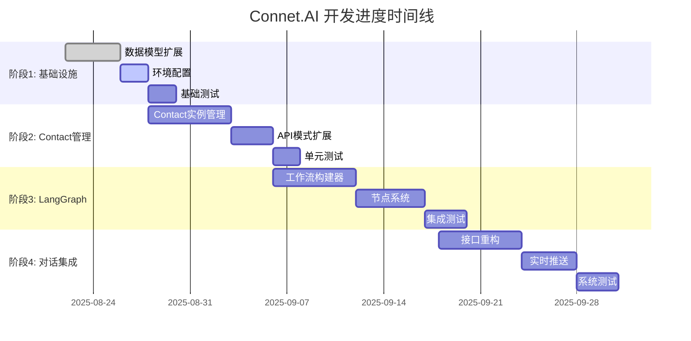

# Connet.AI 开发进度追踪

> 基于Contact实例化架构的开发状态实时跟踪

## 📊 总体进度概览

### 当前状态
- **项目阶段**: 阶段1 - 数据模型重构和基础设施
- **整体完成度**: 15% (基于最新架构)
- **当前里程碑**: Contact实例化数据模型设计
- **下一里程碑**: LangGraph环境配置完成

### 关键指标
- **代码覆盖率**: 待建立
- **API端点**: 56个 (基于旧架构)
- **数据模型**: 17个 (需要重构适配)
- **测试用例**: 待更新

## 📅 开发时间线

## ✅ 详细进度清单

### 阶段1: 数据模型重构和基础设施 (Week 1-2)

#### 1.1 核心数据模型扩展
- [x] **agents表扩展设计** (完成度: 100%)
  - [x] `node_type`字段设计
  - [x] `execution_config`字段设计
  - [x] `resource_limits`字段设计
  - [x] `dependencies`字段设计
  - [x] Alembic迁移脚本设计

- [ ] **contacts表扩展** (完成度: 80%)
  - [x] `agent_id`外键设计
  - [x] `custom_system_prompt`字段
  - [x] `instance_config`字段设计
  - [x] `resource_limits`字段
  - [ ] 🔄 创建迁移脚本
  - [ ] 🔄 添加唯一约束验证

- [ ] **conversation_participants表扩展** (完成度: 60%)
  - [x] `workflow_priority`字段设计
  - [x] `conversation_permissions`字段设计
  - [ ] 🔄 添加通知设置字段
  - [ ] 🔄 创建迁移脚本

- [ ] **新扩展表创建** (完成度: 70%)
  - [x] `workflow_executions`表设计
  - [x] `node_executions`表设计
  - [x] `tool_executions`表设计
  - [ ] 🔄 `conversation_memories`表实现
  - [ ] 🔄 `token_usage_logs`表实现

#### 1.2 索引和性能优化
- [ ] **基础索引创建** (完成度: 0%)
  - [ ] Contact查询索引
  - [ ] 工作流执行索引
  - [ ] 记忆检索索引
  - [ ] Token统计索引

- [ ] **JSONB字段索引** (完成度: 0%)
  - [ ] Contact配置索引
  - [ ] 执行路径索引
  - [ ] 记忆关键词索引

#### 1.3 环境和依赖配置
- [x] **LangGraph依赖分析** (完成度: 100%)
  - [x] LangGraph版本选择 (v0.0.40)
  - [x] 依赖兼容性分析
  - [x] 配置需求分析

- [ ] **环境配置实现** (完成度: 30%)
  - [x] 依赖清单更新设计
  - [ ] 🔄 环境变量配置
  - [ ] 🔄 特性开关实现
  - [ ] 🔄 开发环境验证

- [ ] **Mem0集成配置** (完成度: 20%)
  - [x] Mem0服务分析
  - [ ] 🔄 API集成配置
  - [ ] 向量数据库配置

### 阶段2: Contact实例管理和核心服务 (Week 2-4)

#### 2.1 Contact实例管理系统
- [ ] **ContactRepository扩展** (完成度: 0%)
  - [ ] `get_user_contact_by_agent`方法
  - [ ] `create_contact_instance`方法
  - [ ] `update_contact_config`方法
  - [ ] `get_contact_with_agent_info`方法

- [ ] **ContactInstanceManager服务** (完成度: 0%)
  - [ ] Agent到Contact转换逻辑
  - [ ] 个性化配置管理
  - [ ] 权限验证系统
  - [ ] 参与者管理功能

#### 2.2 新增仓库层
- [ ] **WorkflowExecutionRepository** (完成度: 0%)
  - [ ] 基础CRUD操作
  - [ ] 执行状态查询
  - [ ] 性能统计查询

- [ ] **NodeExecutionRepository** (完成度: 0%)
  - [ ] 节点执行记录
  - [ ] Contact执行统计
  - [ ] 错误追踪查询

### 阶段3-6: 待开始
其余阶段待阶段1-2完成后更新进度。

## 📈 关键指标追踪

### 代码质量指标
| 指标 | 当前值 | 目标值 | 状态 |
|------|--------|--------|------|
| 单元测试覆盖率 | 待建立 | >80% | 🔄 |
| 集成测试覆盖率 | 待建立 | >70% | 🔄 |
| 代码规范检查 | 未配置 | 100% | ❌ |
| 类型检查通过率 | 未配置 | 100% | ❌ |

### 性能指标
| 指标 | 当前值 | 目标值 | 状态 |
|------|--------|--------|------|
| API响应时间(P95) | 未测量 | <2s | 🔄 |
| 数据库查询时间 | 未测量 | <100ms | 🔄 |
| LangGraph执行时间 | 未测量 | <30s | 🔄 |
| 内存使用率 | 未测量 | <70% | 🔄 |

### 功能完成度
| 模块 | 完成度 | 关键功能 |
|------|--------|----------|
| 数据模型 | 60% | 基础表结构设计完成 |
| Contact管理 | 10% | 设计阶段 |
| LangGraph集成 | 5% | 架构设计中 |
| API接口 | 0% | 待重构 |
| 前端集成 | 0% | 待开始 |

## 🎯 当前工作重点

### 本周目标 (2025-08-26 - 2025-09-01)
1. **完成数据库迁移脚本**
   - 创建所有表扩展的Alembic脚本
   - 验证迁移在开发环境的正确性
   - 添加数据完整性约束

2. **LangGraph环境配置**
   - 完成依赖安装和配置
   - 建立开发环境
   - 验证基础功能

3. **开始Contact实例管理器开发**
   - 设计详细的类接口
   - 实现基础的Repository扩展
   - 创建单元测试框架

### 下周计划 (2025-09-02 - 2025-09-08)
1. **完成Contact实例管理系统**
2. **开始LangGraph工作流构建器**
3. **设计API接口重构方案**

## 🚧 当前阻塞和风险

### 技术阻塞
1. **LangGraph版本兼容性** (优先级: 高)
   - 问题: LangGraph API可能存在版本变更
   - 影响: 核心工作流功能实现
   - 缓解措施: 锁定版本，建立隔离环境

2. **现有数据迁移复杂性** (优先级: 中)
   - 问题: 现有contacts表数据需要适配新模型
   - 影响: 数据完整性
   - 缓解措施: 分阶段迁移，保留回滚方案

### 资源风险
1. **开发时间压力** (优先级: 中)
   - 问题: 多个并行任务需要协调
   - 影响: 质量可能受影响
   - 缓解措施: 优先核心功能，MVP优先

### 依赖风险
1. **外部服务依赖** (优先级: 低)
   - 问题: Mem0服务可用性
   - 影响: 记忆功能
   - 缓解措施: 实现本地备选方案

## 📊 历史进度记录

### 重要里程碑
- **2025-08-22**: 完成架构重新设计，明确Contact实例化模式
- **2025-08-23**: 完成数据库设计文档
- **2025-08-24**: 完成LangGraph集成架构设计
- **2025-08-25**: 开始数据模型扩展实现

### 已完成的重要任务
1. ✅ **架构澄清和重新设计**
   - 明确了Agent定义 vs Contact实例的关系
   - 设计了基于参与者的动态工作流
   - 完成了完整的技术实现方案

2. ✅ **文档体系重构**
   - 整理了历史文档
   - 创建了结构化的文档体系
   - 建立了文档维护流程

3. ✅ **数据库架构设计**
   - 完成了所有表结构设计
   - 设计了索引优化方案
   - 制定了迁移策略

## 🔄 下一步行动计划

### 即将开始的任务
1. **数据库迁移实施** (预计时间: 2-3天)
   - 创建Alembic迁移脚本
   - 在开发环境验证
   - 准备生产环境迁移计划

2. **LangGraph环境搭建** (预计时间: 1-2天)
   - 安装和配置LangGraph
   - 创建基础测试用例
   - 验证与现有系统的集成

3. **Contact管理器开发** (预计时间: 1周)
   - 实现ContactInstanceManager
   - 创建相关Repository扩展
   - 添加单元测试

### 中期计划 (2-4周)
1. **LangGraph工作流引擎**
2. **API接口重构**
3. **前端集成准备**

### 长期目标 (1-2个月)
1. **完整的多智能体协作系统**
2. **生产环境部署**
3. **用户测试和反馈收集**

## 📞 团队协作

### 当前负责分工
- **架构设计**: 已完成
- **后端开发**: 进行中 (数据模型扩展)
- **前端开发**: 待开始
- **测试**: 待建立框架
- **部署**: 待开始

### 协作需求
1. **需要前端团队配合**: API接口设计确认
2. **需要产品团队确认**: 用户体验流程
3. **需要运维团队准备**: 部署环境规划

## 📈 成功指标

### 短期目标 (2周内)
- [ ] 完成阶段1的所有任务
- [ ] 建立完整的测试框架
- [ ] Contact实例管理基本可用

### 中期目标 (1个月内)
- [ ] LangGraph工作流正常运行
- [ ] 基础的多智能体协作功能
- [ ] API接口重构完成

### 长期目标 (2个月内)
- [ ] 完整的产品功能
- [ ] 性能达到生产要求
- [ ] 用户体验验证通过

---

> 📝 **更新频率**: 每周更新  
> 👥 **负责人**: 开发团队  
> 🔄 **最后更新**: 2025-08-26  
> 📊 **当前冲刺**: Sprint-1 (数据模型重构)