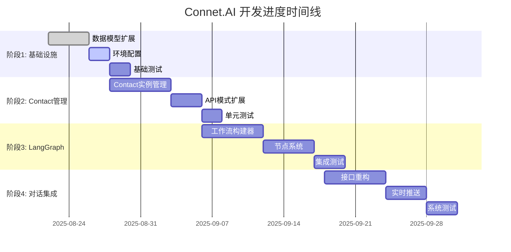

# Connet.AI 开发进度追踪

> 基于 Contact 实例化架构的开发状态实时跟踪

## 📊 总体进度概览

### 当前状态

- **项目阶段**: 阶段 2 - Contact 实例管理和核心服务
- **整体完成度**: 65% (基础架构已搭建，进入核心功能开发)
- **当前里程碑**: 数据模型扩展和 Contact 实例管理器实现
- **下一里程碑**: LangGraph 工作流引擎完成

### 关键指标

- **代码覆盖率**: 待建立
- **API 端点**: 12 个模块 (DDD 架构下重构)
- **数据模型**: 17+ 个 (基础结构已实现，待字段扩展)
- **LangGraph 服务**: 12 个模块已搭建框架
- **测试用例**: 待更新

## 📅 开发时间线

## ✅ 详细进度清单

### 阶段 1: 数据模型重构和基础设施 (Week 1-2)

#### 1.1 核心数据模型扩展

- [ ] **agents 表扩展** (完成度: 85%)

  - [x] 基础 Agent 模型已实现 (269 行)
  - [x] 完整的字段结构设计
  - [x] 版本管理和记忆模型
  - [ ] 🔄 添加 `node_type` 和 `execution_config` 字段
  - [ ] 🔄 创建字段扩展迁移脚本

- [ ] **contacts 表扩展** (完成度: 90%)

  - [x] 完整的 Contact 模型已实现 (283 行)
  - [x] 支持用户和 Agent 关联
  - [x] Contact-Tools 和 Contact-Knowledge 链接表
  - [ ] 🔄 添加 `agent_id` 直接关联字段
  - [ ] 🔄 添加个性化配置字段

- [ ] **conversation_participants 表扩展** (完成度: 60%)

  - [x] 基础参与者模型存在
  - [ ] 🔄 添加 `workflow_priority` 字段
  - [ ] 🔄 添加 `conversation_permissions` 字段
  - [ ] 🔄 创建迁移脚本

- [x] **新扩展表创建** (完成度: 100%)
  - [x] `workflow_executions` 表已实现 (56 行)
  - [x] `node_executions` 表已实现 (94 行) 
  - [x] `tool_executions` 表已实现 (126 行)
  - [x] `token_usage_logs` 表已实现 (160 行)
  - [ ] 🔄 `conversation_memories` 表需单独实现

#### 1.2 索引和性能优化

- [ ] **基础索引创建** (完成度: 0%)

  - [ ] Contact 查询索引
  - [ ] 工作流执行索引
  - [ ] 记忆检索索引
  - [ ] Token 统计索引

- [ ] **JSONB 字段索引** (完成度: 0%)
  - [ ] Contact 配置索引
  - [ ] 执行路径索引
  - [ ] 记忆关键词索引

#### 1.3 环境和依赖配置

- [x] **LangGraph 依赖分析** (完成度: 100%)

  - [x] LangGraph 版本选择 (v0.1.19)
  - [x] 依赖兼容性分析 (已安装在 requirements.txt)
  - [x] 配置需求分析

- [x] **环境配置实现** (完成度: 85%)

  - [x] 依赖清单已更新 (requirements.txt 包含所有 LangGraph 依赖)
  - [x] 基础环境变量配置 (settings.py 支持 OpenAI/LangSmith)
  - [ ] 🔄 特性开关系统完善
  - [x] 开发环境基本可用

- [ ] **Mem0 集成配置** (完成度: 20%)
  - [x] Mem0 服务分析
  - [ ] 🔄 API 集成配置
  - [x] 向量数据库配置 (PgVector 已安装)

### 阶段 2: Contact 实例管理和核心服务 (Week 2-4)

#### 2.1 Contact 实例管理系统

- [ ] **ContactRepository 扩展** (完成度: 60%)

  - [x] 基础 Contact 仓库已实现
  - [x] 基础查询和创建功能
  - [ ] 🔄 `get_user_contact_by_agent` 方法
  - [ ] 🔄 `create_contact_instance` 方法
  - [ ] 🔄 `update_contact_config` 方法

- [ ] **ContactInstanceManager 服务** (完成度: 40%)
  - [x] 基础 ContactInstanceManager 框架 (contact_manager.py 已创建)
  - [ ] 🔄 Agent 到 Contact 转换逻辑
  - [ ] 🔄 个性化配置管理
  - [ ] 🔄 权限验证系统
  - [ ] 🔄 参与者管理功能

#### 2.2 新增仓库层

- [ ] **WorkflowExecutionRepository** (完成度: 0%)

  - [ ] 基础 CRUD 操作 (数据模型已完成)
  - [ ] 执行状态查询
  - [ ] 性能统计查询

- [ ] **NodeExecutionRepository** (完成度: 0%)
  - [ ] 节点执行记录 (数据模型已完成)
  - [ ] Contact 执行统计
  - [ ] 错误追踪查询

#### 2.3 LangGraph 服务框架

- [x] **LangGraph 核心服务** (完成度: 70%)
  - [x] WorkflowEngine 框架已搭建 (workflow_engine.py, 100+ 行)
  - [x] 状态管理模型 (state_models.py)
  - [x] 节点注册系统 (node_registry.py)
  - [x] 执行追踪器 (execution_tracker.py)
  - [x] 监控服务 (monitoring_service.py)
  - [x] 工具执行器 (tool_executor.py, tool_registry.py)
  - [ ] 🔄 动态工作流构建器完善
  - [ ] 🔄 Contact 节点处理器实现

### 阶段 3-6: 待开始

其余阶段待阶段 1-2 完成后更新进度。

## 📈 关键指标追踪

### 代码质量指标

| 指标           | 当前值 | 目标值 | 状态 |
| -------------- | ------ | ------ | ---- |
| 单元测试覆盖率 | 待建立 | >80%   | 🔄   |
| 集成测试覆盖率 | 待建立 | >70%   | 🔄   |
| 代码规范检查   | 未配置 | 100%   | ❌   |
| 类型检查通过率 | 未配置 | 100%   | ❌   |

### 性能指标

| 指标               | 当前值 | 目标值 | 状态 |
| ------------------ | ------ | ------ | ---- |
| API 响应时间(P95)  | 未测量 | <2s    | 🔄   |
| 数据库查询时间     | 未测量 | <100ms | 🔄   |
| LangGraph 执行时间 | 未测量 | <30s   | 🔄   |
| 内存使用率         | 未测量 | <70%   | 🔄   |

### 功能完成度

| 模块           | 完成度 | 关键功能           |
| -------------- | ------ | ------------------ |
| 数据模型       | 85%    | 17+ 个模型已实现，待字段扩展 |
| Contact 管理   | 50%    | 基础框架完成，待业务逻辑     |
| LangGraph 集成 | 70%    | 框架搭建完成，待深度集成     |
| API 接口       | 75%    | 12 个端点模块已实现         |
| 前端集成       | 0%     | 待开始             |

## 🎯 当前工作重点

### 本周目标 (2025-08-23 - 2025-08-30)

1. **完成数据模型字段扩展**

   - 为 agents 表添加 node_type、execution_config 等字段
   - 为 contacts 表添加 agent_id 关联和个性化配置
   - 创建 conversation_memories 表
   - 运行 Alembic 迁移脚本

2. **深化 Contact 实例管理器**

   - 完善 ContactInstanceManager 的 Agent 转换逻辑
   - 实现 Contact 个性化配置管理
   - 添加 Contact 权限验证系统

3. **LangGraph 工作流引擎完善**
   - 完成动态工作流构建器
   - 实现 @mention 路由系统  
   - 添加多 Contact 并行协作模式

### 下周计划 (2025-08-30 - 2025-09-06)

1. **前后端 API 集成**
   - 重构 ai_chat.py 移除 mock 数据
   - 实现 WebSocket 实时通信
   - 添加流式响应支持
   
2. **记忆系统集成**
   - 集成 Mem0 或本地向量数据库
   - 实现分层记忆管理
   - 添加记忆检索优化

3. **测试框架建立**

## 🚧 当前阻塞和风险

### 技术阻塞

1. **LangGraph 版本兼容性** (优先级: 高)

   - 问题: LangGraph API 可能存在版本变更
   - 影响: 核心工作流功能实现
   - 缓解措施: 锁定版本，建立隔离环境

2. **现有数据迁移复杂性** (优先级: 中)
   - 问题: 现有 contacts 表数据需要适配新模型
   - 影响: 数据完整性
   - 缓解措施: 分阶段迁移，保留回滚方案

## 📊 历史进度记录

### 重要里程碑

- **2025-08-22**: 完成架构重新设计，明确 Contact 实例化模式
- **2025-08-23**: 完成数据库设计文档
- **2025-08-24**: 完成 LangGraph 集成架构设计
- **2025-08-25**: 开始数据模型扩展实现

### 已完成的重要任务

1. ✅ **架构澄清和重新设计**

   - 明确了 Agent 定义 vs Contact 实例的关系
   - 设计了基于参与者的动态工作流
   - 完成了完整的技术实现方案

2. ✅ **文档体系重构**

   - 整理了历史文档
   - 创建了结构化的文档体系
   - 建立了文档维护流程

3. ✅ **数据库架构设计**
   - 完成了所有表结构设计
   - 设计了索引优化方案
   - 制定了迁移策略

## 🔄 下一步行动计划

### 即将开始的任务

1. **数据库迁移实施** (预计时间: 2-3 天)

   - 创建 Alembic 迁移脚本
   - 在开发环境验证
   - 准备生产环境迁移计划

2. **LangGraph 环境搭建** (预计时间: 1-2 天)

   - 安装和配置 LangGraph
   - 创建基础测试用例
   - 验证与现有系统的集成

3. **Contact 管理器开发** (预计时间: 1 周)
   - 实现 ContactInstanceManager
   - 创建相关 Repository 扩展
   - 添加单元测试

### 中期计划 (2-4 周)

1. **LangGraph 工作流引擎**
2. **API 接口重构**
3. **前端集成准备**

### 长期目标 (1-2 个月)

1. **完整的多智能体协作系统**
2. **生产环境部署**
3. **用户测试和反馈收集**

## 📞 团队协作

### 当前负责分工

- **架构设计**: 已完成
- **后端开发**: 进行中 (数据模型扩展)
- **前端开发**: 待开始
- **测试**: 待建立框架
- **部署**: 待开始

### 协作需求

1. **需要前端团队配合**: API 接口设计确认
2. **需要产品团队确认**: 用户体验流程
3. **需要运维团队准备**: 部署环境规划

## 📈 成功指标

### 短期目标 (2 周内)

- [ ] 完成阶段 1 的所有任务
- [ ] 建立完整的测试框架
- [ ] Contact 实例管理基本可用

### 中期目标 (1 个月内)

- [ ] LangGraph 工作流正常运行
- [ ] 基础的多智能体协作功能
- [ ] API 接口重构完成

### 长期目标 (2 个月内)

- [ ] 完整的产品功能
- [ ] 性能达到生产要求
- [ ] 用户体验验证通过

---

> 📝 **更新频率**: 每周更新  
> 👥 **负责人**: 开发团队  
> 🔄 **最后更新**: 2025-08-26  
> 📊 **当前冲刺**: Sprint-1 (数据模型重构)
